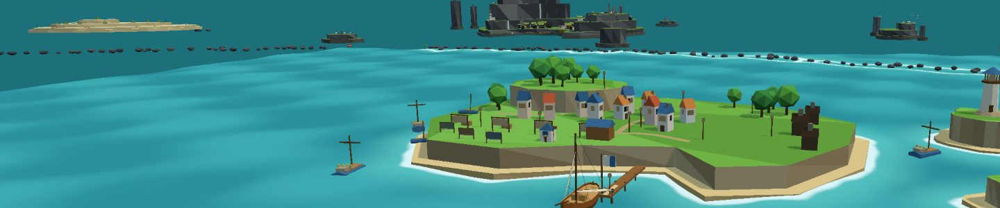
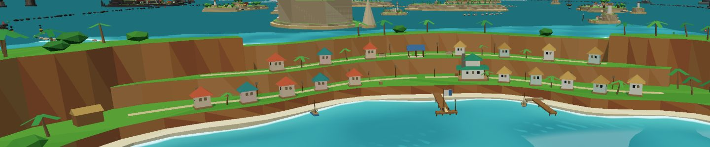
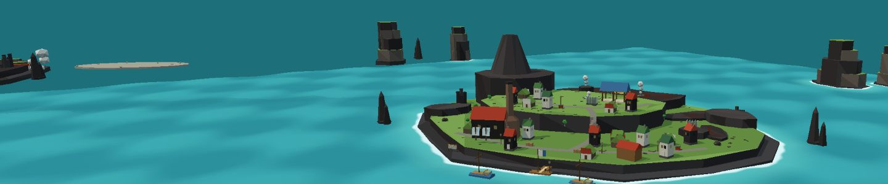
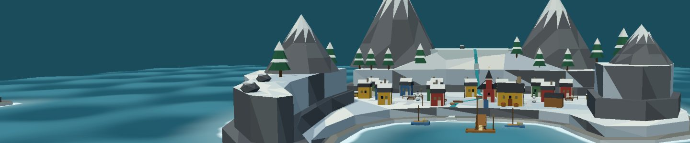
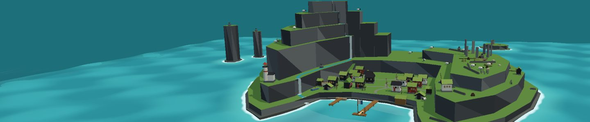
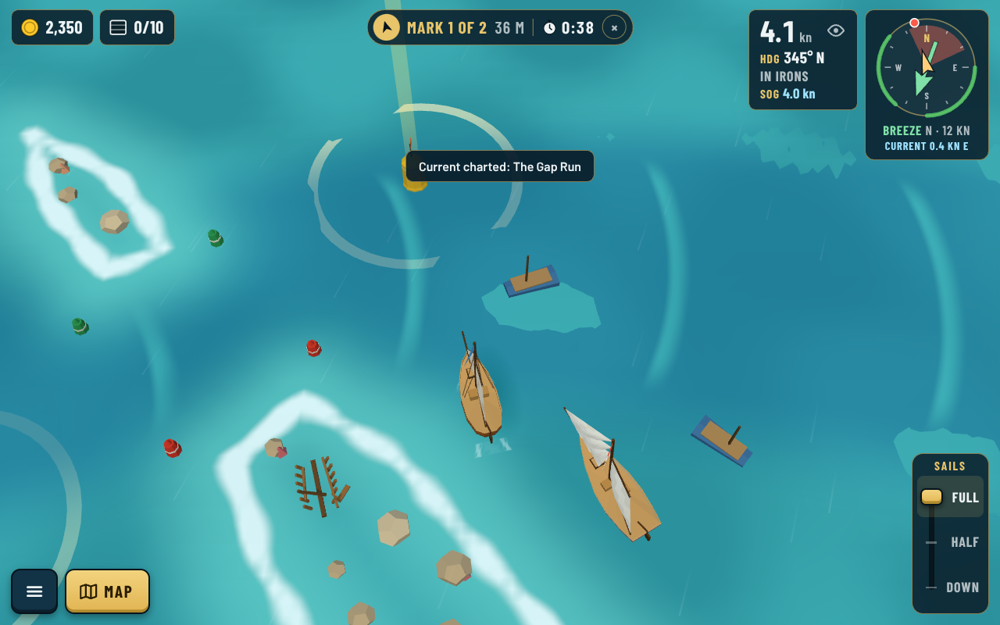
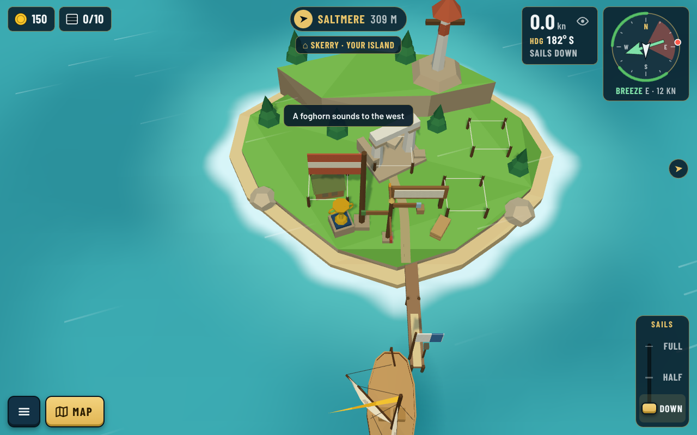

# Fair Winds Trading

[](https://github.com/djguiaume/fair-winds-trading/actions/workflows/deploy.yml)
[](https://github.com/djguiaume/fair-winds-trading/releases/latest)
[](https://djguiaume.github.io/fair-winds-trading/)

A cozy sailing and trading game about reading the wind, helping island communities, and finding a place to call home.

Your first voyage is only the beginning. Leave the familiar harbours of the Windward Ring behind and find a passage into sunlit lagoons, volcanic waters, icy fjords, and fogbound islands. Carry a cargo someone is counting on, follow a neighbour's story to an unfamiliar shore, or chase a rival's sails toward the next race mark. Every journey brings new places to discover—and a reason to return to your own island on Skerry.

Sailing is at the heart of the adventure: read the wind, tack into a headwind, thread a reef passage, and reach the next harbour with a story to tell.

**[Play in your browser](https://djguiaume.github.io/fair-winds-trading/)** · **[Release notes](https://github.com/djguiaume/fair-winds-trading/releases)** · **[Roadmap](docs/roadmap.md)**

> **Preparing for v1.0.** The base game is nearly ready for release, with two bug fixes remaining. The play link follows the latest successful deployment from `main`; the release badge points to the latest published milestone.



_Your adventure begins in the Windward Ring, among green islands and welcoming harbours._

## A sea of small adventures

- **Sail by the wind.** Learn to tack, trim your sails, and navigate by the chart. Different ships bring different handling, cargo capacity, and draft.
- **Trade and grow.** Buy and sell goods, fulfil delivery orders, unlock ships, and help small settlements become thriving ports.
- **Meet your neighbours.** Follow community stories, carry passengers and supplies, and return to familiar faces with new requests.
- **Make Skerry your home.** Shape your island through the choices and buildings unlocked by your adventures.
- **Explore beyond the ring.** Venture from the Windward Ring into four outer seas, with tropical shores, volcanic islands, ice, fog, and storms.
- **Race a friendly rival.** Meet Wren Tally and _Kestrel_, sail the Saltmere Regatta courses, and compete for pennants and the Four Winds Cup.
- **Listen to the sea.** Wind, waves, harbour bells, and music accompany your voyages.

The base game is a gentle adventure without combat. Choose **Fair winds**, **Captain**, or **Old salt** difficulty, and adjust hazards in Settings. Time advances only during active play.

## Five seas, five different horizons

Start among the green shores and working harbours of the **Windward Ring**, then follow the story beyond its reefs. Each outer sea has its own landscape, people, goods, and sailing challenges.

| Sunreach · The tropical south                                                                           | Emberhold · The volcanic west                                                                          |
| ------------------------------------------------------------------------------------------------------- | ------------------------------------------------------------------------------------------------------ |
|  |  |
| Sail through coral passages to palm-lined shores and terraced tea gardens.                              | Find your way past dark rock, steam, and the smoking heights of the Smoulder.                          |

| Rimewick · The icy north                                                                         | Fogwatch · The misty east                                                                     |
| ------------------------------------------------------------------------------------------------ | --------------------------------------------------------------------------------------------- |
|  |    |
| Read the cold wind and navigate ice-strewn waters toward sheltered fjord settlements.            | Pick a passage through fog, rocky skerries, and strong currents to reach distant communities. |

_These pictures are exported directly from the island dock headers used in the game._

## Race, explore, and come home

| A friendly rivalry at sea                                                                               | Your own island on Skerry                                                                                               |
| ------------------------------------------------------------------------------------------------------- | ----------------------------------------------------------------------------------------------------------------------- |
|  |  |

## Playing

Open the [game](https://djguiaume.github.io/fair-winds-trading/) in a modern browser with WebGL support. No installation or account is required.

- **Mouse and keyboard:** play on desktop or laptop.
- **Touch:** play on a phone or tablet, in landscape or portrait.
- **Controller:** play with a compatible gamepad, including navigation through menus and the chart.
- **Languages:** English and French.

The sailing tutorial introduces the controls and your first voyage. Settings includes graphics quality and sound options; choose Low graphics for less powerful devices.

Your voyage saves in your browser. Use the game's save-transfer options to back it up or move it to another device. Progress does not advance while the game is closed or paused.

## Run locally

Use **Node.js 22** and npm, with Git installed. Clone the repository with its history: the build uses Git to generate the displayed version and revision.

```sh
git clone https://github.com/djguiaume/fair-winds-trading.git
cd fair-winds-trading
npm ci
npm run dev
```

Open the local URL printed by Vite. To try the game on a phone or tablet on the same Wi-Fi:

```sh
npm run dev -- --host
```

### Checks and production build

| Command           | Purpose                                                                                         |
| ----------------- | ----------------------------------------------------------------------------------------------- |
| `npm run lint`    | Check code with ESLint and formatting with Prettier.                                            |
| `npm test`        | Run simulation, content, and DOM integration tests with Vitest.                                 |
| `npm run build`   | Check TypeScript and build the static site into `dist/`.                                        |
| `npm run preview` | Serve the production build locally after building.                                              |
| `npm run check`   | Validate game content using the editors' own checks.                                            |
| `npm run balance` | Run the sailing and economy balance tools.                                                      |
| `npm run perf`    | Run the browser performance harness; see its [setup instructions](tools/performance/README.md). |

The game uses **TypeScript, three.js, and Vite**, with plain DOM interfaces and no backend server.

## Build, deployment, and releases

[GitHub Actions](.github/workflows/deploy.yml) checks pull requests and pushes to `main` with a clean dependency install, lint and formatting checks, tests, and a production build. A successful build on `main` is then published to GitHub Pages.

The static build includes the game (`index.html`), map and content editors (`editor.html`), and model sheet (`models.html`). Relative asset paths support hosting under the repository's Pages subdirectory.

Each build embeds its Git revision and a version derived from `package.json` plus the first-parent commit count. Named GitHub releases mark milestones separately from everyday deployments. See [how to cut a release](docs/releases/README.md) and the [release workflow](.github/workflows/release.yml).

## Content and tools

Ships, goods, islands, seas, quests, controls, and tuning live in data files. Use the browser editors or the command-line tools to author and validate content.

- [Adding content](docs/content/README.md)
- [Map editor](docs/map-editor/README.md)
- [Island builder](docs/island-builder/README.md)
- [Quest builder](docs/quest-builder/README.md)
- [Translations](docs/i18n/README.md)

Run `npm run fw` to list the command-line tools; individual tools accept `--help`.

For debugging, add `?debug` to expose the game as `fwt` in the browser console, `?perf` for the performance readout, or `?bench` for the automatic device benchmark.

### Repository layout

| Path          | Contents                                                                |
| ------------- | ----------------------------------------------------------------------- |
| `src/sim/`    | Game state and rules: sailing, trade, quests, weather, and progression. |
| `src/data/`   | Ships, maps, islands, quests, and tuning data.                          |
| `src/render/` | three.js scenes, models, ocean, lighting, and effects.                  |
| `src/input/`  | Keyboard, mouse, touch, and controller input.                           |
| `src/ui/`     | Harbour screens, chart, HUD, menus, and settings.                       |
| `src/editor/` | Content editors and their shared authoring tools.                       |
| `src/i18n/`   | English and French text.                                                |
| `tests/`      | Automated tests.                                                        |
| `tools/`      | Content, balance, screenshots, and performance tools.                   |
| `docs/`       | Roadmap, decisions, guides, art, and release notes.                     |

## Documentation and feedback

- [Roadmap](docs/roadmap.md): the path to v1.0 and ideas for later.
- [Sailing model](docs/sailing-model.md): how the boats move.
- [Art pipeline](docs/art-pipeline.md) and [art bible](docs/art/art-bible.md).
- [Design decisions](docs/decisions/): the reasons behind the game's systems.
- [Screenshots](docs/screenshots/): captures from the game's development.

## Contributing

Bug reports, playtest feedback, translation corrections, and ideas for new content are welcome. For substantial code, art, story, or content contributions, open an issue first to agree on scope and contribution terms before starting work.

Found a bug? [Open an issue](https://github.com/djguiaume/fair-winds-trading/issues) with what happened, steps to reproduce it, your browser and device, and the version shown in the game. For performance problems, include the result from `?perf` or `?bench`.

For an agreed change:

1. Keep the pull request focused and target `main`. Explain what changes and how you checked it.
2. Run `npm run lint`, `npm test`, and `npm run build`.
3. For content changes, also run `npm run check`. For sailing or economy changes, check balance across all three difficulty levels.
4. Include screenshots for visual changes. Keep English and French text in step.
5. Follow the [art bible](docs/art/art-bible.md) and existing [design decisions](docs/decisions/).

See [Adding content](docs/content/README.md) for data and editor workflows, and [Translations](docs/i18n/README.md) for language changes. Contribution permissions must be agreed before outside work is accepted, including the rights needed for future commercial releases.

## Rights and licensing

Fair Winds Trading is a proprietary game whose source is visible on GitHub. Commercial rights to the original game are reserved by its owner; this repository does not grant permission to sell, commercially redistribute, or commercially exploit the original game, code, artwork, music, or story.

No open-source license is granted for the original project. GitHub's platform terms and applicable law still apply. Third-party libraries, fonts, and other third-party materials retain their own licenses and are excluded from this statement.

For reuse or licensing requests, [open an issue](https://github.com/djguiaume/fair-winds-trading/issues).
