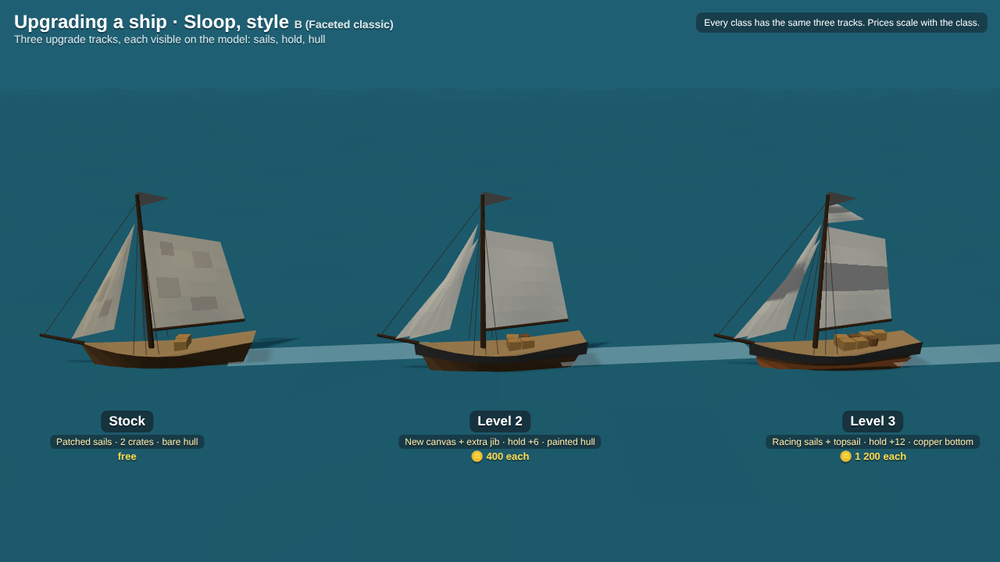
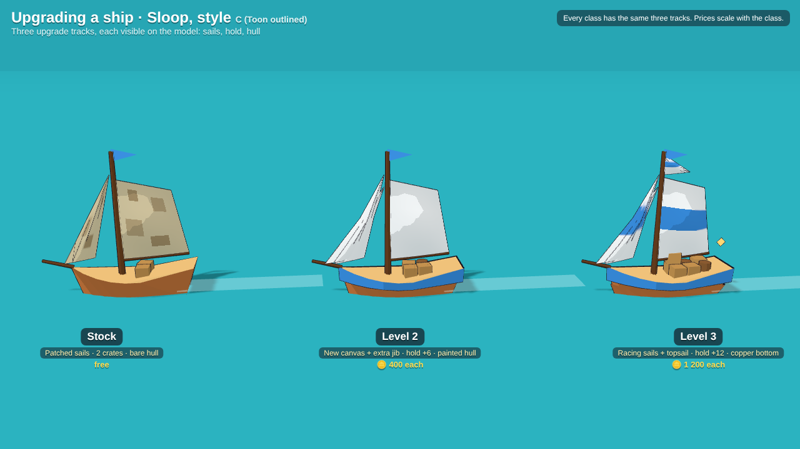

# Art style proposals: boats and islands

Static mockups (1280×720) to choose the look of the ships and islands within the real-time 3D low-poly direction ([0004](../decisions/0004-real-time-3d.md)). They are procedural three.js renders, not game code. The choice is tracked in [decision 0012](../decisions/0012-boat-and-island-art-style.md); the ship lineup and upgrades they show are in [decision 0011](../decisions/0011-ship-lineup-and-upgrades.md).

## Boats

Every sheet shows the same five ship classes, smallest to largest. The colour band on the hull identifies the class.

| A · Chunky toy | B · Faceted classic | C · Toon outlined |
|---|---|---|
|  |  |  |

- **A, Chunky toy.** Short, tall, rounded hulls; big bellied sails; oversized flags; a bright painted band per class. Closest to the *Privateers* ad and the easiest to read on a phone, because silhouettes and sail shapes are exaggerated. Flat-shaded Lambert, no extra passes.
- **B, Faceted classic.** Near-real proportions, flat sails, visible rigging lines, muted wood and canvas. Feels more like a sailing sim; small ships get thin and harder to read at the zoomed-out game camera.
- **C, Toon outlined.** Cel shading (3-tone ramp) with ink outlines and saturated colours. Very characterful and clear, but the outline pass roughly doubles draw calls for every outlined object, which matters on the old tablet ([0006](../decisions/0006-desktop-and-mobile.md)), and it has to be used for the islands too.

## Upgrades

Each ship has three upgrade tracks (sails, hold, hull), and every level is visible on the model. Same sloop at stock, level 2 and level 3, one sheet per style:

| A | B | C |
|---|---|---|
|  |  |  |

- **Sails:** patched canvas → new canvas and an extra jib → racing sails with a class-colour stripe and a topsail.
- **Hold:** more crates and barrels on deck as capacity grows.
- **Hull:** bare wood → painted band → copper-sheathed bottom (sits at the waterline).

## Islands

Every scene shows the four kinds of producer island (fish port, timber, grain, stone) at the game camera, with a sloop in the matching boat style for scale. What an island makes is readable from its props: docks and huts, forest and log piles, fields and a windmill, rocks and a cart.

| A · Sunny sandbar | B · Rugged highlands | C · Toon diorama |
|---|---|---|
|  |  |  |

- **A, Sunny sandbar.** Low rounded islands, a wide sand ring and glowing turquoise shallows, palms and pastel houses. Matches the ad; the glow also shows where the shallows (a hazard, [0010](../decisions/0010-light-hazards-pirates-later.md)) are.
- **B, Rugged highlands.** Stacked rock strata, small beaches, pine forests, stone villages with slate roofs. More dramatic and varied in height, but darker and less readable from far; tall cliffs can hide boats behind them at the tilted camera.
- **C, Toon diorama.** Soft domed hills, puffy trees, white foam rings, ink outlines. Must be paired with toon boats (C).

## Mixing

A and B are both flat-shaded with the same lighting, so boats and islands can be mixed (e.g. A boats with some B-style cliff islands for variety later). C is all or nothing because of the outlines.

## Regenerating

`src/` holds the generator: `lib.js` (boat, island and scene builders for all three styles), one page per sheet, and `shot.js`. Install `three@0.160.0` and `playwright` next to them, then run for example `node shot.js "boats.html?s=A" boats-A.png` (`s` = A, B or C).
