# Art style proposals: boats and islands

Static mockups (1280×720) to choose the look of the ships and islands within the real-time 3D low-poly direction ([0004](../decisions/0004-real-time-3d.md)). They are procedural three.js renders, not game code. The choice is tracked in [decision 0012](../decisions/0012-boat-and-island-art-style.md); the ship lineup and upgrades they show are in [decision 0011](../decisions/0011-ship-lineup-and-upgrades.md).

**Status (round 2):** islands settled on **B2** (B's highland shapes, lighter colours, A's water and shallows glow). Every sheet now uses the **A sea colours**. Boats: Guillaume liked A and B and asked for more options, so D, E and F sit between them; pick pending.

## Boats

### Side by side

Same ship, light and sea for the five candidate styles (A and B plus D, F, E in between):

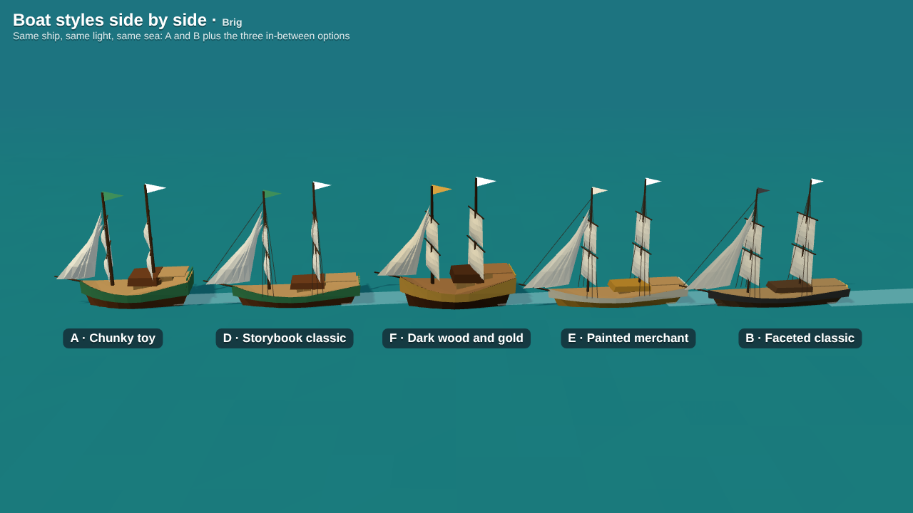
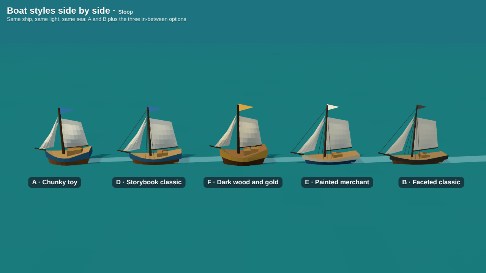

### Full lineups

Every sheet shows the same five ship classes, smallest to largest. The colour band (or trim) identifies the class.

| A · Chunky toy | B · Faceted classic | C · Toon outlined |
|---|---|---|
| 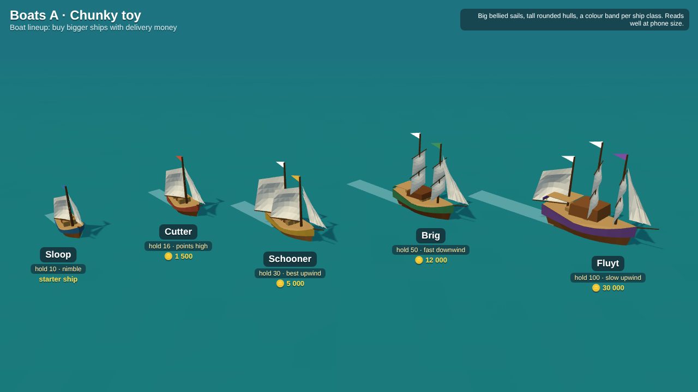 | 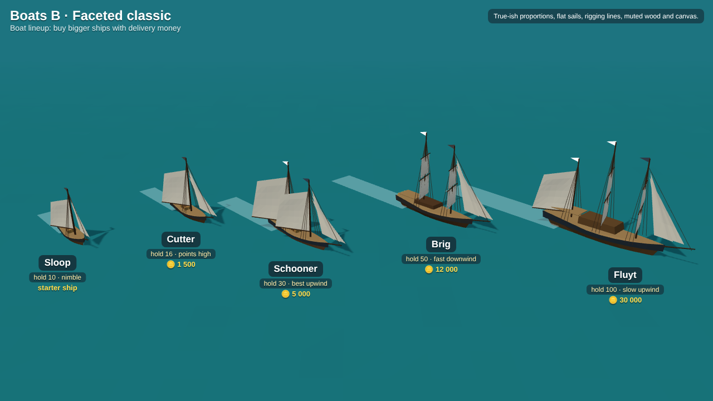 | 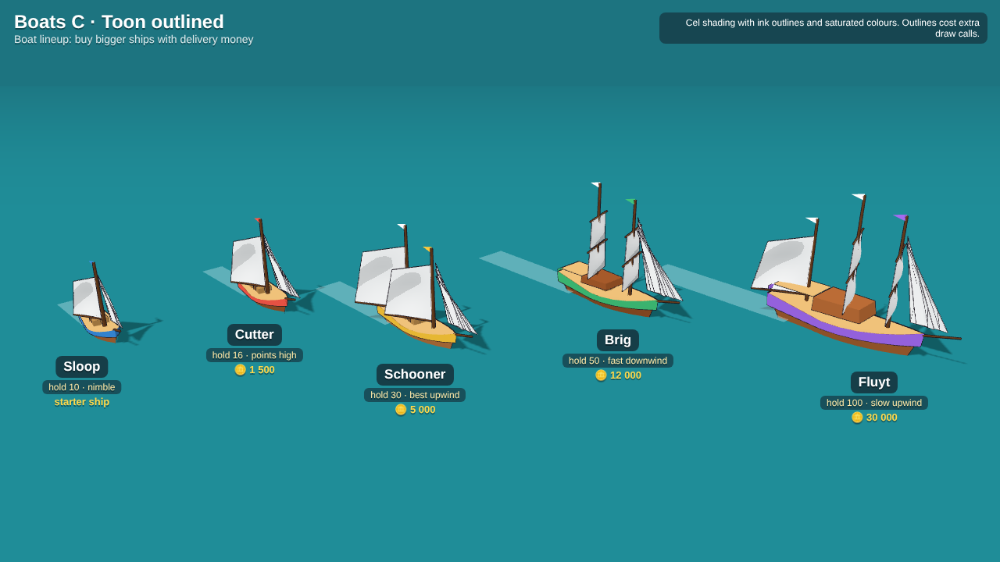 |

| D · Storybook classic | E · Painted merchant | F · Dark wood and gold |
|---|---|---|
| 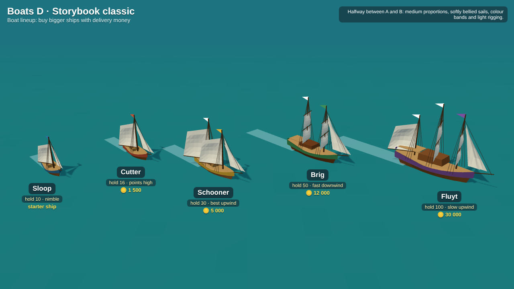 | 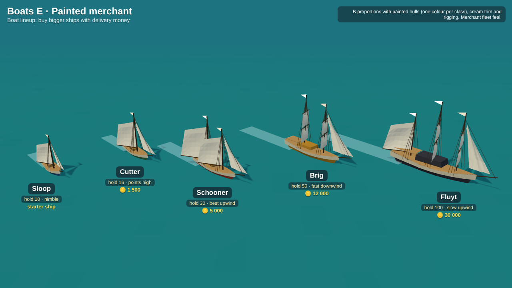 | 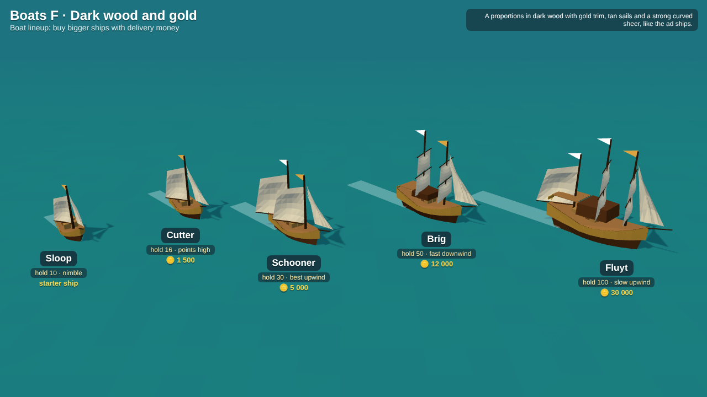 |

- **A, Chunky toy.** Short, tall, rounded hulls; big bellied sails; oversized flags; a bright painted band per class. Closest to the *Privateers* ad and easiest to read on a phone. Flat-shaded Lambert, no extra passes.
- **B, Faceted classic.** Near-real proportions, flat sails, rigging lines, muted wood and dark trim. More "sailing sim"; small ships get thin at the zoomed-out game camera.
- **C, Toon outlined.** Cel shading with ink outlines. Not shortlisted: the outline pass roughly doubles draw calls on the old tablet ([0006](../decisions/0006-desktop-and-mobile.md)) and would force toon islands.
- **D, Storybook classic.** Halfway between A and B: medium proportions, softly bellied sails, the class colour band of A and light rigging lines from B.
- **E, Painted merchant.** B's slim proportions with the hull painted one colour per class (blue, green, red, ochre, black), cream trim and rigging. Reads like a merchant company fleet.
- **F, Dark wood and gold.** A's chunky proportions in dark wood with a gold band, tan sails and a strongly curved sheer, closest to the ships in the ad.

## Upgrades

Each ship has three upgrade tracks (sails, hold, hull), and every level is visible on the model. Same sloop at stock, level 2 and level 3, one sheet per style: [A](upgrades-A.png), [B](upgrades-B.png), [C](upgrades-C.png), [D](upgrades-D.png), [E](upgrades-E.png), [F](upgrades-F.png).

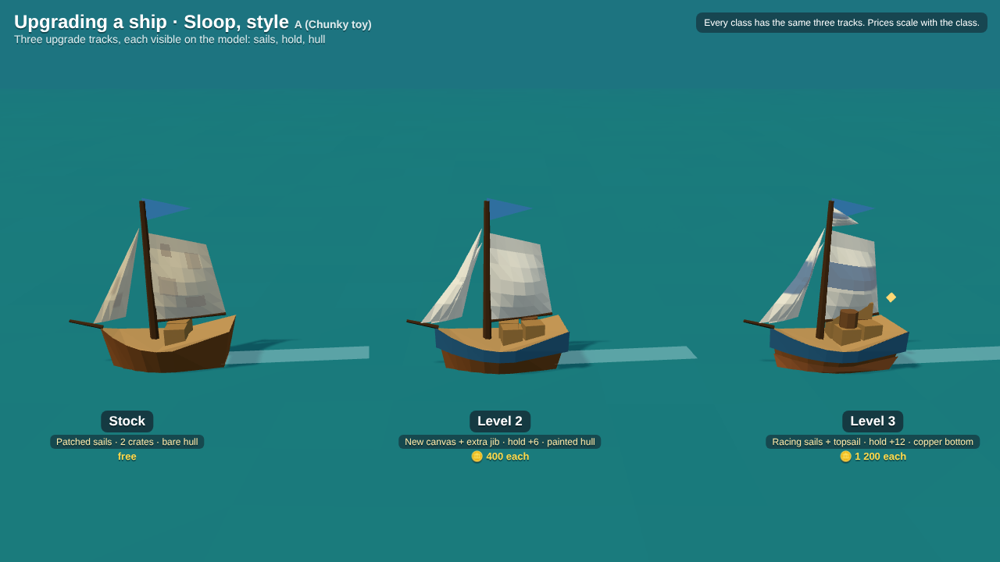

- **Sails:** patched canvas → new canvas and an extra jib → racing sails with a class-colour stripe and a topsail.
- **Hold:** more crates and barrels on deck as capacity grows.
- **Hull:** bare wood → painted band → copper-sheathed bottom (sits at the waterline).

## Islands

Every scene shows the four kinds of producer island (fish port, timber, grain, stone) at the game camera, with a sloop for scale. What an island makes is readable from its props: docks and huts, forest and log piles, fields and a windmill, rocks and a cart.

**Chosen: B2 · Bright highlands** — B's stacked cliffs and small beaches, in light sandstone with bright grass, red and blue roofs, and the glowing turquoise shallows of A.

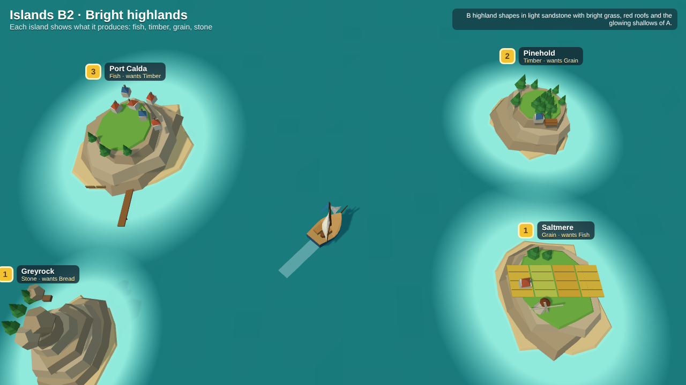

Earlier options, all re-rendered on the A sea:

| A · Sunny sandbar | B · Rugged highlands | C · Toon diorama |
|---|---|---|
| 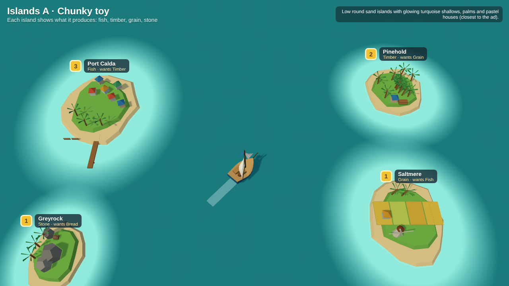 | 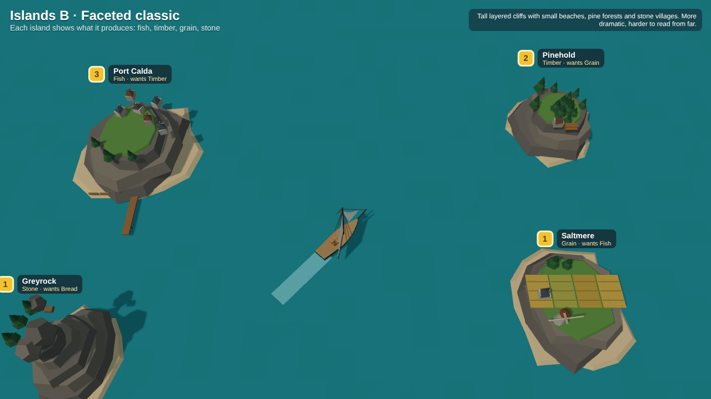 | 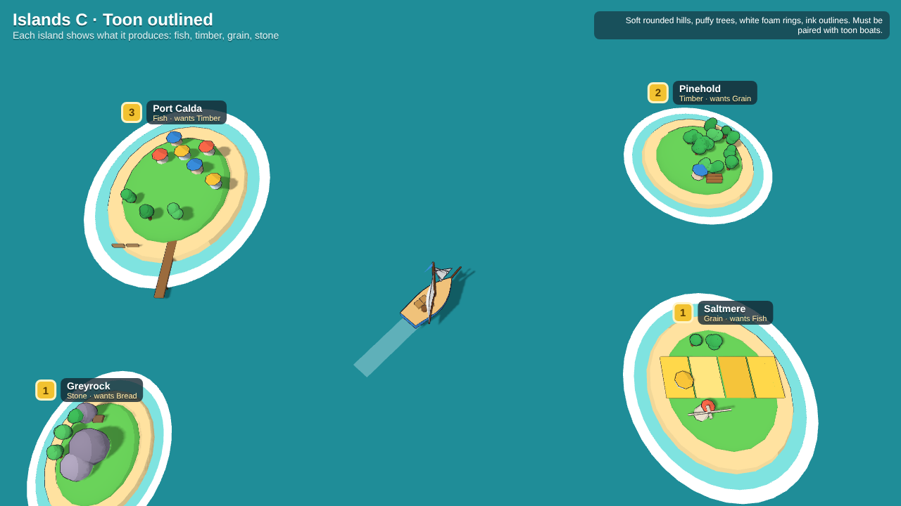 |

## Mixing

A, B, D, E and F are all flat-shaded with the same lighting and sea, so any of them sits well with the B2 islands. C is all or nothing because of the outlines.

## Regenerating

`src/` holds the generator: `lib.js` (boat, island and scene builders for every style, shared sea colours in `SEA`), one page per sheet, and `shot.js`. Install `three@0.160.0` and `playwright` next to them, then run for example `node shot.js "boats.html?s=D" boats-D.png` (`s` = A–F; islands also take `BL` for B2) or `node shot.js "compare.html?c=brig" boats-compare-brig.png`.
