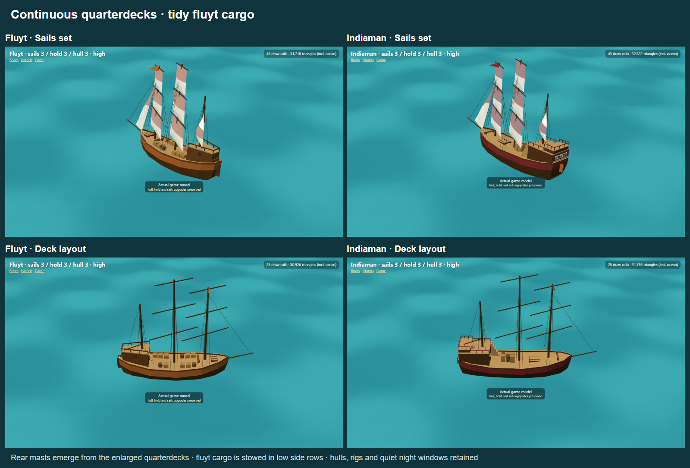

# Continuous quarterdecks and fluyt cargo clearance

One agent handled each boat. The fluyt retains its hull, forward fittings, rig, colours and quiet four-pane night lighting; its cargo is now in deliberate single-layer side stows. The Indiaman retains its hull, forward fittings, cargo, rig, burgundy/cream identity and five-pane gallery lighting. Both stern decks extend forward beneath their existing rear mast positions rather than remaining detached huts behind the masts.

- Fluyt quarterdeck: z -2.645 to -5.3475, rear mast z -3.3, walkable mast deck y about 2.876. The front roof is wider while the back retains the fluyt's narrow tapered stern.
- Indiaman quarterdeck: z -2.99 to -6.37, rear mast z -3.8, mast deck y about 3.182. A distinct higher poop occupies the aft section. Its access stair is outboard, clear of the existing cargo.
- The wooden rear masts now start at the actual raised deck surfaces. Absolute masthead heights are retained; rear sail attachments, boom clearance and coherent wind animation are preserved.
- Fluyt hold upgrades retain 6/8/11 pieces. Boxes/barrels are aligned at x ±0.9, stowed in a single low layer, with a central passage and mainmast clearance. No random rotations or tall stacks remain. Actual cargo bounds are checked against the full square sails on both tacks.

## Historical direction

The design uses museum models as references for the relationship between raised aft decks and rig, while retaining the game's simplified storybook geometry. It is not a measured reconstruction. References: Science Museum Group's [Dutch fluitschip model, representing circa 1645](https://collection.sciencemuseumgroup.org.uk/objects/co41131/model-of-a-dutch-fluitschip), Fries Scheepvaart Museum's [fluitschip model](https://www.zuiderzeecollectie.nl/object/collect/Fries_Scheepvaart_Museum-1000014086), and Royal Museums Greenwich's [Dutch East Indiaman model](https://www.rmg.co.uk/collections/objects/rmgc-object-66326). The Rijksmuseum's [East Indiaman catalogue entry](https://www.rijksmuseum.nl/en/collection/object/Model-of-an-East-Indiaman--b4dbe16a67cb8ed1eabe41ecac34878c?tab=catalogue) also records main deck, forecastle, quarterdeck, companionway and deck fittings. These support reading the aft area as part of the ship's deck arrangement rather than a modern pilot cabin.

## Verification

Thirty focused tests pass across quarterdeck geometry, mast support, fluyt cargo placement, raised-stern clearance, shared-wind sail trim and existing model/upgrade integration. Vertical raycasts check the actual deck surfaces around each mizzen; cargo clearance checks use the actual built cargo bounds and transformed square-sail geometry. TypeScript compilation and production build pass. Fourteen engine captures cover sails set, lowered sails/deck layout, stock, mixed upgrades, both boom directions and night/Low: [raw results](results.json), no browser errors. This does not establish frame rate on older tablets.
