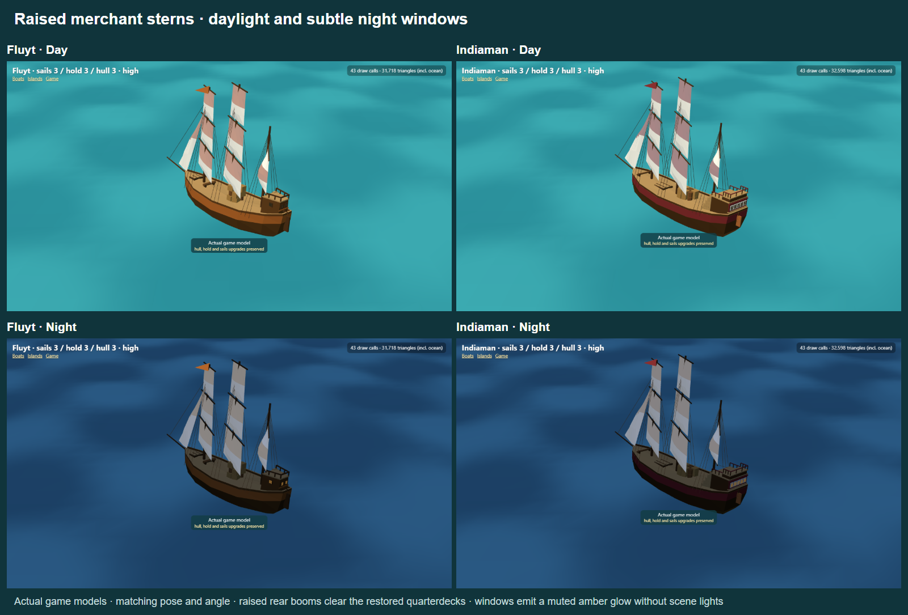

# Raised merchant sterns and quiet night windows

The [current quarterdeck layout](../quarterdeck-layout/README.md) subsequently extends both aft decks forward beneath the rear masts and reorganises the fluyt cargo to clear the square sails. Its captures supersede the compact aft structures shown below.

The subsequent [shared-wind sail-trim correction](../sail-trim/README.md) fixes the square/rear sail inconsistency and the inspector's fixed-wind preview; the raised structures and quiet window lighting remain intact.

The fluyt regains a compact tapered raised cabin and quarterdeck. The Indiaman regains a broader two-level quarterdeck with a five-window stern gallery. Both retain their refined hull sections, upgrades, cargo and forward fittings. The rear booms are raised rather than flattening the cabins: fluyt foot 2.05 m above the mast's deck, aft length 2.05 m; Indiaman foot 2.65 m, aft length 2.3 m. Each remains inside the stern and clears the highest deck rails. The rear sail head stays at its former absolute height, reducing the lower cloth area to accommodate the raised boom. The gaff and working lift/sheet follow tack and reefing; Low skips the rope updates.

Glazing is split out with the same `glowing` geometry marker used by houses. Four fluyt panes and five Indiaman panes share one unlit material per boat, with dark day tint and muted warm night tint, smoothly driven by the actual day/night factor in GameView. There are no added scene lights or bloom, and the windows remain on Low. Boats dispose of their glazing geometry and material along with their existing resources.

## Other boats retain their identity

The [fresh full-fleet comparison](fleet-features.png) uses the original committed models on top and the current models below, with matching pose, lighting, framing and full upgrades in each column.

- Sloop: rounded compact hull, single mast and blue identity remain unchanged.
- Cutter: fine entry, working transom, taller mast and multiple headsails remain unchanged.
- Schooner: independently shaped long hull, unequal two-mast rig and green trim remain; the companionway is an addition.
- Clipper: knife entry, long narrow charcoal hull, gold trim, three unequal masts and three jibs remain; the coachhouse and bow rails are additions.
- Hoy: broad full belly and yellow cargo-carrier identity remain; hatch, deck edges, mooring fittings and steering hardware add finish without removing a defining stern structure.

## Verification

The focused boat/daylight suite covers 43 tests, including 27 independent upgrade combinations per hauler. New tests verify cabin height, boom clearance above all stern fittings, boom length inside the hull, sheet attachment through tack/reefing, night interpolation, absence of scene lights, and Low/disabled-rigging behaviour. The production build, TypeScript, ESLint and changed-file formatting pass. Twelve engine captures cover daylight/night sterns, side views, stock, mixed upgrades with lowered sails, and furled sails on Low; [raw capture results](results.json) record no browser errors. Software rendering does not establish real-device frame rate.

Reproduce with the local development server on port 5173, Playwright installed (or `PLAYWRIGHT_PATH`), and optionally `CHROMIUM_PATH`, using `node docs/art/game-models/raised-sterns/capture.cjs`. The full-fleet comparison uses the preserved comparison scene in `docs/art/game-models/fleet-comparison/`.
