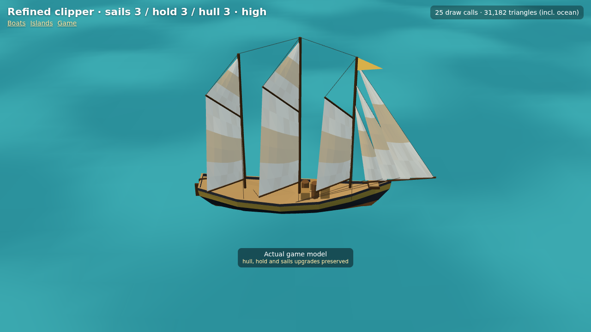

# Refined clipper — actual engine captures

Decision [0056](../../../decisions/0056-refined-upgrade-aware-clipper.md). Captured from the game's real factory, model inspector and GameView at 1280×720 using Chromium software WebGL. These are engine screenshots, not generated illustrations. See [raw measurements](render-results.json) and [capture script](capture.cjs).

The clipper keeps its long, narrow 9.8 × 2.4 × 1.15 reference envelope, charcoal/gold palette, three unequal fore-and-aft masts and three individually stayed jibs. Its own knife entry, long run and small raked transom differ from the schooner's forward shoulder/counter. Main and mizzen gain topsails at sails 3. All 27 hull/hold/sails combinations retain their appearance and stats; 4/6/9 cargo pieces, patched → clean → striped canvas, gold band and copper progression remain.



| State | Inspector query after `models.html?view=clipper&still&` | Capture |
|---|---|---|
| Stock | `level=1&quality=high` | [Stock](level1-high.png) |
| Level 2 | `level=2&quality=high` | [Level 2](level2-high.png) |
| Level 3, High | `level=3&quality=high` | [High](level3-high.png) |
| Level 3, Medium | `level=3&quality=medium` | [Medium](level3-medium.png) |
| Level 3, Low | `level=3&quality=low` | [Low](level3-low.png) |
| Lowered, opposite tack | `level=3&quality=high&sail=0.35&boom=-45` | [Lowered](level3-reefed.png) |
| Second inspection angle | `level=3&quality=high&yaw=-45` | [Stern](level3-stern.png) |
| Mixed upgrades | `hull=1&hold=3&sails=2&quality=medium` | [Mixed](mixed-upgrades.png) |
| Furled on Low | `level=3&quality=low&sail=0&boom=-45` | [Furled](furled-low.png) |

Each mast/gooseneck and individual inclined jib stay retains its own attachments through tack, lowering and heel. The two forward booms clear the next mast. Working lifts and sheets follow actual transformed corners. Low omits ropes and their buffer updates while retaining the sails and upgrades. Correct handling uses the existing lightweight animation, not cloth simulation.

| Common upgrades | Boat triangles | Boat mesh draws | Former triangles / mesh draws |
|---|---:|---:|---:|
| Stock | 939 | 11 | 561 / 9 |
| Level 2 | 995 | 11 | 643 / 9 |
| Level 3 | 1,191 | 11 | 769 / 9 |

Above Low, one optional line draw adds rigging. Inspector counters include the ocean and shadow passes. The hull-sized wake remains **21.56 × 5.544 m**, uses existing quality budgets, and adds no boat-specific passes. Real-game captures: [Low](game-low.png), [Medium](game-medium.png), [High](game-high.png). The script drives the existing debug world and renderer, placing the fully upgraded boat in open water and building wake history before capture. It records full-scene render calls, triangles, geometry count, wake vertices and drawing-buffer dimensions.

Reproduce with dependencies installed, Playwright available, and optionally `CHROMIUM_PATH` pointing at a local Chromium binary:

```sh
node docs/art/game-models/refined-clipper/capture.cjs
```

`npm test` (242 passing), `npm run lint` and `npm run build` validate the change. The representative real-game scenes measure 18/19/31 draws on Low/Medium/High, including the ocean, islands, wake and shadow passes. A physical older-tablet playtest is still required for FPS; software rendering and geometry budgets are not a device performance guarantee.
