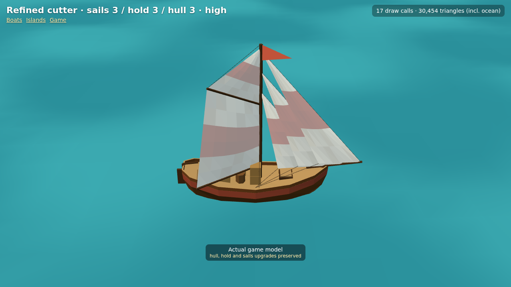
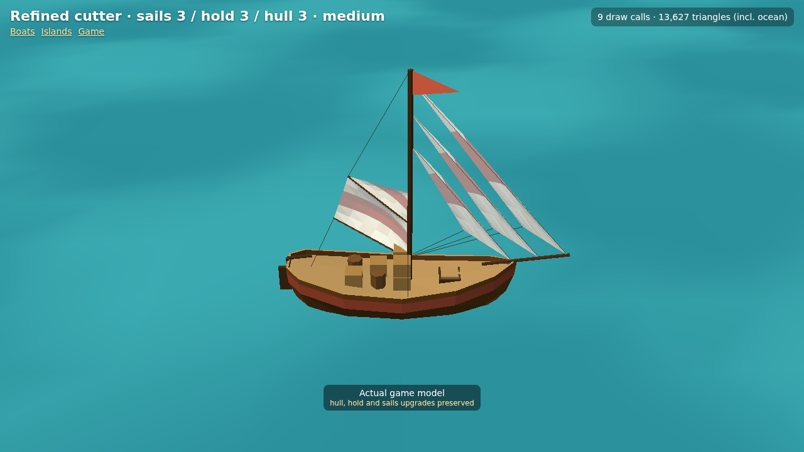

# Refined cutter — actual engine screenshots

Decision [0052](../../../decisions/0052-refined-upgrade-aware-cutter.md). Captured at 1280×720 from the real three.js model inspector and `GameView`; no generated artwork. The refined sloop references are [next door](../refined-sloop/README.md).

| State | Query after `models.html?view=cutter&still&` | Capture |
|---|---|---|
| Stock, two jibs / three cargo pieces | `level=1&quality=high` | [level1-high.png](level1-high.png) |
| Level 2, three jibs / five cargo pieces | `level=2&quality=high` | [level2-high.png](level2-high.png) |
| Maximum upgrades, High | `level=3&quality=high` | [level3-high.png](level3-high.png) |
| Maximum upgrades, Low | `level=3&quality=low` | [level3-low.png](level3-low.png) |
| Lowered sail, opposite tack | `level=3&sail=0.35&boom=-45&quality=medium` | [level3-reefed.png](level3-reefed.png) |
| Independent upgrades: stock sails, hold 2, hull 3 | `level=1&hull=3&hold=2&sails=1&quality=medium` | [mixed-upgrades.png](mixed-upgrades.png) |

Boat-only costs at levels 1/2/3: 591/703/827 triangles and 6/7/7 meshes. The inspector's counter includes its ocean and High shadow passes, so it is not the boat cost. Medium/High add one rope line draw; Low omits it and its buffer updates. The inspector uses a close camera; details are smaller in normal gameplay.

## GameView integration

[Low](game-low.png), [Medium](game-medium.png), [High](game-high.png): actual game renderer, maximum cutter upgrades, moving world position at 7 kn, sail raised, zoom 0.6 (the game's closest permitted zoom). These renderer-only integration captures omit the HUD; they use the existing map, camera, ocean, heel and hull-sized wake rather than the model-inspector scene. The capture harness directly advances a deterministic world pose. Live quality changes and hold-upgrade rebuilds were also exercised. A physical older-tablet FPS playtest remains outstanding.
