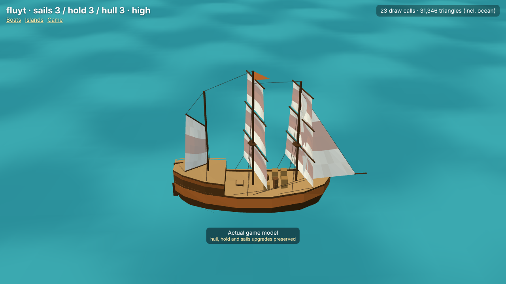

# Refined fluyt — actual engine captures

Decision [0079](../../../decisions/0079-refined-fluyt-and-square-rig.md). These were captured from the game's real factory in the model inspector at 1280×720 with Chromium software WebGL, using the shared script `node tools/ship-models/capture.cjs fluyt` ([measurements](render-results.json)).

The fluyt has square-rigged fore and main masts and a gaff mizzen standing on a stern castle. Its pear-shaped hull tumbles home over a flat floor, with a bluff bow and a narrow stern with lit windows. Each course hangs from its own yard and furls up to it. Its clews sheet to the yard-arms below or to the rail.

| State | Inspector query after `models.html?view=fluyt&still&` | Capture |
|---|---|---|
| Stock | `level=1&quality=high` | [Stock](level1-high.png) |
| Level 2 | `level=2&quality=high` | [Level 2](level2-high.png) |
| Level 3, High | `level=3&quality=high` | [High](level3-high.png) |
| Level 3, Low | `level=3&quality=low` | [Low](level3-low.png) |
| Reefed, opposite tack | `level=3&quality=high&sail=0.35&boom=-45` | [Reefed](level3-reefed.png) |
| Second angle | `level=3&quality=high&yaw=-45` | [Stern](level3-stern.png) |
| Mixed upgrades | `hull=1&hold=3&sails=2&quality=medium` | [Mixed](mixed-upgrades.png) |

| Common upgrades | Boat triangles | Boat mesh draws | Old triangles / mesh draws |
|---|---:|---:|---:|
| Stock | 973 | 9 | 637 / 13 |
| Level 2 | 1,101 | 10 | 763 / 13 |
| Level 3 | 1,273 | 10 | 961 / 17 |
