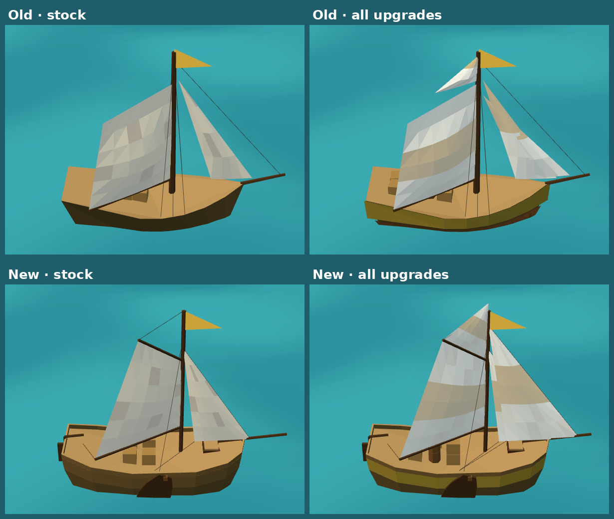

# Refined hoy — actual engine captures

Decision [0080](../../../decisions/0080-refined-upgrade-aware-hoy.md). Captured from the game's real factory, model inspector and GameView with Chromium software WebGL. These are engine screenshots, not generated illustrations. Raw measurements: [render-results.json](render-results.json).

The hoy keeps its 6.2 × 2.7 × 1.3 envelope, brown hull, mustard band and single mast. New: its own bluff, flat-bottomed hull, a leeboard on each side, a boom raised over two layers of deck cargo, and sails that stay attached to the mast, gooseneck, gaff and stays in every pose.

| State | Inspector query after `models.html?view=hoy&still&` | Capture |
|---|---|---|
| Stock | `level=1&quality=high` | [Stock](level1-high.png) |
| Level 2 | `level=2&quality=high` | [Level 2](level2-high.png) |
| Level 3, High | `level=3&quality=high` | [High](level3-high.png) |
| Level 3, Low | `level=3&quality=low` | [Low](level3-low.png) |
| Reefed, opposite tack | `level=3&quality=high&sail=0.35&boom=-45` | [Reefed](level3-reefed.png) |
| Stern quarter | `level=3&quality=high&yaw=-45` | [Stern](level3-stern.png) |
| Mixed upgrades | `hull=1&hold=3&sails=2&quality=medium` | [Mixed](mixed-upgrades.png) |

In game, fully upgraded on a beam reach: [High](game-high.png), [Medium](game-medium.png), [Low](game-low.png), [phone portrait](game-phone-portrait.png). Full scene draws measured 14 / 15 / 22 on Low / Medium / High, including ocean, islands, wake and shadows.

| Common upgrades | Boat triangles | Boat mesh draws | Old triangles / mesh draws |
|---|---:|---:|---:|
| Stock | 627 | 5 | 277 / 5 |
| Level 2 | 755 | 6 | 391 / 5 |
| Level 3 | 879 | 6 | 493 / 5 |

Reproduce the inspector captures with `node tools/ship-models/capture.cjs hoy`.
