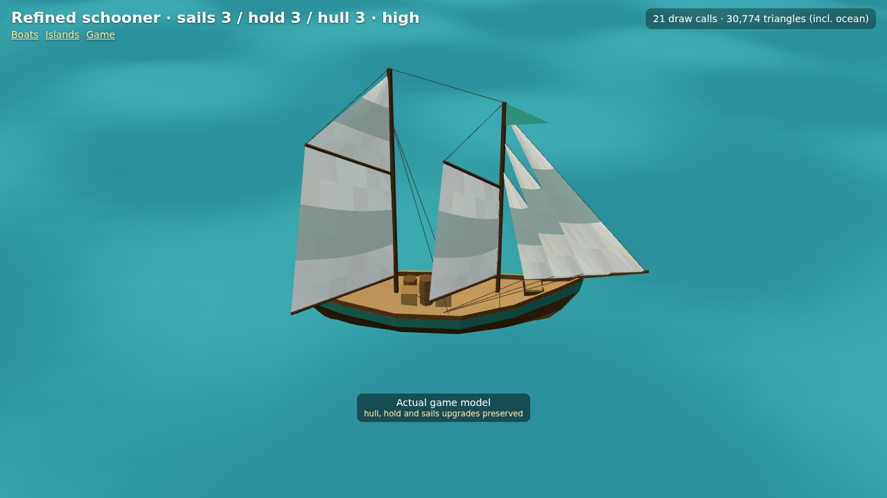

# Refined schooner — actual engine review

These are Chromium WebGL screenshots of the production boat factory, not generated illustrations. The in-game captures use the existing debug interface and real `GameView`, including the hull-sized wake. Captured at 1280 × 720 using software WebGL; they validate rendering, not physical tablet FPS.

The schooner retains its long slender hull, green trim, two unequal masts and two gaff sails. Its own fine bow, forward shoulder, narrow swept counter and tapered lower sections differ from both the rounded sloop and broad-transom cutter. All 27 independent upgrade combinations are preserved.

| Review | Capture |
|---|---|
| Stock, patched canvas, four cargo pieces | [Level 1](level1-high.png) |
| Clean canvas, third jib, six cargo pieces, green band | [Level 2](level2-high.png) |
| Stripes, aft topsail, nine cargo pieces, copper bottom | [Level 3](level3-high.png) |
| Same upgraded boat on Medium / Low | [Medium](level3-medium.png), [Low](level3-low.png) |
| Both gaff rigs lowered, jibs rolled towards individual stays, opposite tack | [35% sail](level3-reefed.png), [fully lowered on Low](furled-low.png) |
| Narrow counter stern and opposite viewing angle | [Stern](level3-stern.png) |
| Bare hull, maximum hold, level-2 sails | [Mixed upgrades](mixed-upgrades.png) |
| Actual game, hull foam and stern trail | [Low](game-low.png), [Medium](game-medium.png), [High](game-high.png) |

Each gaff sail pivots at its own mast/gooseneck; both luffs remain on their corresponding mast while lowering. Every jib has a separate inclined stay, with its head on the forward mast and tack on the solid bowsprit. Luff endpoints stay fixed through tacking, rolling and heeling; sheets and gaff lifts follow moving endpoints. The shorter foresail boom clears the aft mast. Handling is the same inexpensive approximation as the sloop/cutter, not a cloth simulation.

## Measured budgets

| Common upgrade level | Model triangles | Mesh draws | Optional rope draw |
|---|---:|---:|---:|
| 1 | 735 | 8 | 1 |
| 2 | 863 | 9 | 1 |
| 3 | 987 | 9 | 1 |

Low omits ropes and their buffer updates. The fully upgraded former model was 629 triangles / seven mesh draws; extra independent jibs account for two additional draws. Hull, deck details, mast poles and cargo remain one merged vertex-coloured Lambert mesh. No new textures, PBR, shader or per-frame geometry rebuilds.

| Real GameView, fully upgraded | Low | Medium | High |
|---|---:|---:|---:|
| Draw calls, including scene/shadow passes | 16 | 17 | 27 |
| Rendered triangles, including scene/shadow passes | 33,095 | 41,515 | 75,224 |
| Active wake vertices | 216 | 612 | 972 |
| Drawing buffer | 1154 × 649 | 1280 × 720 | 1280 × 720 |

[Raw render results](render-results.json) include all capture URLs, profile verification, model/wake footprint and browser errors (none). The wake envelope is unchanged at 18.04 × 5.313 m. Existing capped pixel ratios, ocean grids, shadows, Auto fallback and wake budgets remain unchanged. All 234 tests, lint and build pass; a physical older-tablet FPS/playability check remains outstanding.

## Reproduce

Start `npm run dev`, then open `/models.html?view=schooner&level=3&quality=high&still`. Also use `quality=medium` / `low`, common `level=1..3`, independent `hull=`, `hold=`, `sails=`, `sail=0..1`, signed `boom=` degrees and `yaw=` degrees. The existing heeling pose is included.

With Playwright available, run `node docs/art/game-models/refined-schooner/capture.cjs` from the repository root; optionally set `CHROMIUM_PATH` to a local executable. It starts its own Vite server, warms the real wake/pose buffers without intermediate GPU draws, then renders and captures the actual scene. No model or scene geometry is substituted. Chromium may issue the existing Three.js Clock deprecation warning; there are no console errors or page errors.

Decision: [0054](../../../decisions/0054-refined-upgrade-aware-schooner.md).
