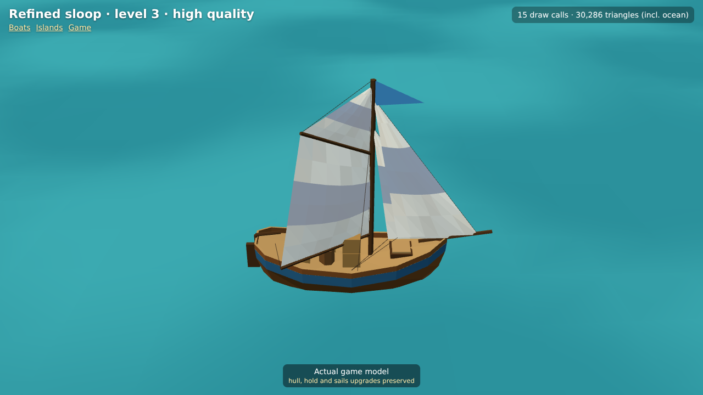
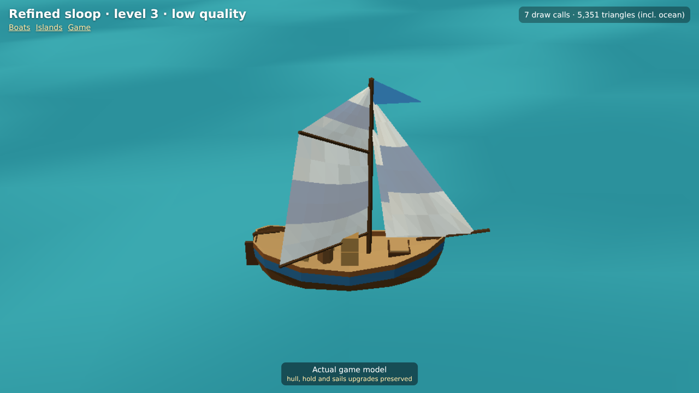

# Refined sloop — actual engine screenshots

Decision [0051](../../../decisions/0051-refined-upgrade-aware-sloop.md). Captured from the real `models.html` model inspector at 1280×720; these are not AI illustrations. Other ships are unchanged.

| State | Inspector query (after `models.html?view=sloop&still&`) | Screenshot |
|---|---|---|
| Stock | `level=1&quality=high` | [level1-high.png](level1-high.png) |
| Level 2 | `level=2&quality=high` | [level2-high.png](level2-high.png) |
| Level 3, High | `level=3&quality=high` | [level3-high.png](level3-high.png) |
| Level 3, Low | `level=3&quality=low` | [level3-low.png](level3-low.png) |
| Level 3, lowered sails on opposite tack | `level=3&sail=0.35&boom=-45&quality=medium` | [level3-reefed.png](level3-reefed.png) |

The boat has 507/619/743 triangles at levels 1/2/3 (5/6/6 mesh draws, plus one optional rigging line draw). The inspector's counter also includes its ocean and High's shadow passes, so its total is not the boat's cost. Low/Medium/High use the game's existing pixel, water and shadow profiles. The inspector uses a closer camera for inspection; details are smaller at normal gameplay zoom. Physical older-tablet performance remains to be checked.
