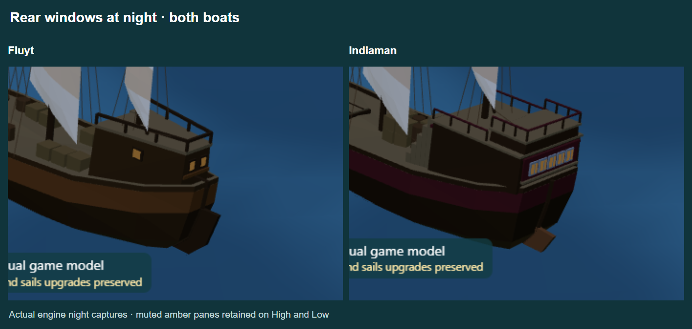

# Immersed rudders and retained night glazing

One boat-specific agent corrected each rudder. The fluyt and Indiaman blades now cross calm water at y=0 and follow the actual raked stern profiles, with connected stocks rather than floating plaques mounted at the deck height. The changes are limited to the rudders and their stocks/tiller; quarterdecks, cargo, sails and glazing are preserved.

| Boat | Blade thickness | Blade bottom, local | Below calm water at game display scale |
|---|---:|---:|---:|
| Fluyt | 0.12 | -0.648 | 1.426 |
| Indiaman | 0.15 | -0.646 | 1.421 |

The blade tips sit close to the aft keel and above the deepest centre keel. The [waterline inspection](waterline-inspection.png) shows the actual hull geometry translucent so the attachment and submerged portions can be seen. The blue line indicates calm water; it is a diagnostic view rather than a change to game rendering.

Rear windows remain softly amber at night on both High and Low. Fluyt retains its four panes (two rear, two side), Indiaman its five rear panes; no new light sources were added. Night images come from the game's model factory and night lighting in the model inspector. The capture helper also produces separate full High/Low images for each boat and [measured results](results.json).

Eighteen focused tests pass, covering rudder submersion across hull upgrades and heel, proportional bounds, existing quarterdeck support, cargo/sail integration, and smooth quiet night glazing on Low. TypeScript, ESLint, production build and changed-file formatting pass.

Reproduce with the local development server on port 5173, Playwright (`PLAYWRIGHT_PATH` optional) and an optional `CHROMIUM_PATH`: `node docs/art/game-models/rudders/capture.cjs`.
