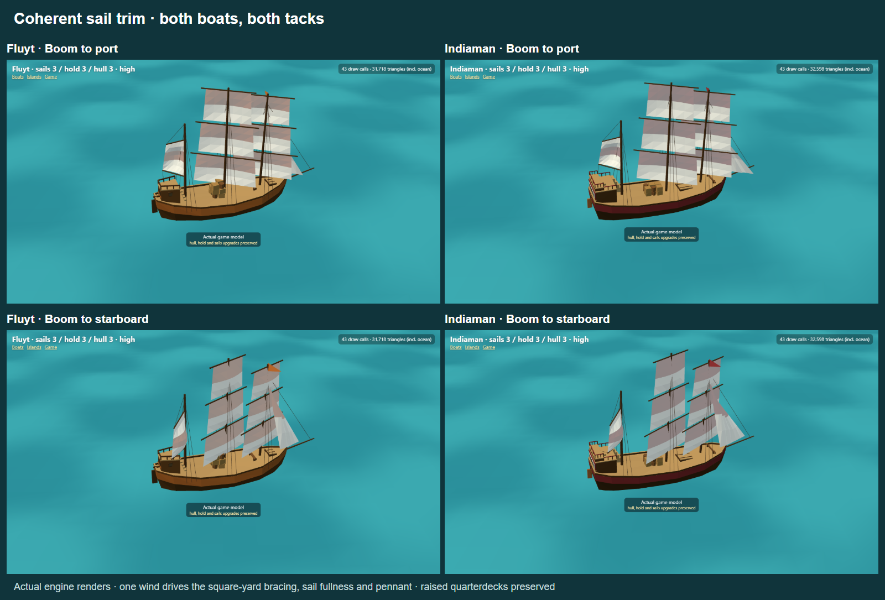

# Shared-wind trim for fluyt and Indiaman

Square sails used to copy the rear boom's rotation sign even though their geometry starts perpendicular to the fore-and-aft sail. Their bellies could therefore point to the opposite side of the ship. Both boats now brace their yards from the same `windRelative` used by the runtime pose (limited to 60 degrees), and fill the cloth from wind pressure projected onto that braced sail plane. This preserves reefing, furling and luffing, including backwinding near head-to-wind. Rear quarterdecks, boom heights, sail attachment geometry and window lighting are unchanged.

The model inspector had also kept a fixed wind when the user switched the boom to the other tack. Its default wind now follows the inverse of GameView's trim mapping; `wind` optionally supplies an explicit relative wind angle in degrees. The preserved fleet comparison scene uses a coherent wind/boom combination too.

Twenty-two focused tests pass across sail trim, raised sterns, hauler upgrades and model integration. New tests inspect the actual cloth belly axes on both tacks and close, beam, broad and downwind headings, plus luff/reef/furl behaviour. TypeScript, ESLint and production build pass. Twelve engine captures cover both tacks, night, close trim, mixed upgrades/reefing and Low/furled views with no browser errors: [results](results.json). The square and rear sails retain different rig-appropriate planes while their filled faces agree with one wind.

## Hoy research (no model change)

The rounder hoy was a deliberate stylisation: its authored outline now has fuller bow shoulders and sides, but the overall 6.2 × 2.7 reference dimensions did not change. Its styled length/beam ratio is about 2.2. Royal Museums Greenwich's [circa-1750 hoy/yacht model](https://www.rmg.co.uk/collections/objects/rmgc-object-66446) records a vessel 56 feet long along the gun deck and 16 feet broad, or 3.5:1. The museum describes English hoys as generally single-masted and sloop-rigged; Dutch examples could have two masts. The current model is recognisable as a stylised English coastal carrier, but its exaggerated beam and bulbous bow should not be presented as a faithful reconstruction. For greater historical plausibility, keep the full cargo body with a finer entry and less exaggerated shoulders. One museum example does not define every historical hoy.
