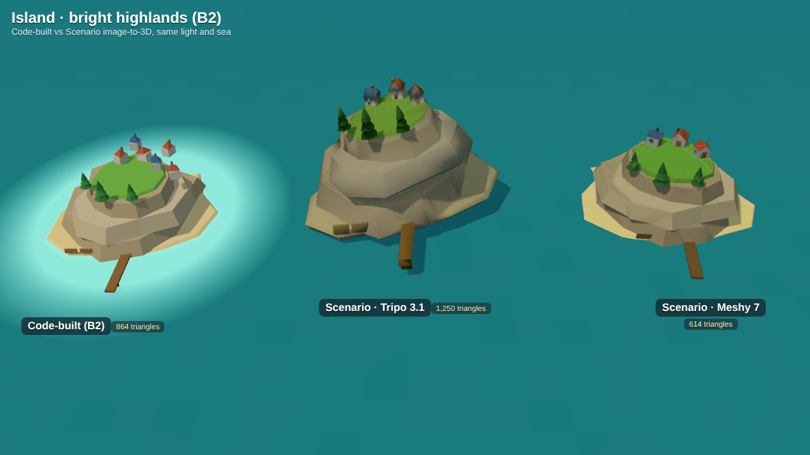
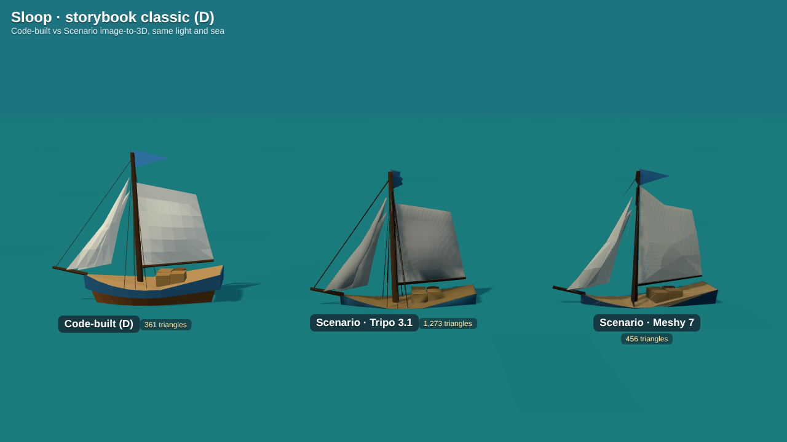

# Scenario (scenario.gg) test: one island, one sloop

A first test of generating game models with [Scenario](https://app.scenario.com) instead of building them in code. One **B2 bright highland island** (fish port) and one **style D storybook sloop**, each made as text + style reference → image → low-poly 3D model (GLB), then compared with the code-built version from the art sheets ([docs/art](../README.md) on the art-style PR). Done 2026-10-19 through the Scenario API.

No decision is recorded yet: this is evidence for one. The boat style pick is still open (see [decision 0012](../../decisions/0012-boat-and-island-art-style.md) on the art-style PR).

## Results




Wireframes: [island](compare-island-wire.png), [sloop](compare-sloop-wire.png).

| Model | Triangles | Draw calls | GLB after optimizing | Raw GLB from Scenario | Animatable parts |
|---|---|---|---|---|---|
| Island, code-built (B2) | 864 (plus a glow decal) | many small meshes, merged to 1 in game | none (built at load) | | n/a |
| Island, **Tripo 3.1** | 1,250 | 1 | **38 KB** | 513 KB | n/a |
| Island, **Meshy 7** | 614 | 1 | **49 KB** | 2.44 MB | n/a |
| Sloop, code-built (D) | 361 | several small meshes | none (built at load) | | boom, sails, pennant |
| Sloop, **Tripo 3.1** | 1,273 | 1 | **42 KB** | 638 KB | none (one mesh) |
| Sloop, **Meshy 7** | 456 | 1 | **45 KB** | 2.21 MB | none (one mesh) |

"Optimizing" is `gltf-transform optimize` with meshopt compression and the 2048² texture shrunk to 512² WebP (below); the renders above use the optimized files, so this is how they would look in game.

### Against the old-tablet budget ([0005](../../decisions/0005-tech-stack.md) / [0006](../../decisions/0006-desktop-and-mobile.md))

- **Download:** fine once optimized. Every model is under 50 KB, so a dozen islands and props cost under 0.6 MB of the ~2 MB initial load. The raw Meshy files (2+ MB each, a 2048² JPEG inside) must never ship as they are.
- **Triangles:** Meshy with remeshing hit the targets (614 and 456 for a 600 target). Tripo's "smart low poly" floor is 1,000 faces and it landed at ~1,250, about 3× the code-built sloop. Fine for islands (a few on screen), heavy for boats once a harbour holds many ships. The art pipeline note asks for "a few hundred triangles per boat": only Meshy meets it.
- **Draw calls and materials:** one mesh and one textured material each, which is good for islands. But each model has its own texture, so islands cannot be merged into one draw call like the code-built ones; that is ~1 draw call per island instead of 1 for all, acceptable for the handful on screen. The plan in 0005 was vertex colours, not textures; these models need a 512² texture each (about 1 MB of GPU memory per island).
- **Lighting:** both outputs are lit by the game's sun and sky like the code-built models; Tripo removes baked shadows ("delight"), but its sloop mainsail still has a dark smudge baked in.

### What it looks like

- **Island: good.** Both tools kept the B2 look: stacked sandstone tiers, bright grass cap, pines, red and blue roofs, beach ring, dock. Meshy's is the closest to the sheet and the cheapest. Tripo's cliffs are taller and smoother. Neither has the turquoise shallows glow, which stays a separate decal in game (as in the code-built version). The shape is fixed, so the beach line would need to match the island's collision radius by scaling, and per-island variety means one generation per island (or kit pieces, see below).
- **Sloop: looks right, but not usable as a game boat.** Silhouette and colours match style D well. It is a single frozen mesh: the boom, sails and pennant are fused with the hull, so the game cannot swing the boom, trim or reef the sails, or swap upgrade parts ([0011](../../decisions/0011-ship-lineup-and-upgrades.md) on the art-style PR). Separating parts afterwards means hand work in Blender for every ship and every upgrade level. Scenario's Tripo "generate parts" option exists but cannot be textured.

**Recommendation:** use Scenario (image → Meshy 7 with remesh → optimize) for islands, buildings and props; keep boats code-built (or modelled by hand) so sails and upgrades stay animatable. This matches the split discussed earlier for the asset pipeline. Not decided until Guillaume says so; it would become decision 0014 or later.

## Cost

Scenario bills in credit units (CU). This test used **412 CU**:

| Step | Model | CU per job | Jobs |
|---|---|---|---|
| Image (2 variations) | Gemini 3.1 (`model_google-gemini-3-1-flash`) | 26 | 2 |
| Image → 3D | Tripo 3.1 (`model_tripo-v3-1-image-to-3d`) | 60 | 2 |
| Image → 3D | Meshy 7 (`model_meshy-7-img23d`) | 120 | 2 |

Each step took 20 s to 2 min.

## Workflow

### On the website (app.scenario.com)

1. **Image.** Open *Generate › Images*, pick the model **Gemini 3.1** (🍌). Add the style reference as a reference image (`island/style-ref.png` or `sloop/style-ref.png`, crops of the art sheets) and paste the prompt from `island/jobs.json` / `sloop/jobs.json`. The important parts of the prompt: *"in exactly the art style of the reference image"*, *isolated object*, *three-quarter view*, *plain pure white background, no water, no shadows*. Aspect 1:1, 2 outputs. Pick the cleanest one (houses attached to the ground, whole object in frame).
2. **3D.** Open *Generate › 3D*, choose **Meshy 7 – Image to 3D**, use the picked image. Turn on **Remesh**, topology **triangle**, target polycount **600** (islands) or **400** (props), PBR **off**. (Or **Tripo 3.1** with **Smart Low Poly** on and face limit 1000.)
3. **Download** the GLB.
4. **Optimize** (needs Node): `npx @gltf-transform/cli optimize in.glb out.glb --compress meshopt --texture-compress webp --texture-size 512 --simplify false`. Check the size and triangle count with `npx @gltf-transform/cli inspect out.glb`.

### Through the API (what was used here)

[`tools/scenario/scenario.py`](../../../tools/scenario/scenario.py) is a small client (Python standard library + nothing else). It reads `SCENARIO_API_KEY` and `SCENARIO_API_SECRET` from the environment (never commit them; the cloud environment for this project has them, and `api.cloud.scenario.com` allowed in its network policy).

```sh
# list a model's inputs
python3 tools/scenario/scenario.py model model_meshy-7-img23d
# run a job; "@path" values in the JSON are uploaded first and replaced by asset ids
python3 tools/scenario/scenario.py run model_google-gemini-3-1-flash island-img.json out/island-img
python3 tools/scenario/scenario.py run model_meshy-7-img23d island-meshy.json out/island-meshy
```

The exact inputs of every job are in `island/jobs.json` and `sloop/jobs.json` (`@` paths there are relative to this folder). Under the hood: `POST /v1/assets` uploads an image, `POST /v1/generate/custom/{modelId}` starts a job, `GET /v1/jobs/{jobId}` is polled until `success`, then `GET /v1/assets/{id}` gives each output's download URL. The output asset ids are listed too, so the raw files can be fetched again from the Scenario account.

### Re-rendering the comparison

`src/compare.html` puts the code-built model (from `docs/art/src/lib.js`, on the art-style PR) and the two GLBs side by side under the same light and sea; `?a=island` or `?a=sloop`, add `&w=1` for wireframes. From this folder, with `docs/art/src` present:

```sh
ln -s ../../../../node_modules src/node_modules
cd .. && python3 -m http.server 8765 &   # from docs/art
node scenario-tests/src/shot.js 'http://localhost:8765/scenario-tests/src/compare.html?a=island' scenario-tests/compare-island.png
```

## Files

- `island/`, `sloop/`: `style-ref.png` (crop of the art sheet given to the image model), `image-picked.jpg` and `image-alt.jpg` (the two generated images), `tripo.glb` and `meshy.glb` (optimized), `jobs.json` (models, inputs, job ids, cost).
- `compare-*.png`: the renders above.
- `src/`: the comparison page and screenshot script.
