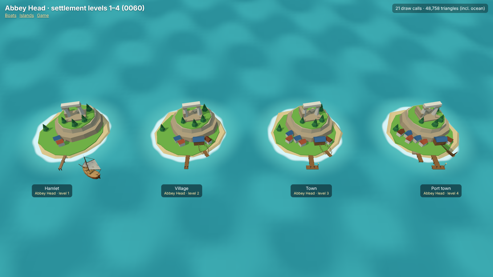
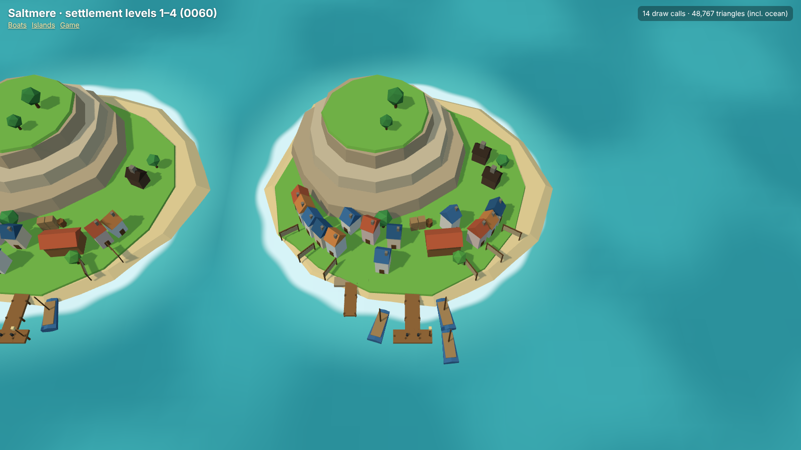
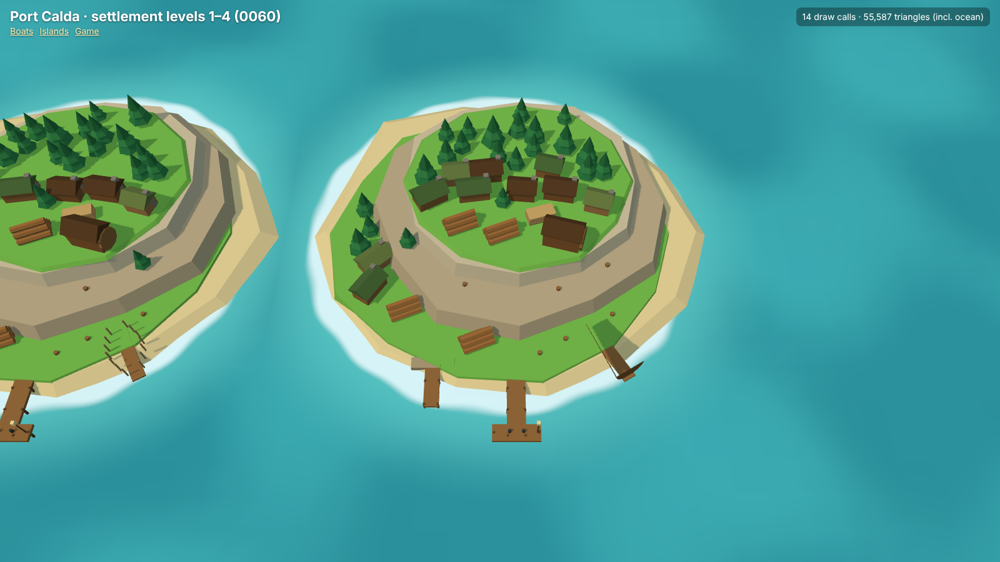
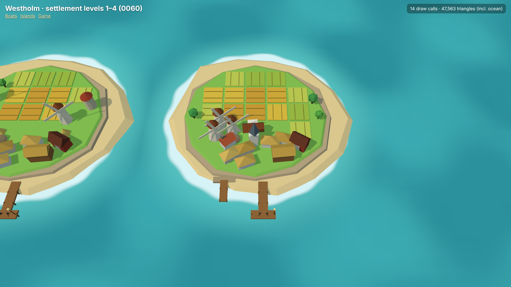
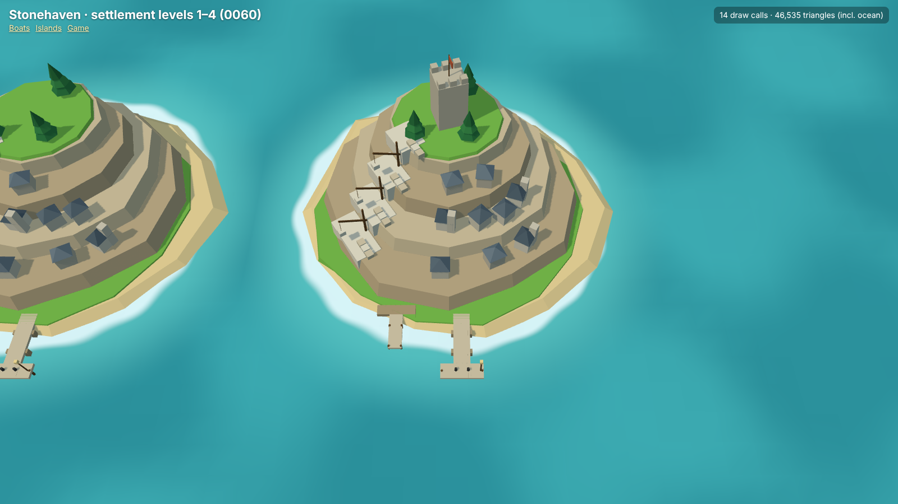

# Growing towns (mockups for decision 0060)

Static renders of the real game code (`models.html?view=towns`), proposed in [decision 0060](../../decisions/0060-growing-town-visuals.md). Each port grows its own way: its own island profile, buildings, layout, industry and dock. The beach, collision outline and main pier line are unchanged.

Reproduce: `npm run build && npx vite preview`, then open `models.html?still&view=towns&kind=fish` (or `timber`, `grain`, `stone`, `yard`), `&kind=all&level=1..4`, `&kind=all&before` for today's islands, and `&focus=1..4` for the game camera on one island of the strip.

## Each port, levels 1 to 4

Hamlet, village, town, port town.

## Today vs port town

## At the game camera (port town)

