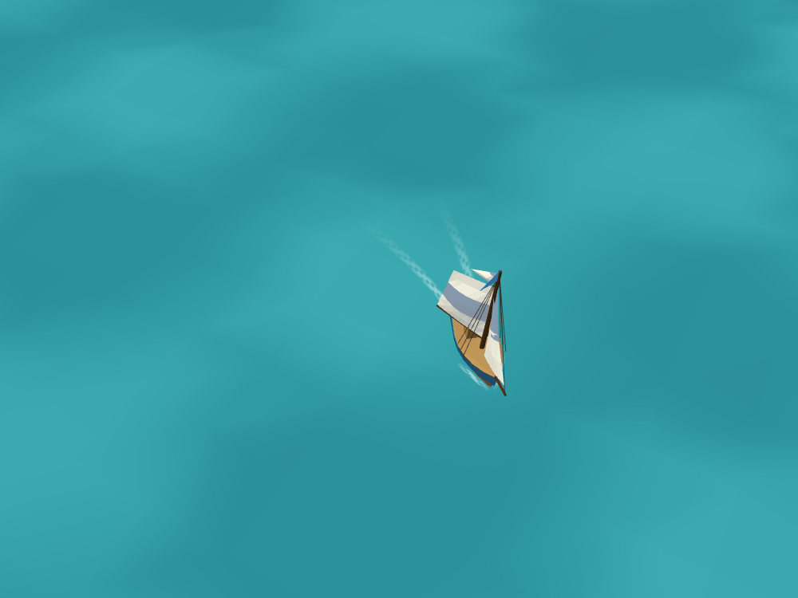
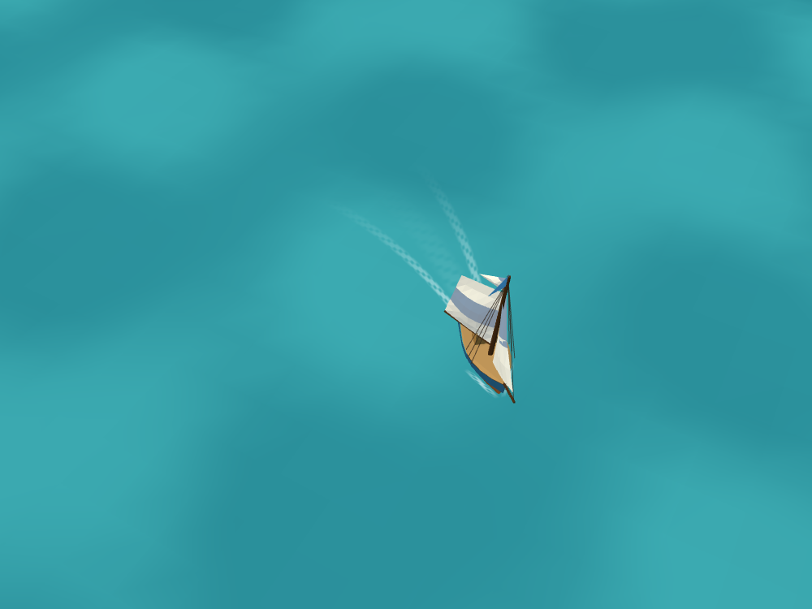
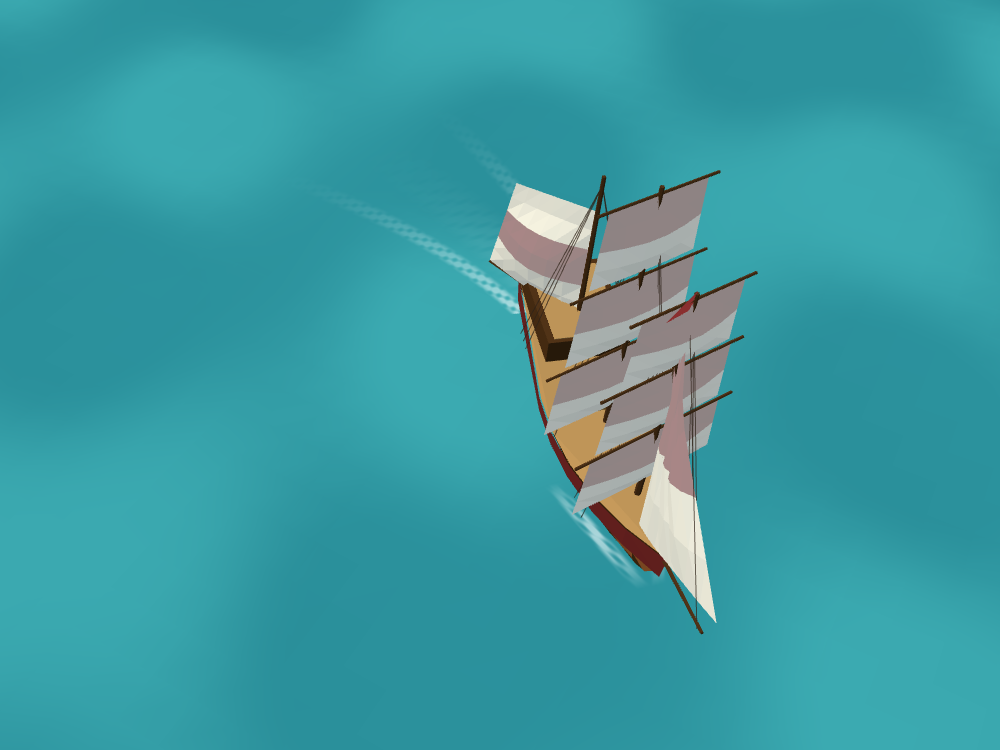

# Wake render checks

Actual Three.js renders of the upgraded sloop at 7 knots on a curved track, using the production Ocean, Wake and boat model. These are controlled close views, not screenshots of the full game or FPS benchmarks. Water shading is unchanged. The Indiaman checks the larger hull attachment.

Run `npm run dev -- --host 127.0.0.1`, then open `/docs/art/src/wakes.html?quality=low` (also `medium`, `high`; add `&ship=indiaman` for the large ship). The frozen frame at six seconds makes comparisons repeatable. Screenshots were captured at 1000 × 750 using software WebGL; no browser/shader errors were reported at any level.

| Low | Medium | High |
| --- | --- | --- |
|  |  |  |

Still to verify on a real older tablet: sustained sailing frame rate and responsiveness, tight turns, stopping, docking and runtime quality changes. Software-rendered screenshots do not establish hardware performance.
