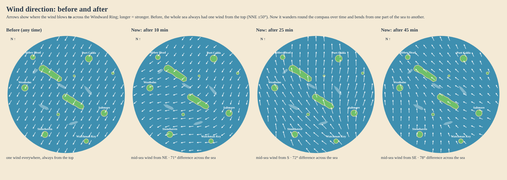

# 0064. Wind from every quarter, and different across the sea

**Status:** Implemented for review, 2026-10-22. Guillaume: "fix the fact that wind only comes from the top at the same time", first step of Phase 2 weather.

## Context

Slow weather shifts ([0026](0026-slow-weather-shifts.md)) picked a new wind every 3 minutes, but always within ±50° of the map's prevailing wind (from 30°, north-north-east on the Windward Ring). So the wind always came from the top of the chart, and it was one wind for the whole sea at any moment: the same tack was upwind everywhere, and no route was ever a beat one hour and a run the next.

## Decision

- **The direction wanders round the compass.** Each 3-minute period now veers or backs by up to 75° from the previous one (a seeded random walk) instead of being drawn fresh within ±50° of the prevailing wind. A gentle pull back (12 % of the offset per period) keeps the prevailing wind the most common one: about half the time it blows within 60° of it, the rest of the time from any other quarter, including from the south. Easing between periods takes the shorter way round and stays under about 2.5°/s.
- **The wind differs across the sea at the same moment.** Two slow seeded waves bend the wind by up to ±40° and change its strength by up to ±15 % from one part of the sea to another (regions about 400 units across, so the Windward Ring holds two or three), drifting slowly so they move over 15 minutes. Gusts arrive at different moments in different places. A boat sailing across a region sees its wind turn gradually (under 0.5° per frame at 16 kn).
- **The boat feels the wind where it is.** `windAt(config, t, seed, pos)` takes a position; the world asks for it at the boat, then applies island lee and channels ([0027](0027-islands-shape-the-wind.md)) as before.
- Still a pure function of map seed, time and position: nothing new in the save, a resumed voyage is back in the same weather. Period 0 is still the prevailing wind, so a new voyage starts in the designed breeze. Phase 0 practice waters keep their steady wind.
- Configured in `WeatherConfig` (`stepDeg`, `revert`, optional `regions`) in `src/sim/wind.ts`; `DEFAULT_WEATHER` replaces `rangeDeg`.

## Consequences

- Routes change character over a session, and two boats far apart can be on different points of sail on the same heading. Reading the compass matters more (pillar 1).
- The compass and wind readout already show the wind at the boat, so no UI change was needed. The chart still shows wind only through its compass ([0058](0058-chart-style-d-port-cards.md)); showing regional wind on the chart is left for later if play-testing asks for it.
- The coming weather states (calm, gale, rain, moving storms) build on this field: a storm is one more local term on top of the regions.
- Cost: one extra seeded RNG and three sines per frame; the period walk is cached. No effect on the tablet budget.
- Tuning knobs: `stepDeg`, `revert`, `regions.bendDeg`, `regions.sizeUnits`, `regions.driftSec`.

**Validation:** `tests/wind.test.ts`: reproducible from the seed, bounded steps, every quarter reached over a long voyage while the prevailing wind stays the most common, different directions across the sea at one moment, smooth under a fast boat, Phase 0 steady.
