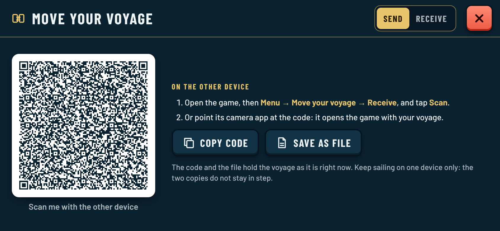
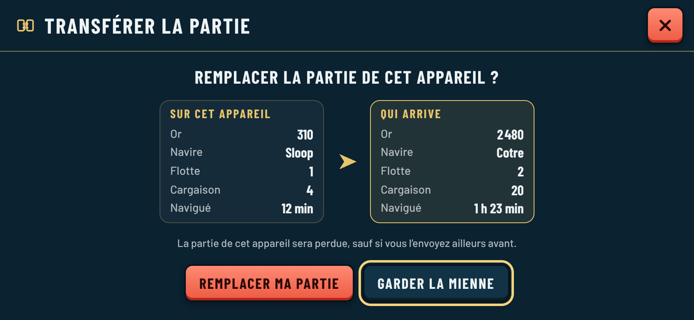
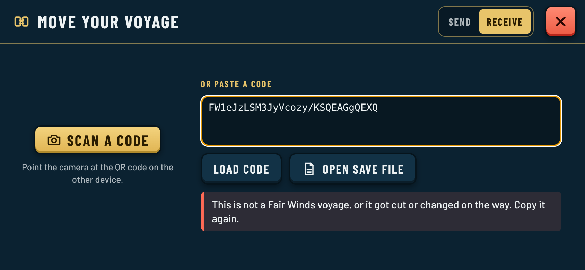

# 0066. Move a voyage between devices with a QR code or a file

**Status:** Implemented for review, 2026-10-22. Guillaume picked options 1 and 2 of the proposal ("ok for 1 and 2, 2 being the main way"): a save code shown as a QR code first, a `.json` file second. No server. The code format was made compact in [0118](0118-compact-save-code.md) (`FW2`); `FW1` codes still read.

## Context

Saves live in the browser's `localStorage` ([0009](0009-sandbox-short-sessions.md), [0015](0015-trade-economy.md)), so a voyage started on the phone cannot continue on the tablet. The game has no backend and should not need one. Options considered: (1) export/import a file, (2) a save code or QR code, (3) the player's own Google Drive or Dropbox (needs sign-in and an app registration per provider), (4) direct device-to-device WebRTC (still needs a signalling helper, so not serverless).

## Decision

- **Menu → Move your voyage** (FR *Transférer la partie*) opens a full-screen sheet in style D with two tabs:
  - **Send** shows the voyage as a QR code (made fresh each time, so it is the voyage as it is now), with **Copy code** and **Save as file**.
  - **Receive** has **Scan a code** (camera), a box to paste a code or link, and **Open save file**.
- **The QR holds a link to the game:** `https://…/fair-winds-trading/#voyage=FW1…`. The other device can scan it with the game's own scanner, or with its ordinary camera app, which opens the game straight on the "replace?" question. The code is read from the address and removed from it at once.
- **Save code:** the normal save JSON ([`SaveData`](../../src/sim/save.ts)) with fractional numbers rounded to 2 decimals and goods at 0 left out, compressed with zlib (`fflate`), in URL-safe base64, prefixed `FW1` (format 1). About 900 characters for a voyage on the Windward Ring: a version 21 QR code (101 modules) at low error correction, which a phone reads off another screen easily. Pasted codes may contain spaces and line breaks, and a whole link works too.
- **Save file:** `fair-winds-voyage-YYYY-MM-DD.json`, a small labelled wrapper `{ game, exportedAt, save }`, readable in a text editor. Import also takes a bare save as stored in the browser.
- **Nothing is trusted on the way in.** zlib's checksum catches a cut or mistyped code; then the same `validateSave` as a normal load checks version, map and every field. The player gets a plain reason: not a Fair Winds voyage or damaged on the way, from a newer game version (update first), for another map, or damaged.
- **Confirm before replacing.** A valid voyage is never applied straight away: the sheet shows both voyages side by side (gold, ship, ships owned, cargo, time sailed) with **Replace my voyage** (red) and **Keep mine**. Replacing stores the voyage as this device's save and reloads into it.
- **Scanner:** the browser's `BarcodeDetector` where it exists (Chrome on Android), otherwise jsQR (Apache-2.0), loaded only when a scan starts (a separate 48 kB gzip chunk), reading frames shrunk to 720 px about six times a second. No camera or no permission: the paste box and the file remain.
- **Libraries:** `uqr` (MIT) makes the QR, `fflate` (MIT) compresses, `jsqr` (Apache-2.0) scans. About 15 kB gzip added to the main bundle.
- The menu gains one row. On short landscape phones the menu panel is tightened one notch so title, buttons and footer still fit without scrolling down to 360 px high (it already overflowed slightly there before).
- Tutorial progress and settings stay per device; a moved voyage resumes like any saved voyage (no first-voyage offer).
- Fix on the way: "New game" (and a replaced voyage) reload the page, and the reload's `pagehide` autosave wrote the old voyage straight back. Autosave now stops once the page is leaving for a new or moved voyage.

| Send | Replace? | Receive (bad code) |
| --- | --- | --- |
|  |  |  |

More shots (portrait, desktop, French): [ui-refactor/transfer](../ui-refactor/transfer/README.md).

## Consequences

- Moving a voyage is a copy, not a sync: both devices keep their own copy and drift apart from the next move. The Send tab says so.
- **Installed app on iPhone/iPad:** a home-screen app has its own storage, separate from Safari. Scanning with the camera app opens Safari, so a captain who plays from the home-screen icon should scan from inside the game instead. Not said in the game yet; worth a line in the Send steps if testers trip on it.
- The save grows with the map (more ports, ships, orders). At about 1,300 characters the QR reaches version 25; past that, consider error correction L only (already), dropping market stocks from the code (they drift back to equilibrium), or a denser alphanumeric encoding. `tests/save-transfer.test.ts` fails if the current map's code needs more than version 25.
- A new save format bumps `SAVE_VERSION`; older games then refuse newer codes with "update this device first" instead of misreading them.
- Options 3 (own cloud drive) and 4 (WebRTC) stay open for later if moving by hand proves tedious.

**Validation:** `tests/save-transfer.test.ts`: a played voyage goes through a code and resumes intact; the link fits in a QR that a real decoder (jsQR) reads back; links and codes with spaces are accepted; cut, mistyped, foreign, newer, other-map and damaged voyages are refused with the right reason; file export/import, including a bare save. `docs/ui-refactor/transfer/capture.cjs` runs the real game in Chromium: device A shows its QR, that QR is fed to device B as a fake camera, B scans it with the in-game scanner (jsQR path), confirms, reloads and has A's gold; a camera-app link opens the confirm screen and clears the address.
