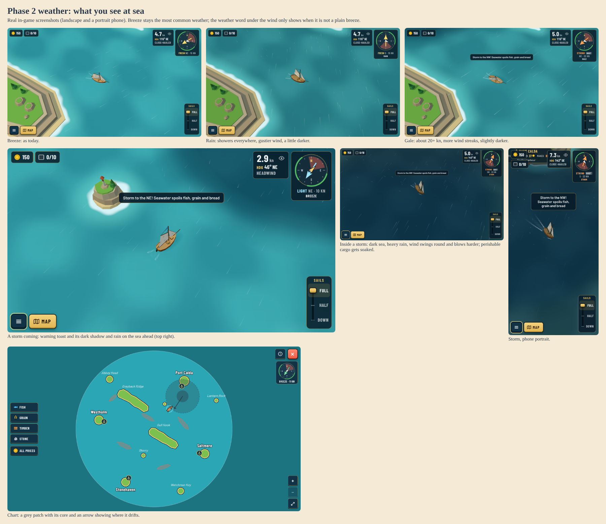

# 0067. Weather states and moving storms

**Status:** Implemented for review, 2026-10-22. Guillaume: "start on weather first", the Phase 2 roadmap item "weather states (calm, breeze, gale, rain, storms) that move across the map and change wind strength; storms can spoil cargo". Builds on [0026](0026-slow-weather-shifts.md) and [0064](0064-wind-from-every-quarter.md).

## Context

After [0064](0064-wind-from-every-quarter.md) the wind wanders round the compass and differs across the sea, but every period is still "a breeze". The roadmap wants weather you can see and plan around, storms that move, and a reason to care about them (spoiled cargo). It must stay cheap on an old tablet and keep the quiet HUD ([0020](0020-quiet-upwind-compass-help.md), [0024](0024-on-demand-chart-and-quiet-sandbox.md)).

## Decision

**Sea-wide weather states.** Each 3-minute weather period is one of four states. A period keeps the previous state 35 % of the time, otherwise draws one by weight:

| State  | Weight | Wind (× map wind, 14 kn) | Rain | Gusts |
| ------ | ------ | ------------------------ | ---- | ----- |
| Breeze | 50 %   | 0.8–1.15 (11–16 kn)      | none | ×1    |
| Calm   | 17 %   | 0.35–0.55 (5–8 kn)       | none | ×0.6  |
| Rain   | 18 %   | 0.95–1.2 (13–17 kn)      | 0.7  | ×1.6  |
| Gale   | 15 %   | 1.35–1.55 (19–22 kn)     | 0.15 | ×1.6  |

Strength and rain ease across the 60 s blend like the direction. A new voyage starts in a dry breeze.

**Moving storms.** One storm crosses the sea in each 10-minute stretch, starting late in the stretch (the first one 5 to 9 minutes into a voyage). It forms outside the map, crosses on a straight track through the middle half of the sea at 3.2 units/s (half a sloop's speed at 8 kn, so it can be outrun or dodged), and fades as it leaves. Radius 95 units, full force in the inner 35 %.

- **Wind:** inside, the wind turns to circle the centre anticlockwise (like a northern low, spiralling 20° inward) and blows up to ×1.9 harder (about 25–30 kn in the core).
- **Overpowered boats:** above 21 kn extra wind only adds a quarter as much drive (`drivingWind` in `src/sim/boat.ts`), so a storm is rough, not a free speed boost. Below 21 kn nothing changes.
- **Cargo overboard when she heels too hard** (Guillaume, replacing a first version where storms spoiled fish, grain and bread: "why not making some cargo go overboard if heeling gets too heavy or too sudden? makes player lower sails or read the wind better"). The heel model of [0044](0044-visual-heeling.md) moves into the simulation (`src/sim/heel.ts`, lively feel) and the world tracks the boat's heel:
  - **Too heavy:** for every 2.5 s spent past 20° of heel, one unit of the good the hold carries most of goes over the side. A full-sailed sloop on a beam reach heels about 14° in the usual 14 kn breeze and passes 20° from about 19 kn, so gales and storms under full sail cost cargo; half sail, a closer course or running off keeps it.
  - **Too sudden:** a lurch faster than 22°/s past 16° of heel (a hard gust) throws a unit at once, at most every 3 s.
  - Nothing is lost alongside. Wider, heavier hulls heel less (`HEEL_FACTOR`), so haulers keep their cargo better.
  - Toast: "Heeled too hard: 1 timber went overboard. Ease the sails".
- **Warning:** once per storm, when its edge comes within 140 units: toast "Storm to the NE! Ease the sails or cargo may go overboard".

Storms and states are pure functions of the map seed and time like the rest of the wind: nothing new is saved and a resumed voyage is back in the same weather.

**What you see.**

- **Light:** rain and storms darken the sky, fog, sea and sun (gale a little, rain more, a storm core most), easing over a few seconds.
- **Rain:** falling streaks around the camera, slanted by the wind, one draw call (160 / 260 / 400 drops on low / medium / high quality). Each drop checks the rain where it is, so a storm's downpour has an edge you can sail into.
- **Storm shadow:** a dark soft disc on the sea under each storm, visible before you are in it.
- **HUD:** the weather word (Calm, Rain, Gale, Storm) appears under the wind readout only when it is not a plain breeze.
- **Chart:** storms show as a grey patch with a darker core and a short arrow for the way it drifts. The chart still shows no wind arrows ([0058](0058-chart-style-d-port-cards.md)). Guillaume found this patch unclear (2026-10-22); clearer options are being proposed as mockups before anything changes.
- **Storms can be turned off** in Settings (Storms, on by default; saved with the other settings). Off removes the storm tracks from the wind, so there are no storms, warnings or storm rain; calm, rain and gale periods stay. Rule from Guillaume: every hazard gets such a switch, so pirates (Phase 5) must get one too.

## Consequences

- Weather becomes something to read and route around: wait out a calm, run before a gale, dodge a storm, or take the risk with timber but not with fish.
- Losses are one unit at a time on purpose, while play-testing tells whether they should bite harder. The visual heel still uses the quality-level feel, so on Low the drawn lean is a little calmer than the one that decides cargo.
- Tuning knobs: `DEFAULT_WEATHER.kinds`, `persist`, `storms` in `src/sim/wind.ts`; `STORM_GAIN`, `STORM_WARNING`, `OVERPOWERED_KN` and `HEAVY_HEEL`, `HEAVY_SECONDS`, `LURCH_RATE`, `LURCH_HEEL` in `src/sim/world.ts`.
- Storm tracks use the map's radius (`storms.areaRadius`, 440 for the Windward Ring); a future map sets its own.
- Cost per frame: a few sines and one storm check for the wind; rain is one dynamic line buffer (~400 segments at most); the storm shadow is one mesh. No new textures or post-processing.
- The day and night cycle comes next and reuses the same light and colour hooks (`Ocean.setColors`, sky and light intensities in `GameView`).

**Validation:** `tests/weather.test.ts` (all four states occur, breeze most common, calm and gale strengths, dry breeze at start, storms reproducible and frequent, cross from the edge slower than a sloop, stronger anticlockwise wind in the core, overpowered cap, one warning; no cargo lost in the breeze with gusts and tacks, losses under full sail in a gale, none with eased sails or alongside) and the updated `tests/wind.test.ts`.
