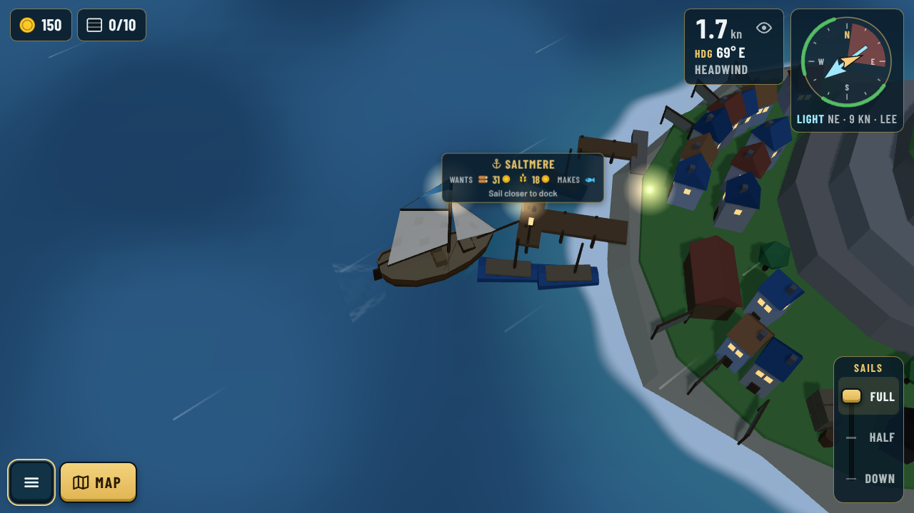
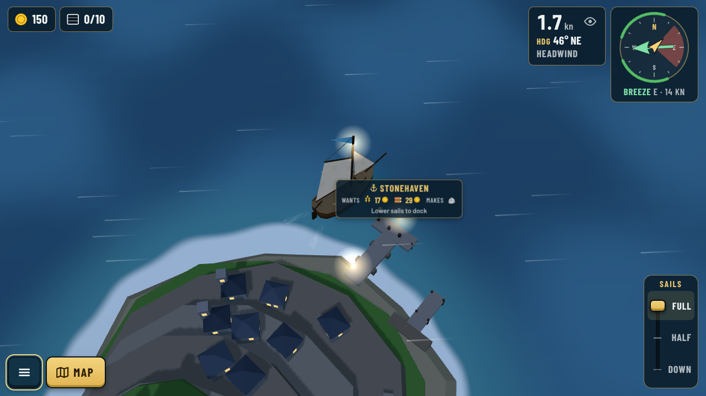
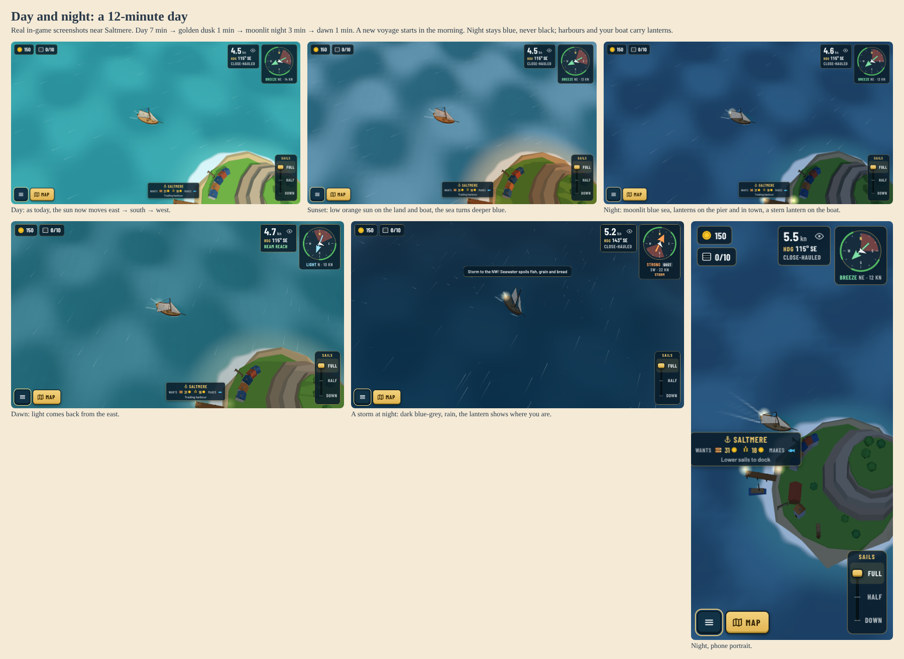

# 0068. Day and night

**Status:** Implemented for review, 2026-10-22. Guillaume: "after its done, day night cycle" (Phase 2 dynamic weather, after [0064](0064-wind-from-every-quarter.md) and [0067](0067-weather-states-and-storms.md)).

## Context

The roadmap's Phase 2 weather includes a day/night cycle. Sessions are short (sandbox, [0009](0009-sandbox-short-sessions.md)), so a player should see a sunset and a night in a normal session, and the night must never make coasts, reefs or the boat hard to read on an old tablet or a phone in daylight.

## Decision

- **A 12-minute game day:** 7 minutes of day (7:00 to 19:00), a 1-minute golden dusk, 3 minutes of moonlit night and a 1-minute dawn. A new voyage starts at 7 in the morning. Like the weather, the hour is a pure function of game time (`daylightAt` in `src/sim/daylight.ts`); the time is already in the save, so a resumed voyage is at the same hour.
- **The light moves:** the sun rises in the east, crosses the south and sets in the west; the moon takes the same path at night. Shadows and the flat shading of the waves follow it.
- **Looks:** four colour sets blend smoothly in `src/render/atmosphere.ts`: day (unchanged), golden (low orange sun on land and sails, a deeper blue sea), night (deep blue sea, pale blue moonlight, never black) and the storm look from [0067](0067-weather-states-and-storms.md), which stays dark blue-grey at night. Shallows and foam dim too.
- **Lanterns:** warm glows on every harbour pier head and in each town, and a masthead lantern on the boat, fading in at dusk (and a little under storms). One additive point cloud with a small generated texture: one draw call, no real lights. The boat's lantern first hung at the stern, but from the high camera it read as a light on the tiller (Guillaume), so it moved up the first mast and heels with it (`BoatModel.lantern`).
- **Lit windows:** town houses, cabins, farms, the bakery and the keep have window panes; street lamps and the lighthouse lamp room glow too. They are dark glass by day and light up warm at night (most windows, not all). All glass is one extra merged mesh whose colour the view brightens with the lanterns: one more draw call, no lights.

- **Can be turned off:** Settings → Display → "Day and night" (on by default). Off keeps an early-afternoon light, for players who dislike sailing at night (Guillaume).
- **No gameplay change and no HUD clock** for now, in line with the quiet HUD. Night does not change wind, prices or hazards.
- `GameView` hands the weather and the hour to one `Atmosphere` object, replacing the storm-only gloom code; the ocean gains `setSunDirection` and its shallow and foam colours in `setColors`.

## Consequences

- Sessions get a rhythm (a sunset roughly every 12 minutes) and storms at night are more dramatic, with the masthead lantern marking the boat.
- Cost: a few colour lerps per frame, one extra draw call for lanterns and one for window glass. No new shaders or passes.
- Possible follow-ups once play-tested: a small sun/moon icon or clock, lighthouse beams on Lantern Rock, night affecting gameplay (e.g. harder-to-see reefs), and a longer or shorter day as an option.
- Tuning knobs: `DAY_SECONDS`, `DAY_END`, `DUSK_END`, `NIGHT_END` in `src/sim/daylight.ts`; the `DAY`, `GOLDEN`, `NIGHT` and `STORM` looks in `src/render/atmosphere.ts`.

**Validation:** `tests/daylight.test.ts` (starts at 7 in full day, repeats every day, about a quarter of the day is full night, no jumps in light, warmth or clock, sun east → south → west and above the horizon). Screenshots in `docs/screenshots/day-night/`.
