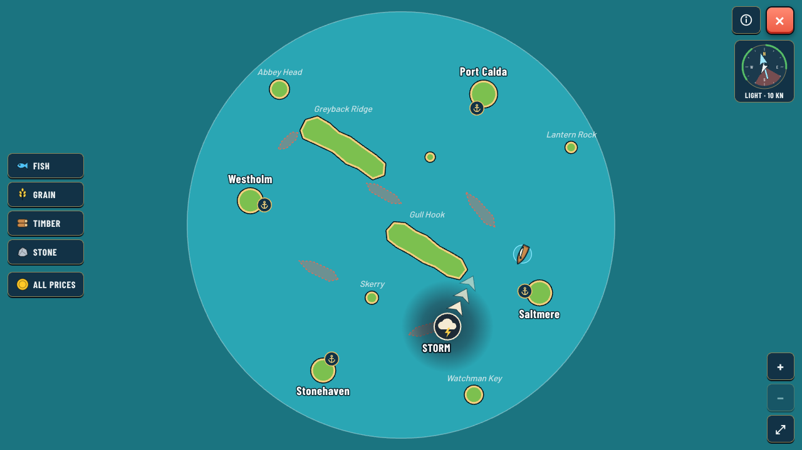
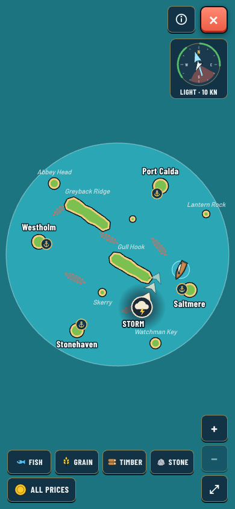
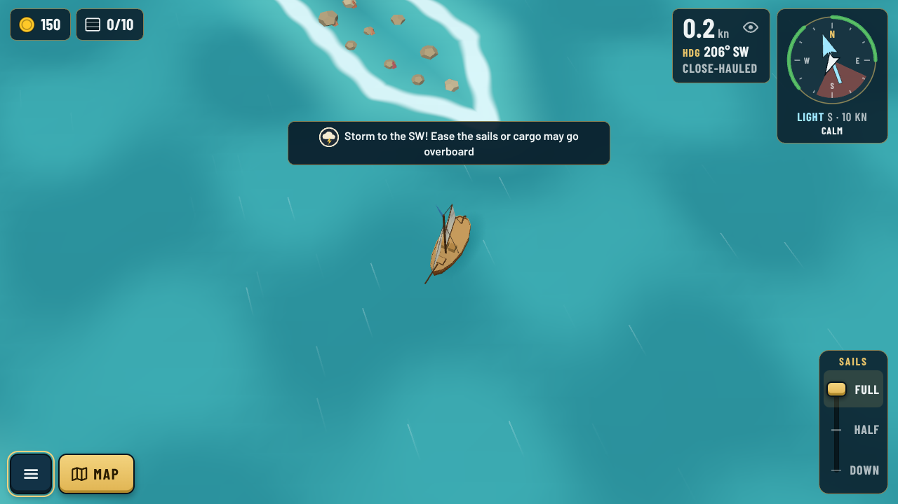

# 0070. Hazard markers on the chart and in warnings

**Status:** Implementation for review (2026-10-22)

## Context

The first chart storm ([0067](0067-weather-states-and-storms.md)) was a grey dashed patch with a darker core and a thin arrow. Guillaume found it unclear: players won't understand it. He asked for proposals first. There were four mockups in [docs/mockups/chart-storm](../mockups/chart-storm/README.md):

- A: a storm badge
- B: a weather-map swirl
- C: a badge plus where the storm will be in 1 minute
- D: a red danger zone

He weighed A against D, and asked that the same warning system serve pirates later (Phase 5).

## Decision

Guillaume picked **A**, built as a reusable **hazard marker** (`src/ui/hazardMarker.ts`):

- **Badge:** a round badge with the hazard's icon (`#i-storm`: a cloud with a lightning bolt).
- **Name:** written in the port-name lettering with a halo ("STORM" / "TEMPÊTE"), placed on the side the hazard comes from so it never covers the chevrons.
- **Chevrons:** three chevrons, fading ahead, show the way it moves. There are no dashed lines.
- **Reach:** a hazard that covers an area (a storm) also gets a soft dark cloud for its reach. A single ship (a pirate) gets only the badge and chevrons.
- **Colour means kind of danger:** storms are slate and cream, because they are weather you can wait out or sail around. Red is kept free for pirates, who hunt you.
- **The warning toast** ("Storm to the SW!") shows the same badge, so the warning and the chart match.
- **Legend:** the chart legend has a "Storm · drifts slowly" entry.

Pirates plug in with a new `HazardKind`, an icon, and a `.hazard-pirates` colour set.

## Consequences

- One visual language for every danger. A Phase 5 pirate sighting reuses `drawHazard` and `hazardBadge` with no new chart code.
- The marker keeps its screen size at every zoom, like port names.
- C's "in 1 min" ghost circle can be added on top later if play-tests show players still misjudge where a storm will be.
- Small fix along the way: the legend sheet now sits above the goods buttons, which used to cover it in landscape.
