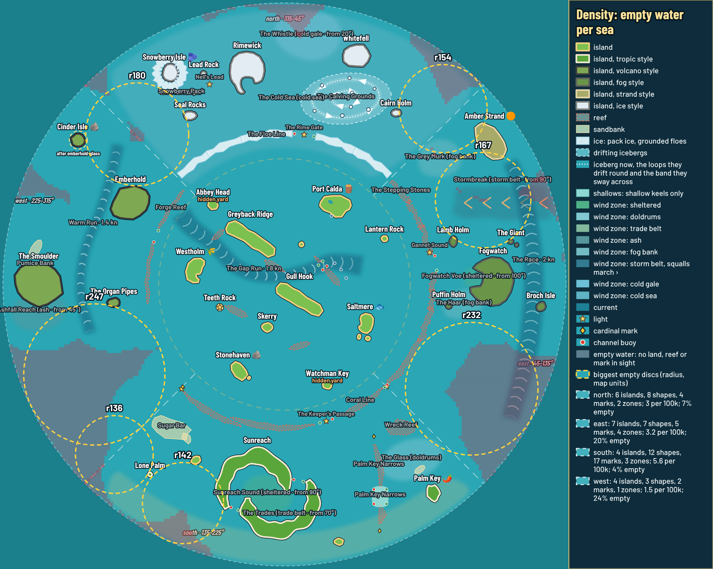
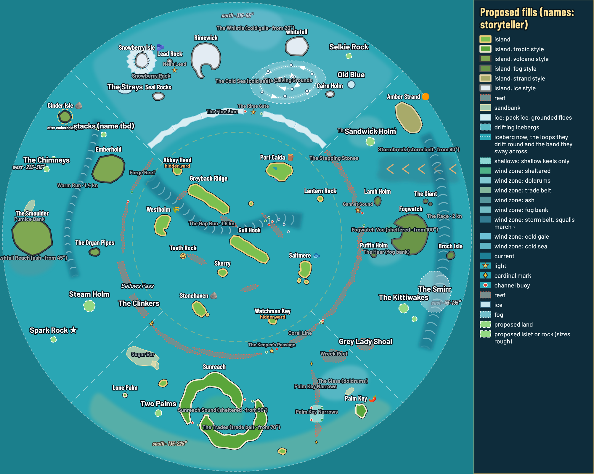

# 0180. Even density across the four seas

**Status:** Proposed (2026-10-25). Waiting on Guillaume's OK of the plan before the build threads start.

## Context

Guillaume (2026-10-25) asked for a review of how full the four outer seas are, so none feels empty, and then for as many threads as needed to build what is missing. With equal quarters ([0179](0179-four-equal-sea-quarters.md)) the east gained 100..135° and the west 225..260° from the south, and both slices are open water. The Phase 4 layout ([0137](0137-phase-4-biomes-and-founded-outposts.md)) already asked for open sea "kept busy with islets and landmarks".

Measured on main with PR #188 (quarters) and PR #183 (north sea), over the outer ring (r 445..985). A **landmark** is something the boat sees: an island, a reef, bank or ice shape, a sea mark. **Empty water** is farther than 160 map units from every landmark (about what the camera shows ahead of the boat at normal zoom: fog far is 2.4 × 110). Zones and currents are counted apart: they are felt, and invisible in good weather.

| Sea | Islands | Shapes | Marks | Zones | Landmarks per 100k u² | Empty water | Biggest empty disc |
|---|---|---|---|---|---|---|---|
| North (Rimewick) | 6 | 8 | 4 | 2 | 3.0 | 7% | r180 at 316° (west border) |
| East (Fogwatch) | 7 | 7 | 5 | 4 | 3.2 | 20% | r232 at 119° |
| South (Sunreach) | 4 | 12 | 17 | 3 | 5.6 | 4% | r142 at 205° |
| West (Emberhold) | 4 | 3 | 2 | 1 | 1.5 | 24% | r247 at 245° |

The gaps, biggest first: west 225..260° (r247), east 100..135° (r232), the north/west corner at 315° (r180), the north/east corner at 45° (r154), the outer west at 291° (r165), the south-west at 205° (r142).

## Decision

1. **A density measure in the tools**, shared code in `src/sim/seaDensity.ts`: `npm run sea -- density` prints the table above, the empty share per 15° slice and the biggest empty discs; `npm run chart -- --sea phase4 --density` shades the empty water and rings the biggest discs, with each sea's numbers in the legend.
2. **The target**, from the art director: in every sea **no empty disc over r150** and **about 8–12% empty water**, with **one deliberate open reach per sea** (r120–150 with a current or a wind zone), because sailing players like open water. Zones never count as landmarks; marks make at most about a third of a sea's fill.
3. **Fill with small scenery, each sea in its own look** (art bible §8 and "Where seas meet"): islets, stacks, skerries, reefs, banks, marks, one wreck. No new ports, people or quests (storyteller). Names from the storyteller:

   | Where | Pieces |
   |---|---|
   | West 225..260° | **The Clinkers**, a basalt lava reef closing the Coral Line to Forge Reef gap, with **Bellows Pass** buoyed through it and at least about 40 units of open water before the coral; **Steam Holm**, a hot-spring islet with one small vent; **Spark Rock**, a cinder rock with a light |
   | Outer west 285..300° | **The Chimneys**, basalt sea stacks in a pair or three |
   | North/west corner 315° | west side: basalt stacks (name from the storyteller); north side: **The Strays**, grounded floes, inside the north quarter |
   | North/east corner 45° | north side: **Selkie Rock** (seals) and **Old Blue** (grounded berg); east side: **Sandwick Holm**, a small strand islet |
   | East 100..135° | **The Kittiwakes**, a bird-cliff skerry group; **Grey Lady Shoal**, an old empty wreck on a basalt shoal with a cardinal mark (the only new wreck in all four seas); **The Smirr**, a small fog bank |
   | South-west 205° | **Two Palms**, one small palm islet |

   

   Places on the chart are rough; each build thread places its pieces with the sea and island tools and re-measures.
4. **Rules for the build threads** (storyteller and art director): nothing on or beside Cinder Isle's site (about one island's width of water); nothing near Snowberry Pack, Nell's Lead or the cove, and no second way in; no second free gap through a gateway barrier (a buoyed passage is fine); every piece inside a named chart area (grow the nearest area if not), so the fog of war still lifts; most fills solid, so a sea looks full with every hazard switched off; pieces within about 80 units of a seam stay neutral (bare rock, buoy, wreck); corner pieces at least 60 units from the other sea's; a west cardinal past the Coral Line must stay true after The Clinkers. Budget: a stack or skerry ≤ ~300 triangles, a wreck ≤ ~400, an islet ≤ ~1,200; per quarter ≤ ~15 pieces and ~8,000 triangles; at most ~3 islets inside camera far at once; existing batches.
5. **Build threads**, once Guillaume OKs: west (The Clinkers, Bellows Pass, Steam Holm, Spark Rock, The Chimneys, the corner stacks), east (The Kittiwakes, Grey Lady Shoal, The Smirr, Sandwick Holm), north (The Strays, Selkie Rock, Old Blue; after PR #183 merges, by the north thread or a new one) and south (Two Palms, small; may join the west thread at the 225° seam). Each one: data files only through `npm run sea` / `npm run island`, `npm run check`, `npm run balance` (The Clinkers changes west routes), `npm run sea -- density` to show its sea meets the target, chart and sailing-camera shots to the art director, then Guillaume before merge.

## Consequences

- West and east grow to the north's and south's level; the quarters read as equally full on the chart and at sea.
- The density measure stays as a tool; once the seas are filled, a follow-up can make `npm run check` warn when a sea falls under the target (the target as data).
- The Clinkers closes today's open way between the Coral Line and Forge Reef except through Bellows Pass, so west leg times change; the west thread runs the balance bots on all three difficulties.
- Storyteller answer and art notes: project files `plan/sea-density/storyteller-answer.md`, `art-director/sea-density/notes.md`.
