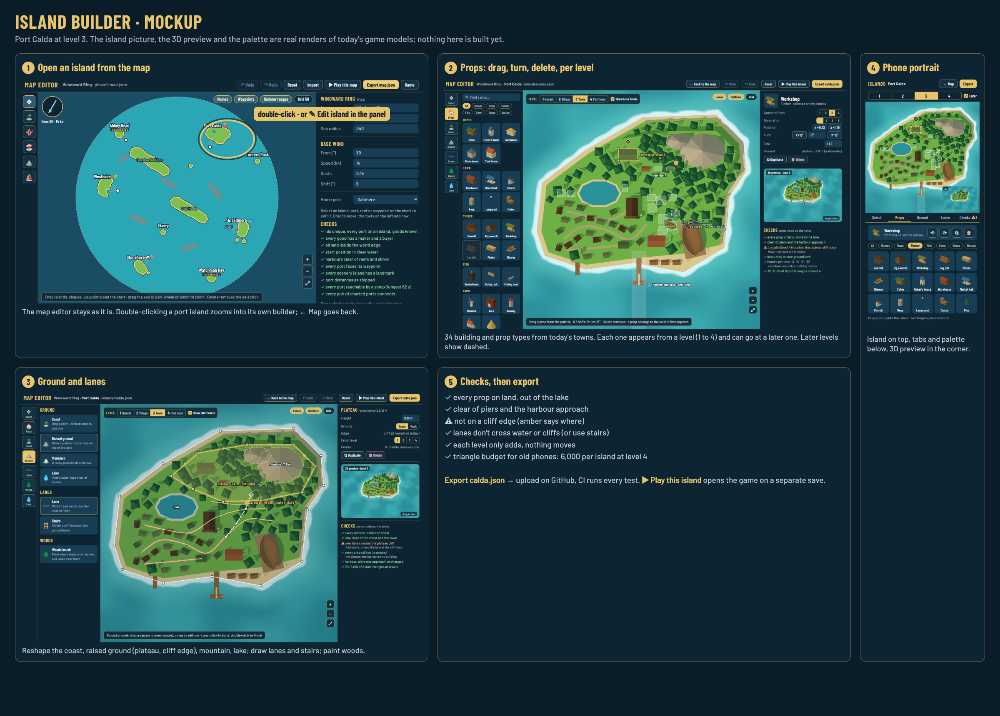
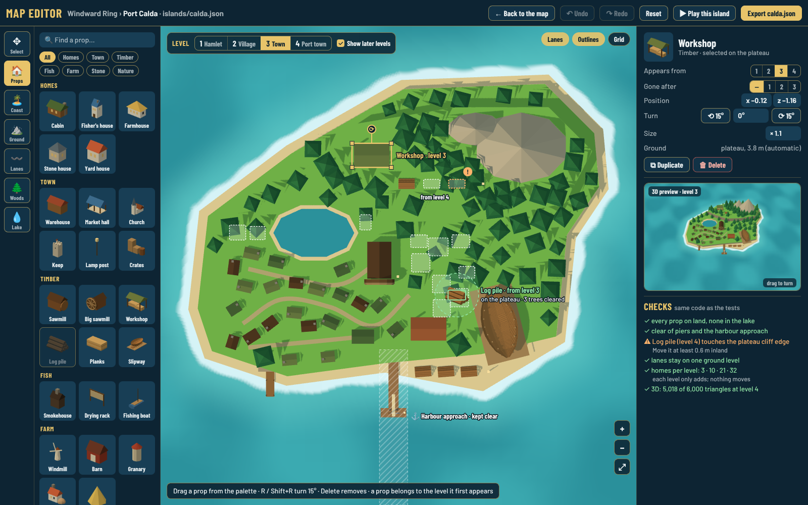
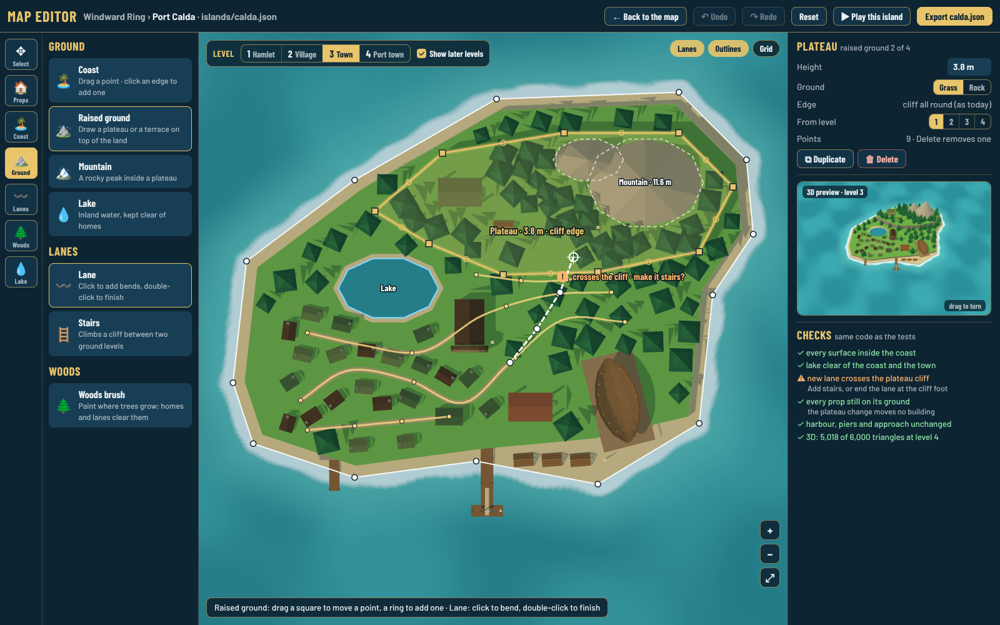
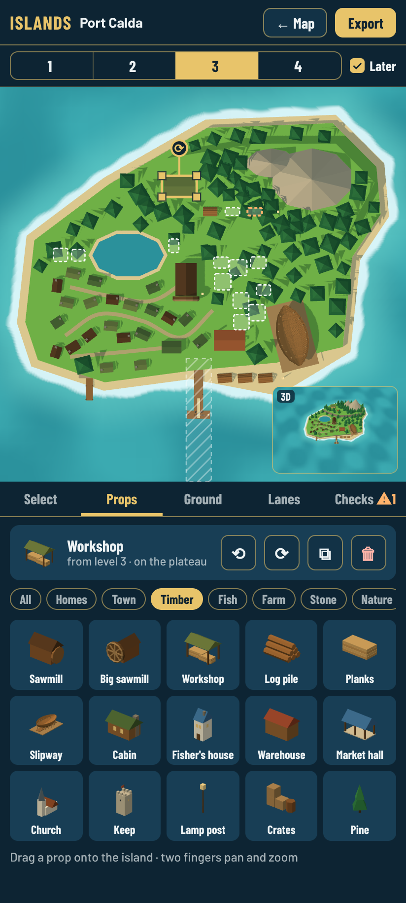

# Island builder: mockup and plan

*Decision [0096](../decisions/0096-island-files-and-island-builder.md), accepted: Guillaume approved this mockup on 2026-10-23. Step 2, the island files, is built ([0101](../decisions/0101-island-files-built.md)); step 3, the builder, has its first part ([0105](../decisions/0105-island-builder-props.md), [how to use](builder/README.md)). This page is the mockup and the plan.*

## The mockup

All pictures show **Port Calda at level 3**. The island picture and the 3D preview are real renders of the game's models (`models.html`, top-down), the palette tiles are the real prop models, and the homes, lanes, ground outlines and later-level ghosts come from the game's own layout code. Source: [`mockup/island-builder.html`](mockup/island-builder.html) (`?view=props`, `?view=terrain`, `?view=portrait`) and [`mockup/overview.html`](mockup/overview.html), served by `npm run dev`.

### 1. Open an island from the map

Double-click a port island in the map editor, or **✎ Edit island** in its panel. **← Back to the map** returns. The map editor itself does not change.

### 2. Props

- Palette on the left: 34 types in groups (homes, town, timber, fish, farm, stone, nature, landmarks), with search. Drag one onto the island: the footprint shows green where it fits and says which trees it clears.
- Select a prop to drag it, turn it with the handle (or R / Shift+R, or the 15° buttons), size it, duplicate or delete it.
- **Level switch** at the top: the island at level 1 Hamlet, 2 Village, 3 Town or 4 Port town. A prop belongs to the level it first appears (*Appears from*), and can go at a later one (*Gone after*, for a sawmill replaced by the big sawmill). With **Show later levels**, what later levels add shows dashed.
- The hatched lane under the main pier is the harbour approach: nothing may be placed there.
- Right: the selection, a small 3D preview at the game's camera angle (drag to turn), and the checks.

### 3. Ground and lanes

- **Coast**: drag points, click an edge to add one (as for reefs in the map editor).
- **Raised ground**: plateaus and terraces with a height and grass or rock; each edge is a cliff, as in the game today, or a **slope** (a ramp of the width you choose, asked for after the mockup; decision 0096 §4). **Mountain**: a rock peak. **Lake**.
- **Lanes**: click to add bends, double-click to finish. Lanes follow the ground, so they climb slopes. A lane that crosses a cliff is flagged: make it **stairs** (Stonehaven has two flights) or end it at the cliff foot. Lanes still appear piece by piece near the homes that exist at each level.
- **Woods**: paint where trees may grow; homes, lanes and fields clear them as the town grows.

### 4. Phone portrait

The island on top with the level switch above it, the 3D preview in a corner, tabs (Select, Props, Ground, Lanes, Checks) and the palette below. Two fingers pan and zoom.

### 5. Checks and export

The checks are code shared with the tests (`src/sim/islandChecks.ts`, see 0096 §2): props on land and out of the lake, boats in water, nothing in the harbour approach or on piers, nothing on a cliff edge, buildings not overlapping, lanes not crossing water or cliffs, each level only adding, and at most **6,000 triangles per island at level 4** for old phones (Calda today: 5,018). **▶ Play this island** opens the game on the edited map's own save; **Export calda.json** downloads the file to upload to `src/data/islands/` on GitHub, where CI runs every test.

## The plan after approval

Two steps, one after the other.

### Step 2: Island files

**Done ([0101](../decisions/0101-island-files-built.md), PR #78):** the four port islands are built from `src/data/islands/*.json`, proven identical; format and checks in [files](files/README.md).

Move the four port islands out of the code, with **no visible change**.

1. Prop catalogue `src/render/models/props.ts`: each type id (`cabin`, `log-pile`, `big-sawmill`…) maps to today's model function in `towns.ts`, with its footprint.
2. Island file types and loader (`src/data/islands.ts`), `look.design` in the map, `islandLayout` reading coasts, lake and ground from the file.
3. A one-off bake script (`tools/bake-islands.ts`) runs today's code (house plan, fields, every `placeAt` and `put`, piers, moorings, stairs and paths) and writes `calda.json`, `saltmere.json`, `westholm.json` and `south-cay.json`, so the numbers are exact rather than copied by hand.
4. One generic island builder replaces the four per-kind branches and `characterTownPlan` in `towns.ts`.
5. **Proof that nothing changed**, committed before the old code is removed: for every port and level 1 to 4, the merged geometry (positions and colours) from the files equals the old code's (a hash per island and level kept as a golden test), and the coasts, lake, piers and moorings used for collision and docking are equal. Every existing test keeps passing unchanged. Model-sheet pictures before and after in the PR.
6. `src/sim/islandChecks.ts` and `tests/island-files.test.ts`: every check of 0096 §2 on the shipped files and on broken copies.

About one pull request. Risk: small floating-point or ordering differences in the bake; the geometry hash test catches them.

### Step 3: Island builder UI

**Part 1 built ([0105](../decisions/0105-island-builder-props.md), [how to use](builder/README.md)):** island view, props, levels, 3D preview, checks, play and export. Part 2 (ground, slopes, lanes, woods) next.

In `editor.html`, under `src/editor/island/`, following this mockup:

1. Island view: double-click to open; live top-down render (three.js, orthographic) with an SVG overlay; level switch with later-level ghosts; pan, zoom, fit.
2. Props: palette with thumbnails rendered from the catalogue at load, drag and drop (mouse and touch), select, move, turn, size, duplicate, delete, *Appears from* and *Gone after*; undo and redo.
3. Ground, lanes and woods tools, including sloped edges and lanes that climb them (0096 §4): height on a slope interpolates; small props may stand on a slope, buildings not.
4. 3D preview at the game camera's angle; live checks with marks on the island.
5. Play this island (the edited map's separate save now carries edited islands too) and Export `<id>.json` in Prettier format, round-trip tested like the map file.
6. Landscape and portrait layouts; docs in this folder with screenshots of the real thing.

Probably two pull requests: props, levels, preview, checks and export first; ground, lanes and woods second.

### Later

- **Convert to editable island** for the yard ports (Abbey Head, Watchman Key) and the scenery islands, which keep their generated look until then.
- **New island** from a blank template or a copy of an existing one, so a new port is a file plus a map entry.
