# Island builder

*Step 3 of [0096](../../decisions/0096-island-files-and-island-builder.md). Part 1, [0105](../../decisions/0105-island-builder-props.md): props, levels, 3D preview, checks, play and export. Part 2, [0106](../../decisions/0106-island-builder-ground-lanes-woods.md): ground with cliffs or slopes, lanes and woods.*

Open the map editor (`editor.html`, or `npm run dev` then `/editor.html`) and **double-click any island**, or select it and press **✎ Edit island**. An island or ridge without a file (one you just added, say) first gets one made from how it is drawn ([0110](../../decisions/0110-every-island-has-a-file.md)); export it with the map, both files are needed. An island without a dock has no levels and no harbour. The palette on the left has three modes: **Props**, **Ground** and **Lanes**.

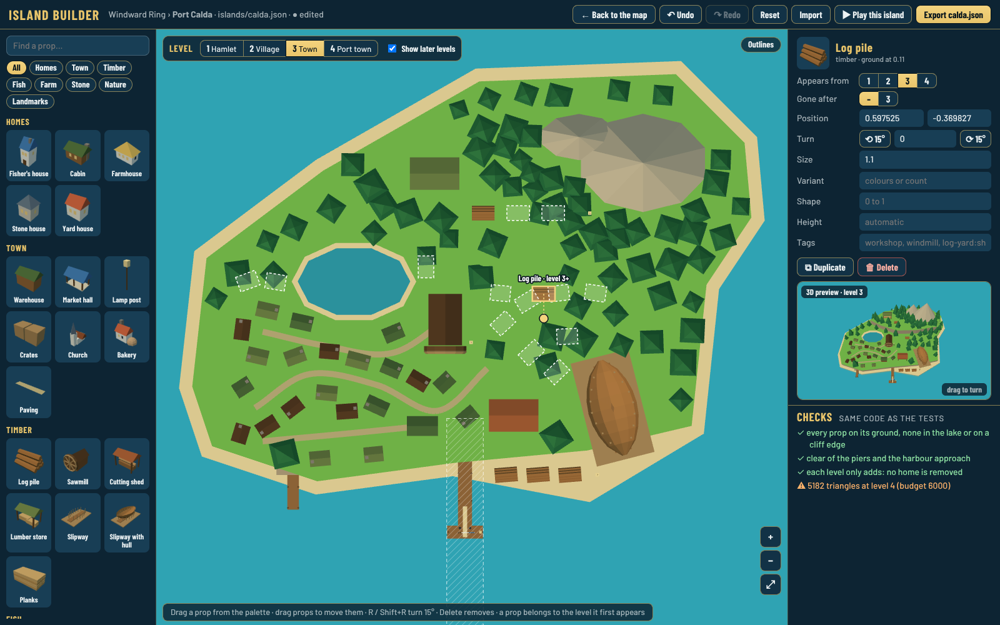

## Props

- **Add:** drag a tile from the palette onto the island. The outline shows green where it fits and red where it does not. On a phone or tablet, tap the tile, then tap the island. A new prop belongs to the level you are looking at.
- **Select:** click it. **Move:** drag it. **Turn:** drag the round handle (Shift snaps to 15°), or R / Shift+R, or the ⟲ ⟳ buttons. **Nudge:** arrow keys (Shift for bigger steps).
- **Duplicate:** Ctrl+D or ⧉. **Delete:** Delete key or 🗑.
- The panel sets *Appears from* and *Gone after* (a sawmill replaced by a bigger one at level 3 is two props: one 1 to 2, one from 3), position, size, colours (*Variant*), *Shape* (a fish house's height, a cabin's length), a fixed height and the game *tags* (`workshop`, `windmill`, `log-yard:shore`, `outbuilding`). Homes count as residences in file order.
- The hatched lane under the main pier is the harbour approach: keep it clear.

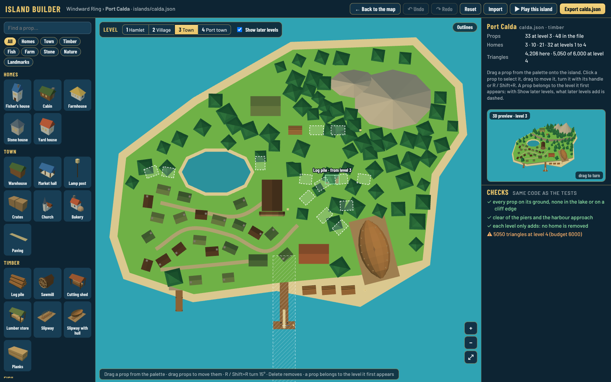

## Ground and slopes

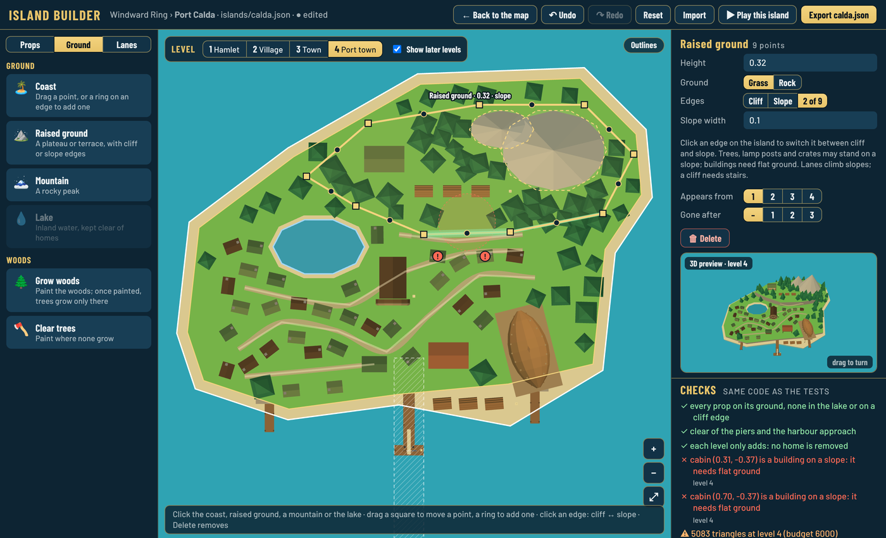

In **Ground** mode the outlines of the coast, raised ground, mountains and the lake are drawn over the island. Click one to select it.

- **Reshape:** drag a square to move a point; drag the small ring in an edge to add one; Delete removes the selected point.
- **Add:** **Raised ground** (a plateau 0.2 above the ground you click), **Mountain** (a rock peak), **Lake** (one per island). It appears from the level on show.
- **Panel:** height, grass or rock, *Appears from* / *Gone after*, a peak's base, and **Edges: Cliff / Slope**.
- **Slopes:** with raised ground selected, **click an edge** to switch it between cliff and slope (green on the island). *Slope width* is how far the ramp runs out, down to the ground below. Trees, lamp posts, crates and other small props may stand on a slope; **buildings need flat ground** (a red check). The 3D preview shows the ramp.

### Ramps

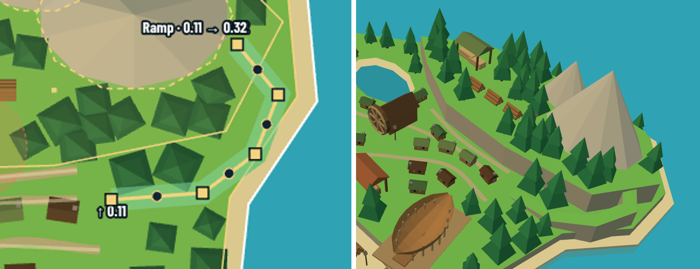

A slope only runs straight out from an edge. To climb **along** a path, for example round a plateau, use **↗️ Ramp** ([0123](../../decisions/0123-island-builder-ramps.md)):

1. In **Ground** mode press **Ramp**.
2. Click the **foot** (on the lower ground), then any **bends**, then the **top** (on the higher ground). Click the top again or press **Enter**.
3. It starts at the ground's height at the foot and ends at the ground's height at the top. Change *Start height*, *End height* and *Width* in the panel. Example: start 0.05, end 0.27.
4. Drag a square to move a point, the ring in a run to add a bend. Lanes and paths climb it, trees may stand on it, buildings need flat ground.

## Lanes, paths and stairs

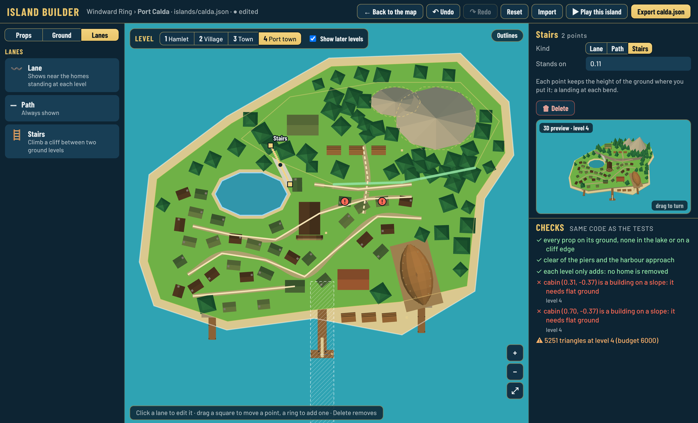

In **Lanes** mode pick **Lane** (shows near the homes standing at each level), **Path** (always shown) or **Stairs**, click the island for each bend, then click the last point again or press **Enter**. Esc cancels. Lanes and paths follow the ground: they **climb slopes**, and a piece that crosses a **cliff** is not drawn (an amber check): put stairs there. Stairs take the ground's height at each point. Click a lane to move its points or change its kind.

## Woods

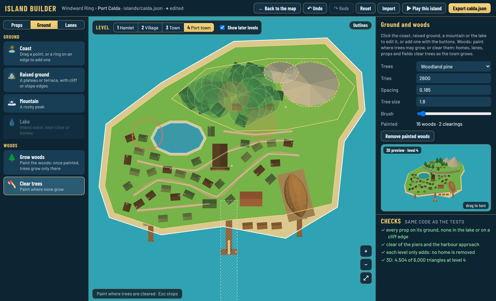

In **Ground** mode with nothing selected, the panel sets the tree, how many tries, the spacing and the tree size. **Grow woods** paints where trees grow; once you have painted some, trees grow only there. **Clear trees** paints where none grow. The brush size is in the panel; each tool rubs out the other. **Remove painted woods** goes back to trees anywhere. Homes, lanes, props and fields still clear trees as the town grows.

## Build spots

**Spots** mode ([0128](../../decisions/0128-build-spots-on-any-island.md)) edits where the captain builds on a home island (Skerry today, more islands in extensions). Any island whose file has spots can be the captain's.

- Drag a spot to move it, **+ Add a spot** adds one, **Delete spot** (or Delete) removes it.
- **Kind**: an arc spot of a pair (a finished arc offers that pair's two buildings there, free) or a spare spot (a building passed over comes back there, for gold). Pairs and buildings are in `src/data/buildings.json`.
- **Show**: *Everything* draws every building at once (as the file has them, to edit them); *First look* draws the island as the captain first finds it; *As chosen* draws the buildings you pick per spot. The checks run on the island as shown.
- Buildings and run-down props are ordinary props (Props mode) with tags: `home:<building>` at the building's arc spot (moved as is to a spare spot), `home-empty:<spot>` for what goes when that spot is built.

| Everything | First look | As chosen |
|---|---|---|
| 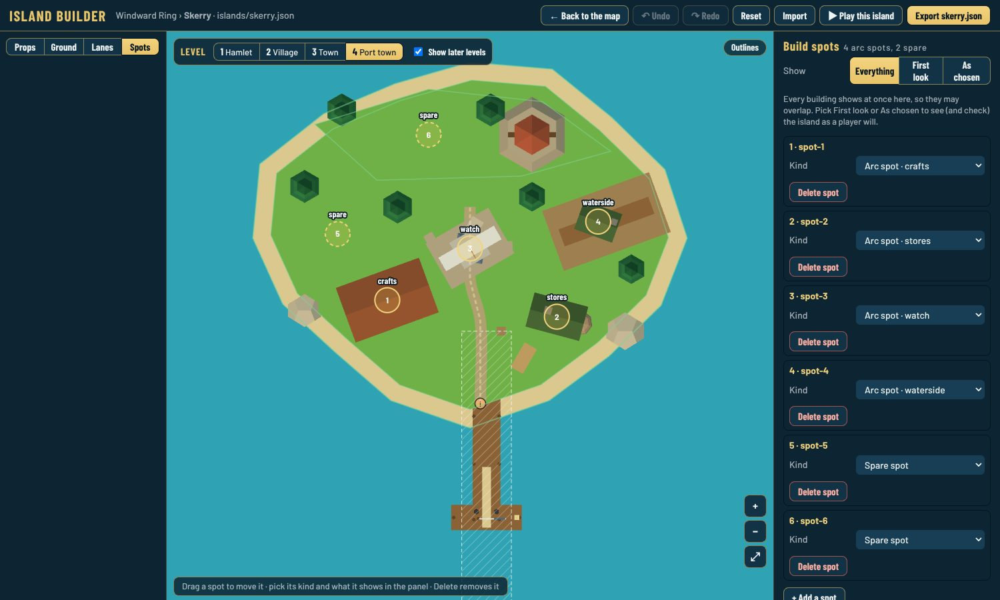 | 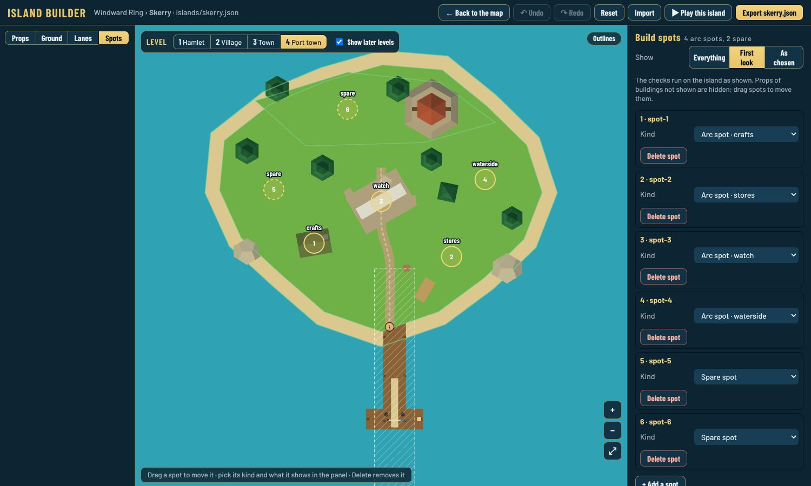 | 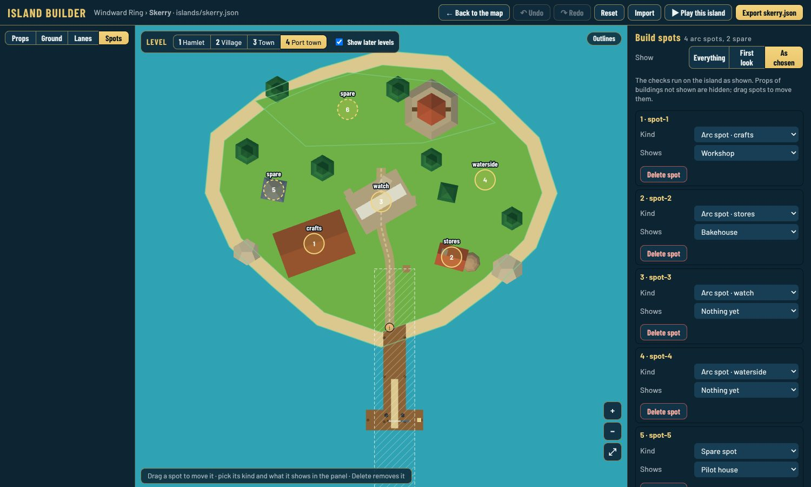 |

## Levels

**1 Hamlet · 2 Village · 3 Town · 4 Port town** (or keys 1 to 4) show the island at that level. With **Show later levels**, what later levels add is dashed; click a dashed outline to select it.

## 3D preview and checks

The preview on the right is the island at the game's camera angle: drag it to turn. **⤢** opens a bigger view: drag across to turn, up and down to tilt, wheel or pinch to zoom, **⟲** back to the game's angle, **✕** or Esc to close. **☾ Night** shows the island in the game's moonlight with its windows lit ([0119](../../decisions/0119-island-builder-preview-big-and-night.md)).

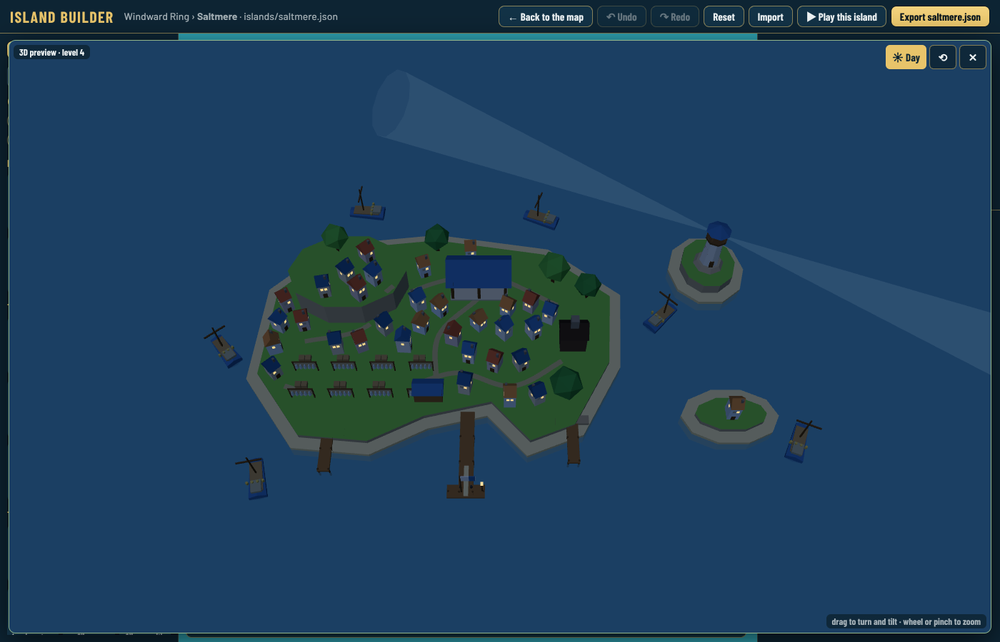

 The checks are the same code as the test suite (`src/sim/islandChecks.ts`): props on land and out of the lake, boats in the water, nothing in the harbour approach or on a pier, nothing on a cliff edge, buildings not overlapping, each level only adding, no building on a slope, lanes and paths not crossing water or a cliff, and at most 6,000 triangles at level 4. Click a result to select the prop and go to its level; red and amber marks show where on the island.

## Play and export

- **▶ Play this island** opens the game with your edited islands (and your edited map, if any) on a separate save, as for the map editor. Your edits stay in this browser.
- **Export calda.json** downloads the file. Upload it to `src/data/islands/` on GitHub (a pull request): CI runs every test. The golden hash test in `tests/island-files.test.ts` fails on purpose because the island changed: look at it, then paste the new hashes it prints.
- **Import** loads an island file; **Reset** goes back to the shipped island; **Undo / Redo** (Ctrl+Z, Ctrl+Shift+Z).

## Phone portrait

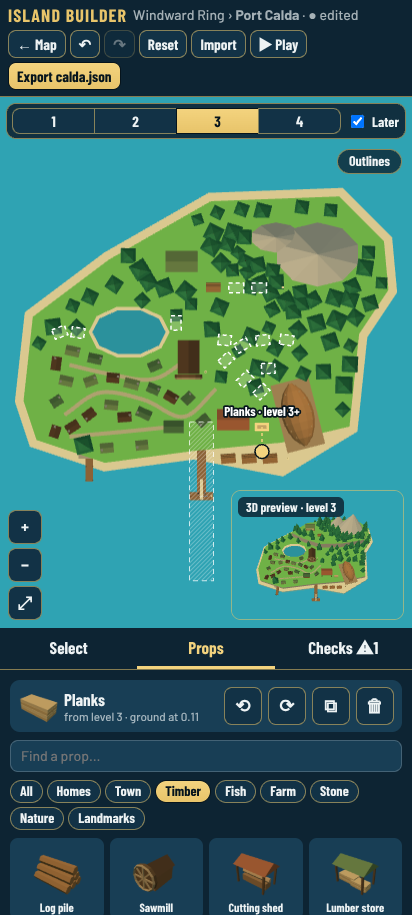 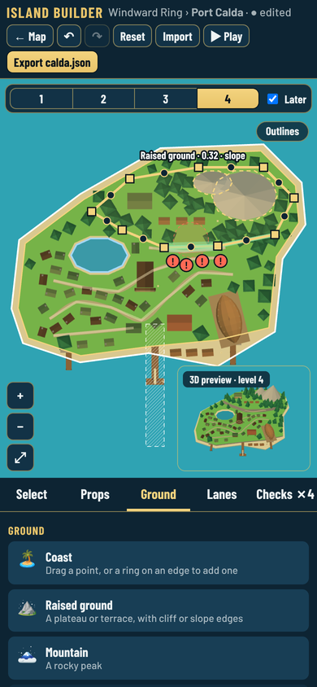

The island on top with the preview in its corner, then tabs: **Select** (the panel), **Props** (the palette, with the selected prop's quick actions on top), **Ground**, **Lanes** and **Checks**. Two fingers pan and zoom.

## Code

`src/editor/island/`: `doc.ts` and `shapes.ts` (the edits, tested in `tests/island-builder.test.ts`), `shapePanel.ts` (ground, lanes, woods), `scene.ts` (top view, preview, thumbnails), `overlay.ts` (SVG), `panel.ts`, `builder.ts`, `checks.worker.ts`, `island.css`. Export uses `formatIslandJson` in `src/editor/model.ts`; play-test loading is in `src/data/editedMap.ts`.
