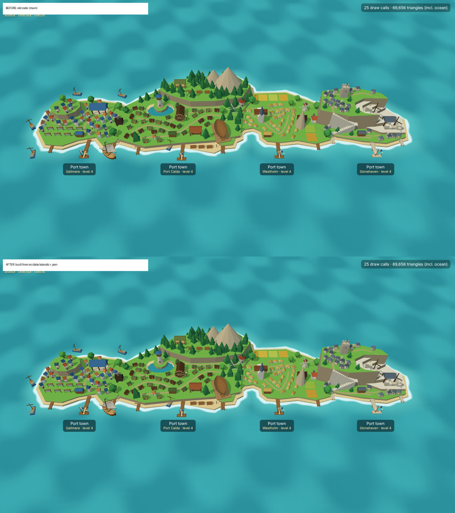

# Island files

*Decision [0101](../../decisions/0101-island-files-built.md), step 2 of [0096](../../decisions/0096-island-files-and-island-builder.md). The four port islands are built from `src/data/islands/<id>.json`; the game looks the same as before.*

Top: the model sheet (`models.html?view=towns&kind=all&level=4&still`) from the old code; bottom: the same from the files. Same triangle count; 2 to 7 pixels out of 1.4 million differ, at edges, because parts are drawn in a slightly different order. One island close up: [before-after-focus1-level4.png](before-after-focus1-level4.png).

The files were baked once from the old code by `tools/bake-islands`, and a test matched every part the old code drew for the four ports at levels 1 to 4; both, with a copy of the old code, are in commit cc1fd8a of PR #78 and were removed after it passed.

## Where things are

| What | Where |
|---|---|
| The files | One per island: the ports `calda.json`, `saltmere.json`, `westholm.json`, `south-cay.json` (Stonehaven), and since [0110](../../decisions/0110-every-island-has-a-file.md) the scenery islands `skerry`, `bell-rock`, `lantern-rock`, `abbey-head`, `watchman-key` and the ridges `greyback-ridge`, `gull-hook`. Reefs and sandbanks stay outlines in the map file |
| Map entry | `"look": { "design": "calda", … }` in `src/data/phase1-map.json`; position, radius and harbour bearing stay in the map |
| Types and loader | `src/data/islands.ts` |
| Prop catalogue (models, ids, footprints) | `src/render/models/props.ts`, `PROP_TYPES` |
| The builder | `designedTownParts` in `src/render/models/towns.ts` |
| Ground for collision, docking, chart, water | `islandLayout`, `characterPiers`, `islandMoorings` in `src/sim/islandLayout.ts` |
| Checks | `src/sim/islandChecks.ts`, run by `tests/island-files.test.ts` |

## The format

Coordinates are **island-radius units**, harbour toward +z, x to the right seen from the sea; heights (`height`, `y`, `base`) are radius units too, so a file scales with the radius in the map. Levels are 1 Hamlet, 2 Village, 3 Town, 4 Port town; `from` is the first level something stands at and `to` (left out: to the end) the last.

- **Harbour:** an island has its arrival pier, flag, landing, side piers and harbour approach only when its map entry has `look.dock`; without one it is always drawn at level 4 ([0110](../../decisions/0110-every-island-has-a-file.md)).
- `style`: `fish`, `timber`, `grain` or `stone` (house colours, rock colour, the stone pier).
- `seed`: seeds the woods.
- `coasts`: the main island first, then islets. They are the collision shore.
- `lake`: optional inland water.
- `ground`: raised ground, every edge a cliff unless it slopes. `"coast": 0` is that coast's ground inside the sandy beach; otherwise an `outline`. `height`, `material` (`grass` or `rock`), optional `holes`, `from`/`to`, and `"shape": "peak"` with `base` for a rock cone. `slope` (a ramp's width, outward from the outline, down to the ground below) with optional `slopeEdges` (runs `[first, last]` of edge indices, edge *i* from point *i* to *i + 1*; left out, every edge slopes): [0106](../../decisions/0106-island-builder-ground-lanes-woods.md).
- `lanes`: plain lanes (points `[x, z]`, smoothed; a piece shows when a standing home is near and it stays on one ground level or climbs a slope), `"kind": "path"` (always shown, at `y`, or along the ground when there is no `y`) and `"kind": "stairs"` (points `[x, z, height]`, masonry down to `base`, a landing at each bend).
- `piers`: side piers `{ x, z, length, from }`. The arrival pier is the simulation's and is not in the file.
- `props`: `{ type, x, z, turn, size, variant, shape, from, to, y, fit, clear, tags }`.
  - `turn` in degrees; `size` scales the model (landmarks take it as their own size).
  - `variant`: a house's colours (and every third stone house's tower), how many crates or blocks, a field's crop.
  - `shape` (0 to 1): what the old code drew at random, a fish house's height or a cabin's length.
  - No `y`: the prop stands on the ground under it, else on the sand, else in the sea.
  - `fit`: the footprint radius the checks use, when it is not the model's own. `clear`: how far round it trees are cleared (default: its footprint plus 0.1; `0` clears nothing).
  - `tags`: `workshop` (the level-3 industry the game shows when production unlocks), `windmill`, `log-yard:shore` / `log-yard:upland`, `outbuilding` (a house that is not a residence).
  - Homes are the home types (`fish-house`, `cabin`, `farmhouse`, `stone-house`, `yard-house`); their order in the file is the residence order.
- `woods`: the seeded scatter: `tree` (`woodland-pine`, `woodland-fir`, `woodland-broadleaf`), `tries`, `area` `[x0, z0, x1, z1]`, `size`, `margin` (from cliffs, beach and lake), `spacing` and `spacingAt` (`[height, spacing]`), `clear` circles `[x, z, r]`, and optional painted `areas` circles `[x, z, r]` (trees then grow only inside them). Homes, lanes, props and fields clear trees as the town grows.

## Prop types

42 ids in `PROP_TYPES`:

- **Homes:** `fish-house`, `cabin`, `farmhouse`, `stone-house`, `yard-house`
- **Town:** `warehouse`, `market-hall`, `lamp-post`, `crates`, `spire-church`, `bakery`, `paving`
- **Timber:** `log-pile`, `sawmill`, `cutting-shed`, `lumber-store`, `slipway`, `slipway-hull`, `lumber`
- **Fish:** `drying-rack`, `smokehouse`, `moored-boat` (in the sea, solid to the ship)
- **Farm:** `field`, `windmill`, `barn`, `granary`, `haystack`
- **Stone:** `masons`, `derrick`, `stone-blocks`, `rail`, `keep`
- **Nature:** `pine`, `broadleaf`, `boulder`, `woodland-pine`, `woodland-fir`, `woodland-broadleaf`
- **Landmarks:** `lighthouse`, `ruins`, `beacon`, `wreck`

## Checks

`checkIsland` (0096 §2) gives errors (✗) and warnings (⚠): unknown types, kinds or levels ✗; a land prop off the island, in the lake or on a cliff edge (on the sand only its centre counts; slipways, rails and paving may overhang) ✗; a moored boat ashore ✗; a prop in the arrival lane or on a side pier over the water ✗; ground or lake past the coast ✗; a home removed ✗, another prop removed with nothing in its place ⚠; buildings overlapping ⚠; lane pieces over water or a cliff ⚠ (not drawn); more than 6,000 triangles at level 4 ✗, more than 5,000 ⚠. Today the shipped files have no errors; the warnings are lane pieces the lanes never drew (Saltmere, Stonehaven) and Calda's 5,050 triangles.

## Editing a file by hand

Change the JSON, run `npm test`: the checks say what is wrong, and the golden hash test in `tests/island-files.test.ts` fails because the island changed; look at it in `npm run dev` → `models.html?view=towns&kind=all&level=4`, then paste the new hashes the test prints.
