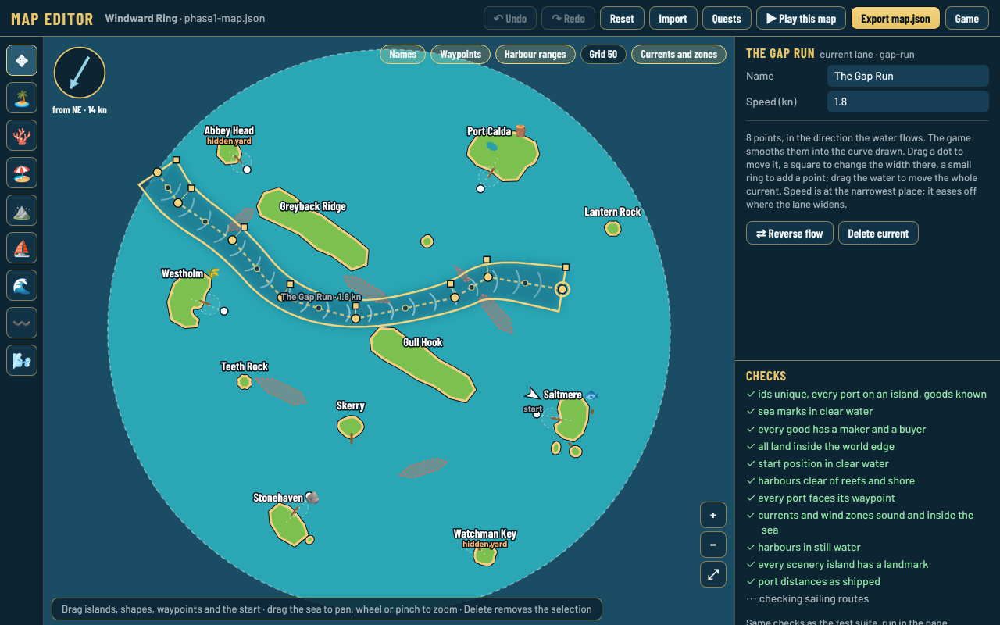
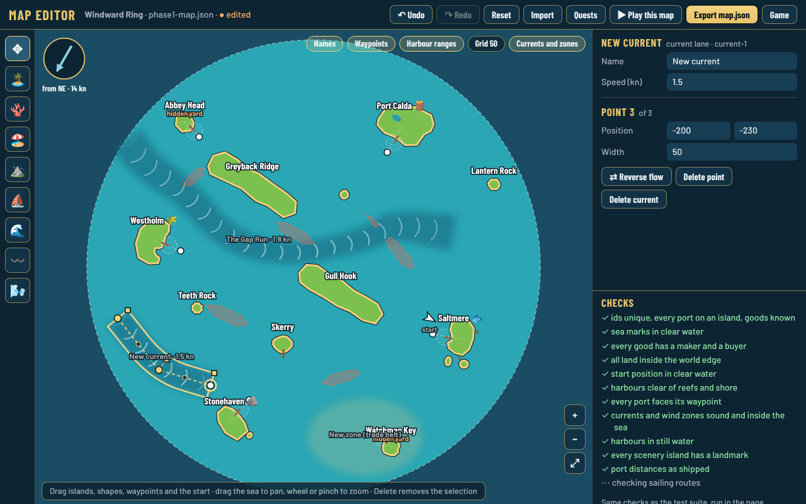
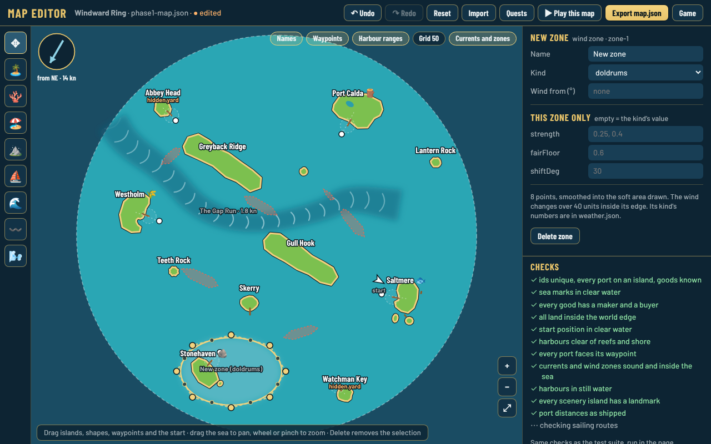

# Map editor

*Decision [0095](../decisions/0095-map-editor.md), step 3 of [0093](../decisions/0093-data-driven-content-and-authoring-tools.md).*

Open **<https://djguiaume.github.io/fair-winds-trading/editor.html>** (or `/editor.html` under `npm run dev`). It edits `src/data/phase1-map.json`, the Windward Ring, or with **Phase 4 sea** picked in the top bar the whole grown sea and its sea files ([below](#the-phase-4-sea-sea-editor)).

## Editing

- **Move**: drag an island (its harbour waypoint follows), a reef, sandbank or barrier island, a white waypoint dot or the start boat. Drag the sea to pan; mouse wheel, pinch or the + / − buttons zoom, ⤢ fits the map.
- **Resize an island**: drag one of the four square handles round a selected island.
- **Reshape a coastline**: select a reef, sandbank or barrier island; drag a dot to move a point, drag a small ring on an edge to add one, **Delete** removes the selected point (three stay at least).
- **Add**: the tools on the left add a small island, a reef, a sandbank or a barrier island where you click, or move the start. A new island becomes a port with **⚓ Make it a port** in the panel.
- **Edit what is on an island**: double-click any island or ridge (or **✎ Edit island** in its panel) to open the [island builder](../island-builder/builder/README.md). One without a file gets one made first ([0110](../decisions/0110-every-island-has-a-file.md)); commit both `phase1-map.json` and its `islands/<id>.json`.
- **Edit the quests**: **Quests** in the top bar opens the [quest builder](../quest-builder/builder/README.md) ([0142](../decisions/0142-quest-builder.md)): steps, places on the chart, card and text in English and French, the story of every quest, checks and export.
- **Map size**: click the sea and change **Sea radius** in the panel.
- **Panel**: everything about the selection. For a port: name, start level, what it makes and wants, what it makes and wants from levels 2, 3 and 4, specialities it buys, ships its yard builds, hidden, home port. Click the sea (or the wind compass) for the map itself: name, sea radius, base wind, home port.
- **Keys**: Delete, arrows nudge 1 unit (Shift: 10), Ctrl+Z / Ctrl+Shift+Z, Escape.
- A dashed outline shows where a moved island or shape was in the shipped map.

A port's harbour and pier face the waypoint that has **exactly the island's name**. Renaming an island in the panel renames its waypoint too.

## The Phase 4 sea (sea editor)

*Decision [0161](../decisions/0161-sea-editor-every-sea-file-in-the-map-editor.md).* Pick **Phase 4 sea** in the top bar (or open **[editor.html?sea=phase4](https://djguiaume.github.io/fair-winds-trading/editor.html?sea=phase4)**): the Windward Ring and every sea file in `src/data/seas/` as one map, the one `?map=phase4` sails. The dashed circle is the ring's own edge.

- **Every thing knows its file.** Select an island, reef, mark, current, zone or chart area: **Sea file** says where it is saved (`phase1-map.json` or `seas/<sea>.json`) and moves it to another file. An island takes its port and harbour waypoint along.
- **New things go into** the sea picked in the sea panel (click the sea to see it). Chart areas never go into the ring, which is charted from the start.
- **＋ New sea** makes an empty sea file, listed last in `seas/grown.json` (`"seas"`, the order they open). No code: the game, `npm run check`, `chart` and `shots --sea phase4` pick it up.
- **Sea radius** and **Charted radius** are in `grown.json`; each sea's name in its file; the ring's wind, start and home port stay in `phase1-map.json`.
- **Tools** added for the seas, and usable on the ring too: 🫧 shallows (with **Max draft**), 🛟 sea marks (red and green buoys, the four cardinals, lights, fishing boats, pilot cutters, with a name, a turn and **On the chart**), 🗺️ chart areas (fog of war, [0156](../decisions/0156-fog-of-war.md); Phase 4 sea only). A port has **Founding site** ([0157](../decisions/0157-founding-an-outpost.md)).
- **▶ Play this sea** sails the edited grown sea on its own save, with your edited islands and quests.
- **Export files** lists every file, changed or same, with a download for each changed one; each is written exactly like the repository's file, so only your edits show in the diff. **Import** takes a sea file (or `phase1-map.json`) and replaces that file's things.

From the command line, `npm run sea` makes the same edits with the editor's code ([CLAUDE.md](../../CLAUDE.md)).

## Currents and wind zones

*Decisions [0140](../decisions/0140-wind-zones-and-currents.md) and [0145](../decisions/0145-building-currents.md).* They are stored in the map file as `currents` and `windZones`; the numbers each kind applies are in `src/data/tuning/weather.json`.

- **🌊 Add current**: click to lay the points in the direction the water flows, then double-click (or Enter) to finish. The game smooths the points into the curve drawn here, with the same code.
- **Edit a current**: select it (click its water). Drag a dot to move a point, a **square** to change the width there, a small ring to add a point, the water to move it all. **Reverse flow** turns it round. Its speed is at the narrowest place and eases off where it widens, at its ends, its sides and near any shore.
- **〰️ Add area current**: an area of drifting water with a direction, "Flows toward (°)".
- **🌬️ Add wind zone**: an area you reshape like a reef, a **Kind** (trade belt, doldrums, stormy coast, cold gale, sheltered), "Wind from (°)" for the kinds that turn the wind, and **This zone only** to change one of the kind's numbers for this zone.
- Currents show as the darker band with crests drifting downstream, zones as soft tinted areas. **Currents and zones** in the layer list hides them.
- The checks add: ids unique, known kinds, lanes at least 20 units wide, speeds 0.5 to 2.5 kn, no outline crossing itself, all inside the sea, and still water at every harbour.

## Checks

The panel's checks are the code the test suite runs (`src/sim/mapChecks.ts`). Quick ones update on every edit; the sailing routes (a sloop reaches every port from the start in the base wind and against it, every pair of ports connects, the deepest ship gets round any shallows) run in the background: under a second on the ring, about 6 s on the Phase 4 sea.

- ✓ green: fine. ⚠ amber: worth a look (for example a port distance changed by more than 5 %, so trade timings and prices change). ✗ red: the game or the tests would break.
- Some tests are about the Windward Ring itself (four ports in four quarters, the Saltmere–Westholm block, the eastern lane, a measured circuit). They only run in CI, so a big rework can pass the editor and still fail there; the PR says which test.

## Play it, then commit it

1. **▶ Play this map** opens the game on your edited map in a new tab. That voyage has its own save: your real voyage is never touched. A small "Edited map · back to editor" link sits at the bottom. It also sails with the quests and text edited in the quest builder, whose **▶ Play from step…** starts a quest at any step ([how to](../quest-builder/builder/README.md#play-from-a-step)).
2. Your edits stay in this browser (reloading the editor keeps them). **Reset** goes back to the shipped map, **Import** opens a map file.
3. **Export map.json** downloads `phase1-map.json`, formatted exactly like the repository's file. On GitHub, open `src/data/`, *Add file › Upload files*, drop it, commit to a new branch and open a pull request: CI runs every test. Or drop the file in the chat.

In portrait the panel goes under the chart:

