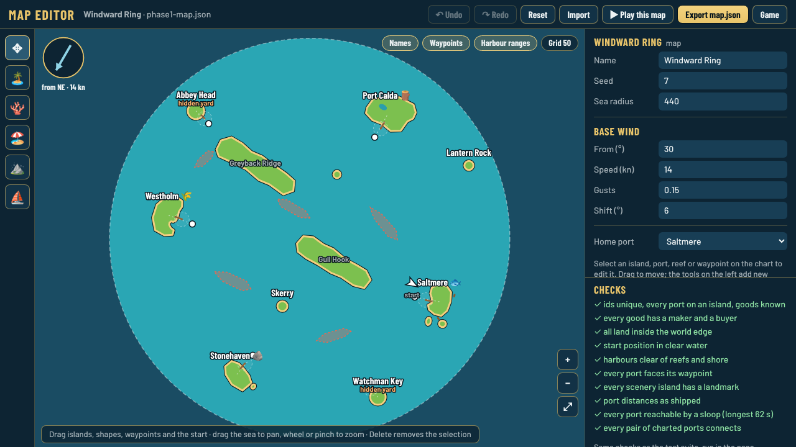
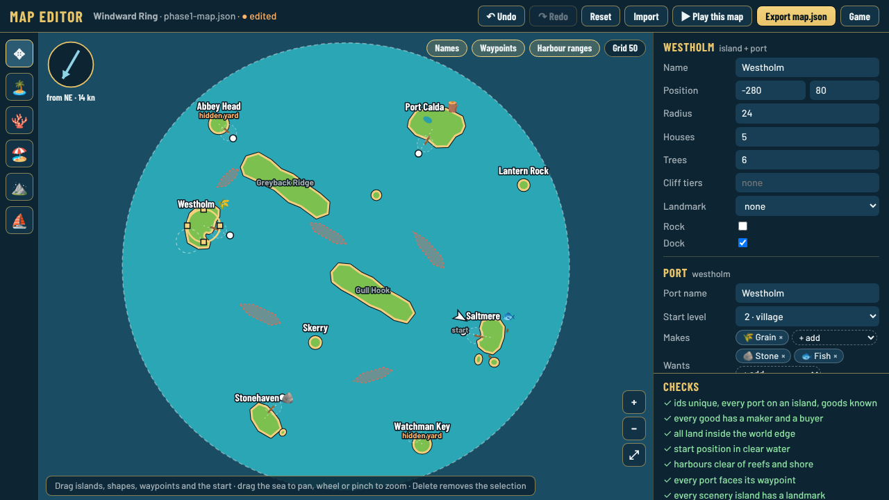
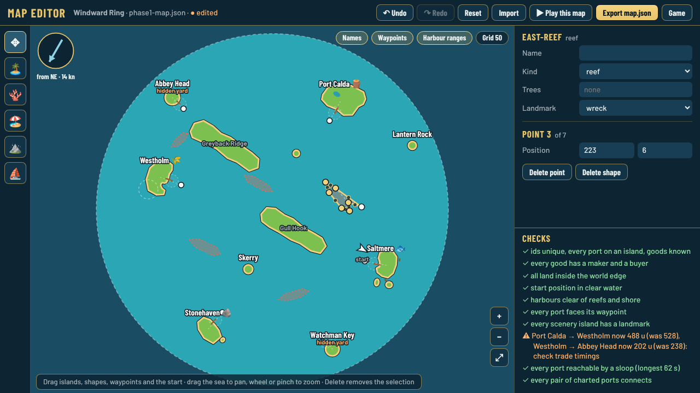
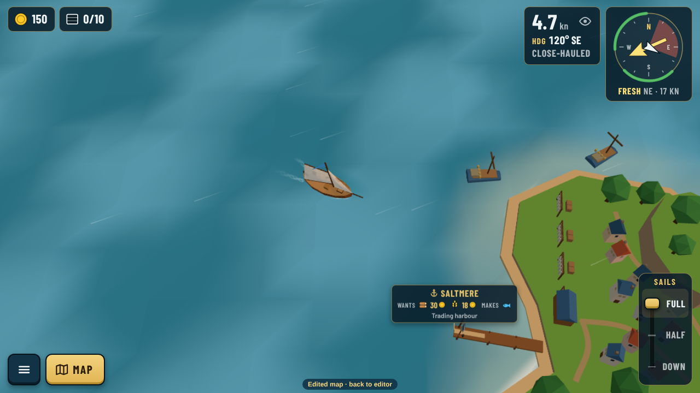
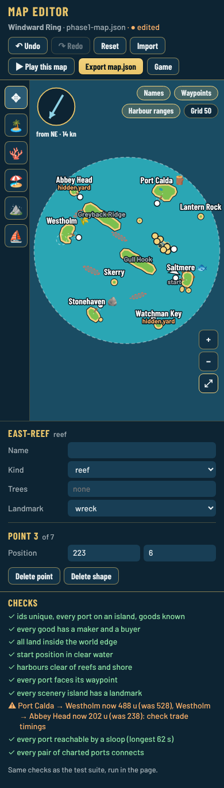

# Map editor

*Decision [0095](../decisions/0095-map-editor.md), step 3 of [0093](../decisions/0093-data-driven-content-and-authoring-tools.md).*

Open **<https://djguiaume.github.io/fair-winds-trading/editor.html>** (or `/editor.html` under `npm run dev`). It edits `src/data/phase1-map.json`, the Windward Ring.

## Editing

- **Move**: drag an island (its harbour waypoint follows), a reef, sandbank or barrier island, a white waypoint dot or the start boat. Drag the sea to pan; mouse wheel, pinch or the + / − buttons zoom, ⤢ fits the map.
- **Resize an island**: drag one of the four square handles round a selected island.
- **Reshape a coastline**: select a reef, sandbank or barrier island; drag a dot to move a point, drag a small ring on an edge to add one, **Delete** removes the selected point (three stay at least).
- **Add**: the tools on the left add a small island, a reef, a sandbank or a barrier island where you click, or move the start. A new island becomes a port with **⚓ Make it a port** in the panel.
- **Edit what is on an island**: double-click any island or ridge (or **✎ Edit island** in its panel) to open the [island builder](../island-builder/builder/README.md). One without a file gets one made first ([0110](../decisions/0110-every-island-has-a-file.md)); commit both `phase1-map.json` and its `islands/<id>.json`.
- **Edit the quests**: **Quests** in the top bar opens the [quest builder](../quest-builder/builder/README.md) ([0142](../decisions/0142-quest-builder.md)): steps, places on the chart, card and text in English and French, the story of every quest, checks and export.
- **Map size**: click the sea and change **Sea radius** in the panel.
- **Panel**: everything about the selection. For a port: name, start level, what it makes and wants, what it makes and wants from levels 2, 3 and 4, specialities it buys, ships its yard builds, hidden, home port. Click the sea (or the wind compass) for the map itself: name, sea radius, base wind, home port.
- **Keys**: Delete, arrows nudge 1 unit (Shift: 10), Ctrl+Z / Ctrl+Shift+Z, Escape.
- A dashed outline shows where a moved island or shape was in the shipped map.

A port's harbour and pier face the waypoint that has **exactly the island's name**. Renaming an island in the panel renames its waypoint too.

## Checks

The panel's checks are the code the test suite runs (`src/sim/mapChecks.ts`). Quick ones update on every edit; the sailing routes (a sloop reaches every port from the start in the base wind and against it, every pair of ports connects) take a few seconds and run in the background.

- ✓ green: fine. ⚠ amber: worth a look (for example a port distance changed by more than 5 %, so trade timings and prices change). ✗ red: the game or the tests would break.
- Some tests are about the Windward Ring itself (four ports in four quarters, the Saltmere–Westholm block, the eastern lane, a measured circuit). They only run in CI, so a big rework can pass the editor and still fail there; the PR says which test.

## Play it, then commit it

1. **▶ Play this map** opens the game on your edited map in a new tab. That voyage has its own save: your real voyage is never touched. A small "Edited map · back to editor" link sits at the bottom. It also sails with the quests and text edited in the quest builder, whose **▶ Play from step…** starts a quest at any step ([how to](../quest-builder/builder/README.md#play-from-a-step)).
2. Your edits stay in this browser (reloading the editor keeps them). **Reset** goes back to the shipped map, **Import** opens a map file.
3. **Export map.json** downloads `phase1-map.json`, formatted exactly like the repository's file. On GitHub, open `src/data/`, *Add file › Upload files*, drop it, commit to a new branch and open a pull request: CI runs every test. Or drop the file in the chat.

In portrait the panel goes under the chart:

