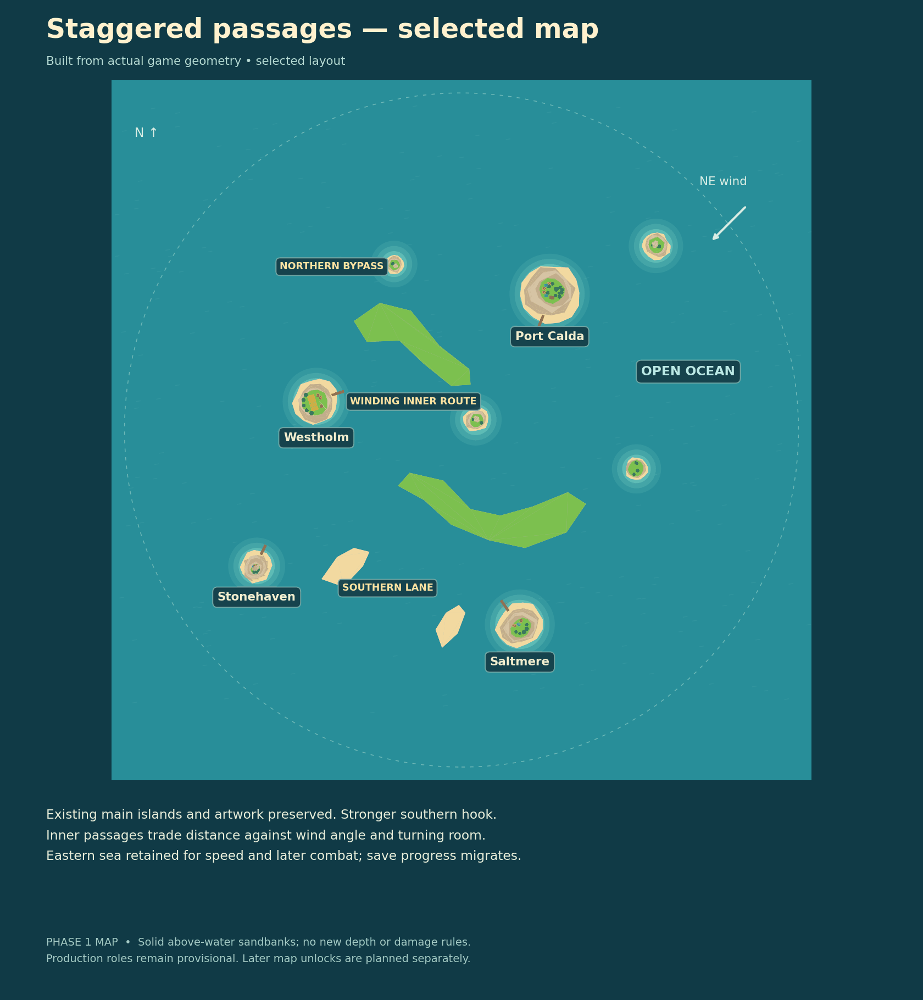
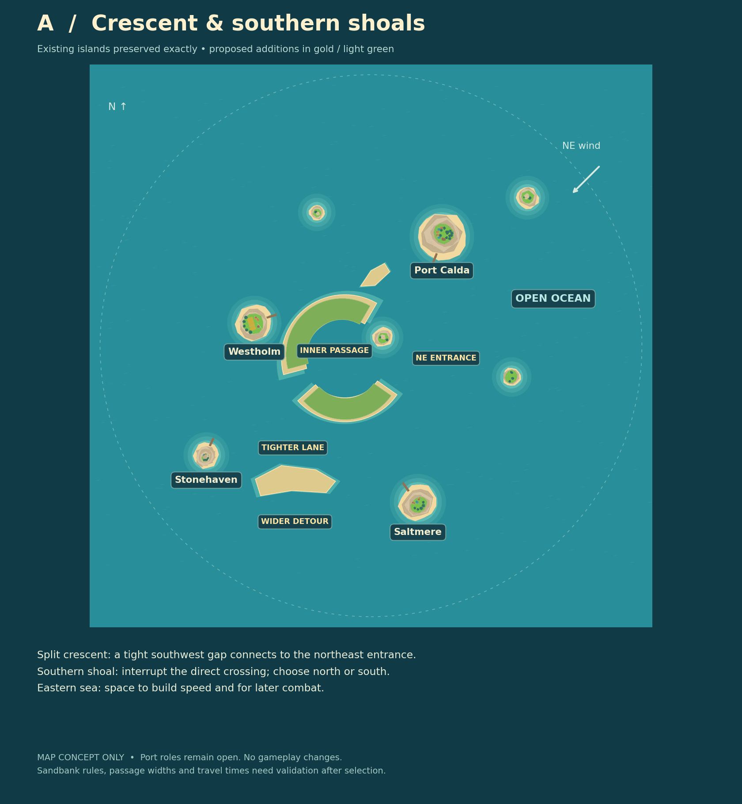
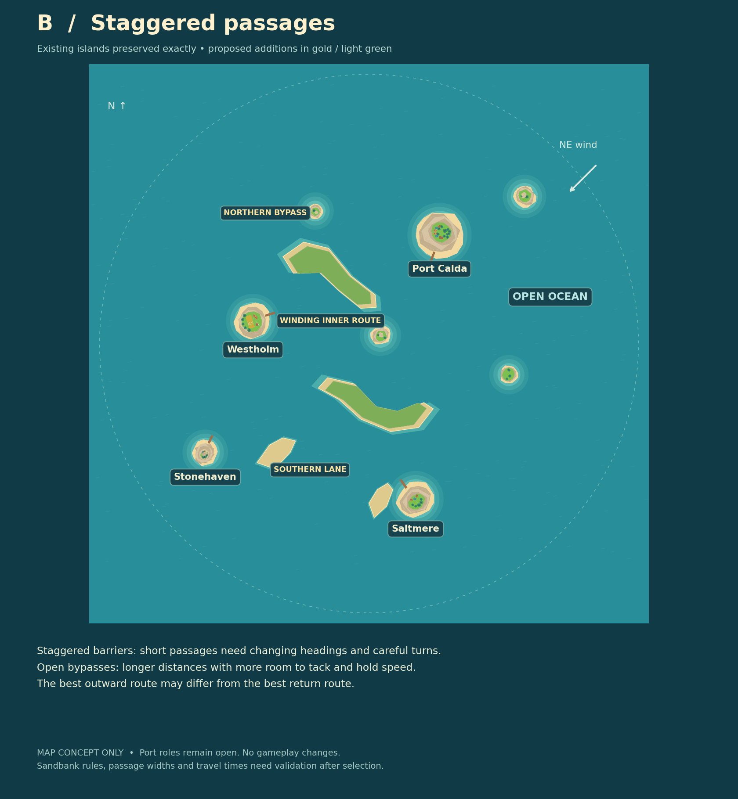

# Phase 1 map proposals

> **Rework in progress (2026-10-19):** two new layouts are proposed in [rework/](rework/README.md) after Guillaume found this map lacking.

**Status:** Guillaume selected the strengthened B layout, 2026-10-19. Implemented in `src/data/phase1-map.json`; [decision 0019](../decisions/0019-staggered-passages-first-map.md).

## Selected map



The final southern hook extends farther east, giving the open eastern approach a useful role. The southern sandbank has moved west to protect Saltmere's docking ring. These adjustments strengthen B without moving, resizing or changing the existing main islands. All eight original islands, their ordering, seed and course references remain intact; the latest B2 island and D boat artwork is inherited from main.

The remaining sections preserve the original alternatives for context. They are superseded where they differ from the selected implementation.

## Authoritative brief

Keep the **four current main islands exactly as they appear in the game**, at their existing sizes and positions. Add smaller islands, sandbanks, corridors or crescents to make route planning matter. Retain substantial open ocean for faster ships and later fighting. The port production roles remain open: prototype economy assignments are not approved final design choices.

The two current proposals supersede the earlier generated exploratory images. They use the actual game island geometry and current map coordinates, rather than asking image generation to approximate the existing islands. All eight existing islands are retained in original array order, preserving index-dependent random seeds and dock directions. Only new proposal overlays differ. These PNGs are deterministic orthographic map previews, not gameplay changes.

| Main island | Center x / y | Radius |
|---|---|---|
| Port Calda | 68 / 105 | 20 |
| Saltmere | 45 / -150 | 16 |
| Westholm | -112 / 22 | 15 |
| Stonehaven (south-cay) | -158 / -105 | 11 |

Names identify existing islands in the previews; they do not approve production roles. The northeast wind is the current prototype wind used to discuss routes, not a newly approved final wind design.

## A — Crescent & southern shoals



A split central crescent makes straight crossings less useful: round its north or south side, or thread the southwest gap and northeast entrance through its inner basin. The second opening keeps it a useful passage rather than an empty dead-end bay. A southern sandbank interrupts the direct Saltmere–Stonehaven leg, offering a tighter northern lane and a wider southern detour. A smaller northern shoal shapes approaches without sealing the sea. The eastern sector remains broad and clear.

This proposal concentrates complexity in two recognizable landmarks. The split crescent is a barrier and optional through-passage, not a new mandatory port or production center. Wind and available tacking room should determine whether the shorter passage is actually faster.

## B — Staggered passages



Two staggered barrier islands force heading changes along the inner route. Rounding their ends gives more tacking room at the cost of distance. Southern sandbanks divide approaches into lanes. The eastern open sea remains available for speed, maneuvering and later fighting.

This proposal spreads route decisions across several legs. An outward journey through a short passage may favor a different return route when sailing against the wind. It must not become a maze in which every passage is too narrow for the starter ship.

## Limits and implementation gate

The original images were layout choices. The selected implementation has automated clearance, collision, rendering, migration and wind-aware navigation checks; economic and device play-testing remain necessary. The current renderer/collision system uses circular islands; crescents and elongated barriers need matching collision geometry and shallow rendering rather than a giant enclosing circle. Implemented sandbanks are permanently exposed solid coastlines, with normal shore collisions. No depth, cargo damage or weather-dependent grounding rules are added. No new hazard rules, regional wind shelter, locks or production roles are implied.

Further play-testing: refine passage dimensions and collision outlines; ensure all port approaches and the spawn remain clear; test all port pairs with the actual sailing model and several wind directions; compare route distance with measured travel times; check tacking space for the sloop and turning room for larger future ships. Preserve open eastern sea and check phone readability. Coordinate map identity and save migration before replacing any runtime data.

## Reproducing previews

From the repository root, using Node 22.15+ (module hooks and TypeScript stripping) and Python with NumPy and Matplotlib:

```sh
npm ci
node docs/maps/src/export-geometry.mjs /tmp/fwt-geometry.json
python docs/maps/src/render.py /tmp/fwt-geometry.json
```

To render the selected map instead of the historic overlays:

```sh
node docs/maps/src/export-geometry.mjs /tmp/fwt-selected.json phase1-map.json
python docs/maps/src/render.py /tmp/fwt-selected.json
```

The exporter loads the real `buildHighlandIslands` implementation and preserves original map data and index-dependent seeds. The Python renderer draws its triangles in an overhead orthographic view, adding only the proposal polygons. `proposal-overlays.json` records those polygons for review; it is not loaded by the game. No generated bitmap is used as a runtime map.

## Multiple maps

The roadmap includes selectable handmade sandbox maps and persistent unlock progression. Prefer delivery and settlement milestones over XP accumulated merely by sailing, following the selected recommendation. Exact milestones, thresholds and rollout timing remain open. Keep per-map voyages separate from captain unlocks. Implement only the chosen first map now; later maps and unlock UI are future work.

## Implementation and validation

- `phase0-map.json` stays unchanged as the original practice/test map; normal play now loads `PHASE1_MAP`.
- Polygon outlines are the shared source for collision, terrain geometry and ocean shallows/foam. Added static geometry stays in the existing merged island mesh, with a 64-edge water-shader budget.
- Known Phase 0 saves migrate through an explicit map compatibility entry. Gold, cargo, upgrades, ships and markets survive. A saved position covered by new land returns to the clear spawn; unrelated-map saves are rejected.
- Tests preserve original island geometry byte-for-byte, check the full docking rings for the cutter, cover concave corner collisions, and keep an eastern sector free of new coastlines.
- A navigation audit checks all 12 directed port pairs for five wind directions, excluding no-go headings and sampling coastline clearance along each segment. Costs are steady-state sailing estimates, not economic balance or fleet AI.
- A four-port circuit runs the actual sloop motion/collision model under a fixed northeast wind. It uses conservative sail settings and a deliberate offshore departure from Saltmere before turning upwind; the test is a navigation harness, not an automated-route feature in the game.
- Browser/device performance and the complete trading-loop balance still need hands-on play-testing. The local review image is an orthographic render of actual model triangles, not a browser screenshot.
