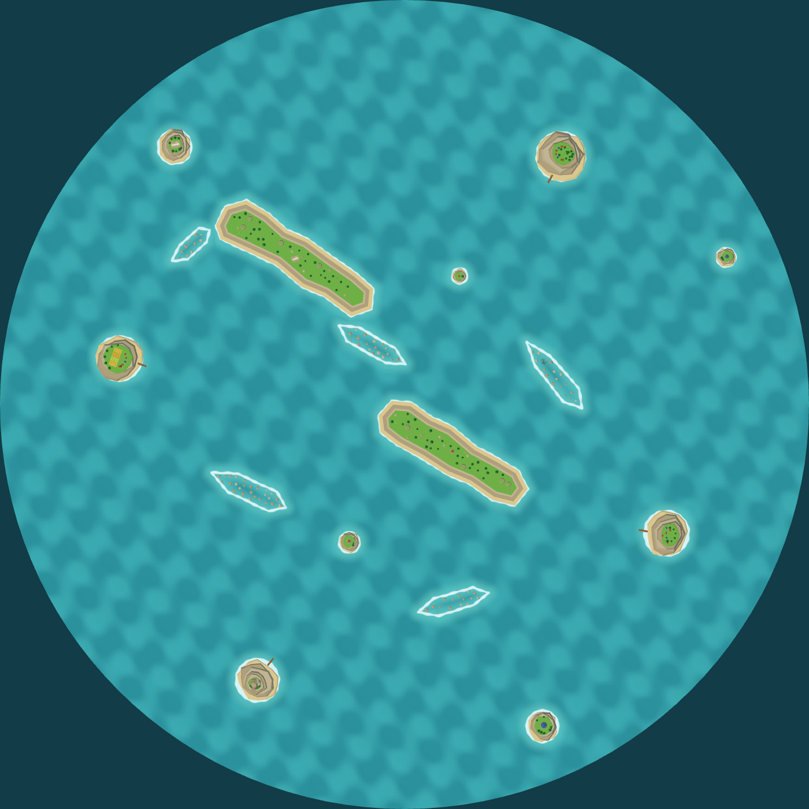
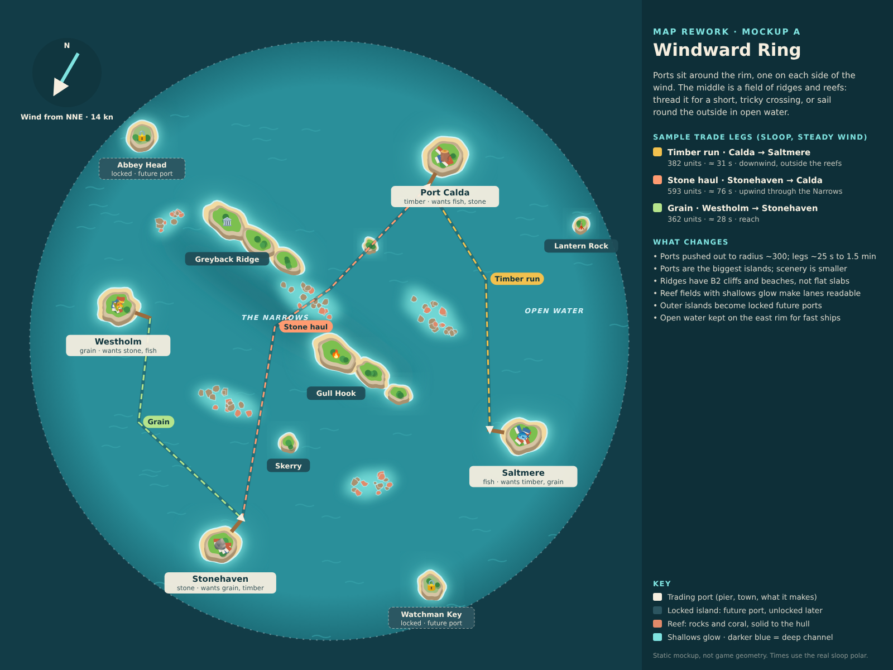
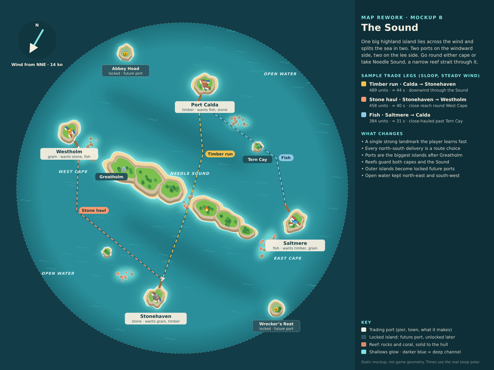

# Phase 1 map rework: mockups

**Status:** Guillaume chose **A, Windward Ring**, 2026-10-19, asking for a real reason to sail between Saltmere and Westholm (now drawn on the mockup). Implemented in `src/data/phase1-map.json`; [decision 0031](../../decisions/0031-windward-ring-map.md).

## As built

Rendered from the real island models and ocean shader by `docs/maps/src/overview.html` (open it with `npm run dev`). Differences from the mockup: reefs are drawn as rocks and coral inside a foam line rather than a filled shallow, and the two outer islands are scenery until unlockable ports exist.

## Why a rework

Guillaume found the current map ("Staggered passages", [0019](../../decisions/0019-staggered-passages-first-map.md) and [0021](../../decisions/0021-larger-sea-and-coastal-landmarks.md)) still lacking. A review of `src/data/phase1-map.json`, the renders and a play-through on main found the problem is composition, not detail:

1. All four ports and every barrier sit inside the old 260 radius. The outer two thirds of the 440 sea hold four scenery islands with nothing to do. Port legs are short (Calda to Saltmere is about 20 s with the sloop, Westholm to Stonehaven about 10 s).
2. Scenery outshines the ports: Wrecker's Rest (radius 34) and Lantern Isle (30) are two to three times bigger than Stonehaven (11) and Saltmere (16).
3. The barriers and sandbanks are flat grass or sand slabs with no beach or cliff tiers, unlike the B2 island style, and have no shallows around them. Reefs and shallows from the roadmap are not really there yet.
4. The water is one flat colour at map scale, so passages are hard to read before you reach them.
5. What works: the barriers lie across the NE wind, so they do force tacking choices. Both mockups keep that idea.

## The two mockups

Both keep the four ports and their goods (decision [0015](../../decisions/0015-trade-economy.md)), the NNE 14 kn wind and the 440 radius. Both make the ports the biggest, busiest islands, draw every coast in the B2 style (beach, sandstone cliff tier, bright grass), add reef fields with a shallows glow, mark deep channels with darker water, and turn two outer islands into locked future ports, which is where the unlockable maps and ports in the roadmap ([0018](../../decisions/0018-map-proposals-and-unlocks.md)) can start.

### A: Windward Ring

Ports around the rim, one on each side of the wind. The middle is a field of ridges and reefs: thread the Narrows for a short, tricky crossing, or sail round the outside in open water. Sample legs: 28 s to 76 s.

### B: The Sound

One big highland island, Greatholm, lies across the wind and splits the sea. Two ports are on the windward side and two on the lee side, so every north–south delivery is a route choice: round the West or East Cape, or take Needle Sound, a narrow reef strait through the island. Sample legs: 31 s to 44 s.

## Notes

- Trade-leg times are steady-state estimates with the real sloop polar (`src/sim/ship.ts`) and a 14 kn wind, summed over the drawn legs. They ignore acceleration and tacking losses, so real legs will be longer.
- These are static mockups, not game geometry. The chosen one will be rebuilt as map data in `src/data/` with the existing collision, shoreline and save-migration tests.
- Reproduce: `node docs/maps/rework/src/mockups.mjs` writes `layout-a.svg` and `layout-b.svg`; the PNGs are browser screenshots of those SVGs at 1600 × 1200.
