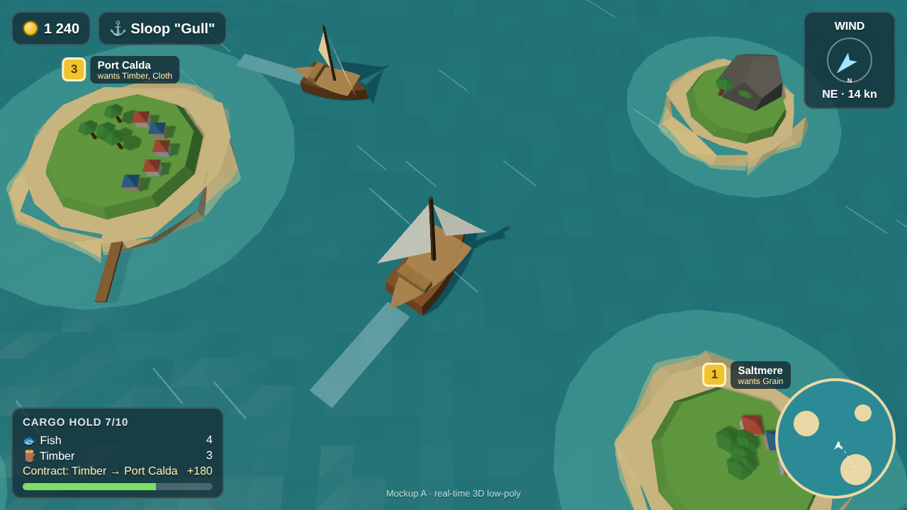
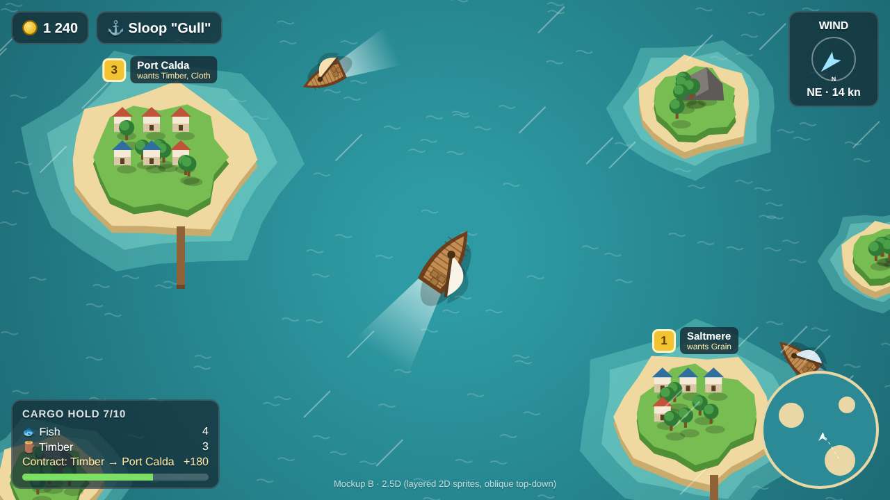

# Art-direction mockups: 3D vs 2.5D

Static screenshots (1280×720) of the same scene, used to choose the rendering approach. They are not game code.

| A · Real-time 3D low-poly | B · 2.5D layered sprites |
|---|---|
|  |  |

**A, 3D:** closest to the *Privateers* ad. Real lighting and shadows, sails can turn and fill with the wind, and the camera can tilt or zoom freely. More work per asset (modelling) and heavier on low-end devices.

**B, 2.5D:** a flat top-down canvas with drop shadows and stacked layers to fake height. Faster to draw and iterate, very light to run, but the camera is fixed and the boats rotate as flat sprites.

## Regenerating

`src/3d.html` (three.js 0.160) and `src/25d.html` (Canvas 2D) share `src/hud.html`/`src/hud.css`. Install `three@0.160.0` and `playwright` next to them, splice `hud.html` into the `HUD_HERE` placeholder, then run `node shot.js 3d.html mockup-3d.png`.
