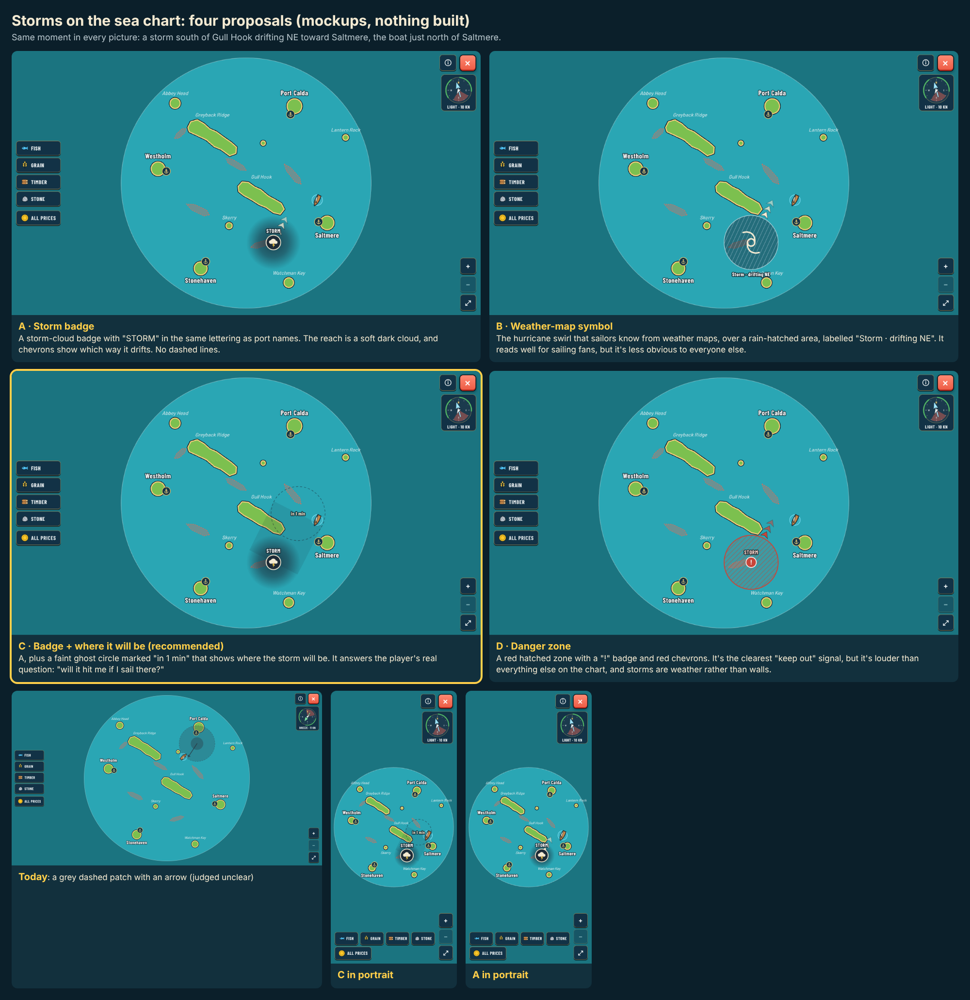

# Storms on the sea chart: proposals

Guillaume (2026-10-22): the chart's storm (grey dashed patch, darker core, drift arrow, [ADR 0067](../../decisions/0067-weather-states-and-storms.md)) is unclear, and players won't understand it. He asked for proposals only, with nothing implemented yet.

- **A · Storm badge:** a storm-cloud badge labelled "STORM" in the port-name lettering, a soft dark cloud for its reach, and chevrons for its drift.
- **B · Weather-map symbol:** a hurricane swirl over a rain-hatched area, labelled "Storm · drifting NE".
- **C · Badge + where it will be (recommended):** A, plus a ghost circle "in 1 min" that shows where it will be.
- **D · Danger zone:** a red hatched zone with a "!" badge.

Mockups are drawn by injecting SVG into the live chart (`capture.cjs`, run against `npx vite --port 5199`).
The pick will be recorded as an ADR before it is built.
