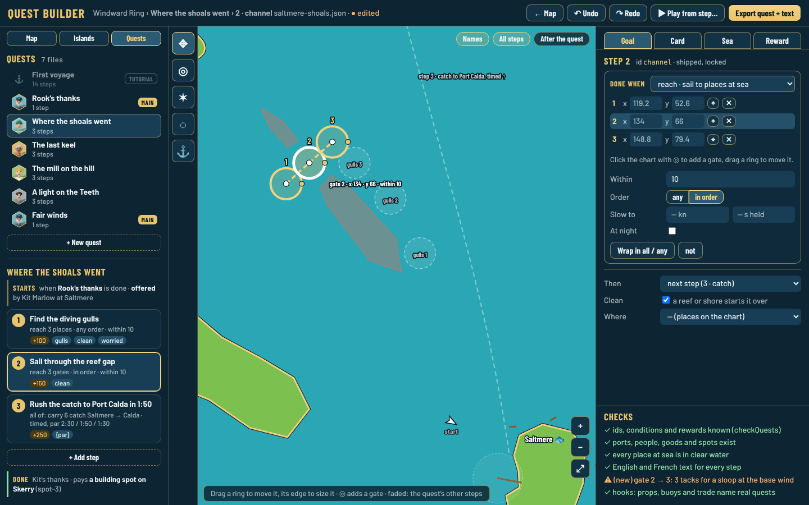
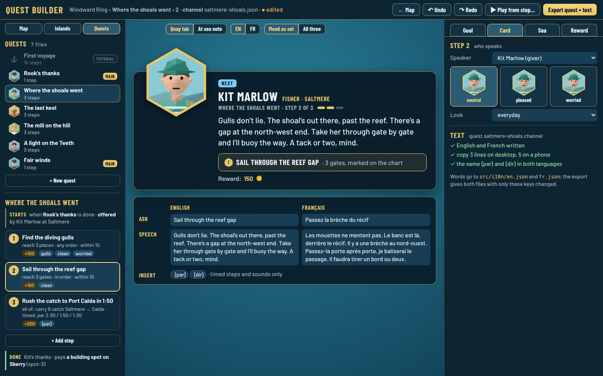
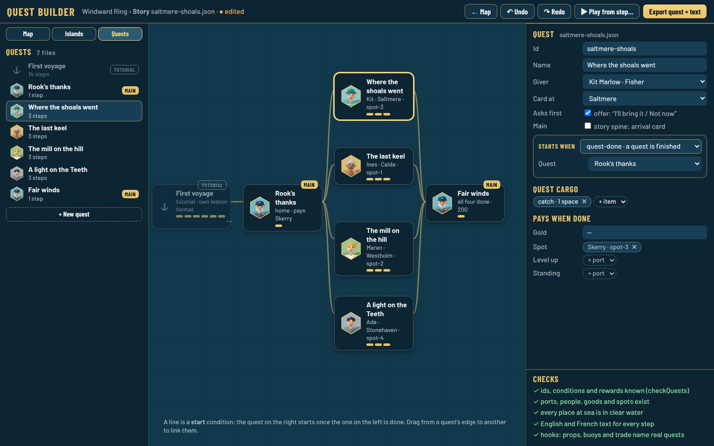
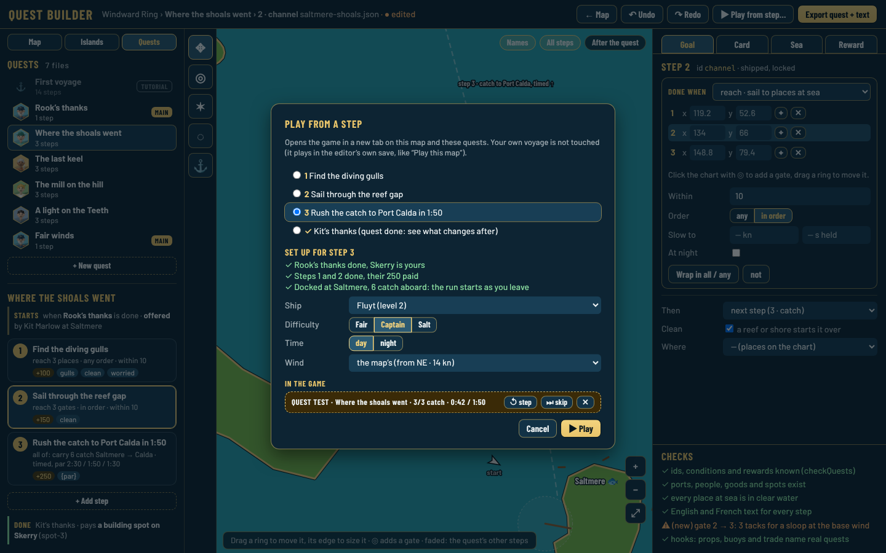
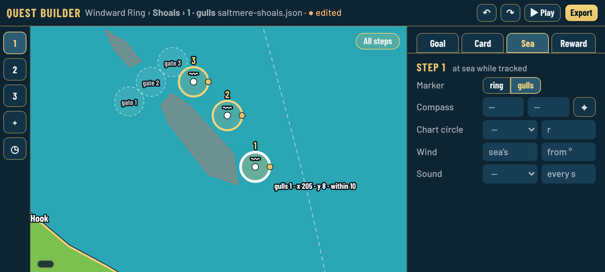
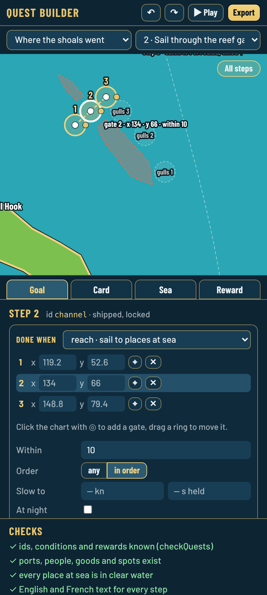
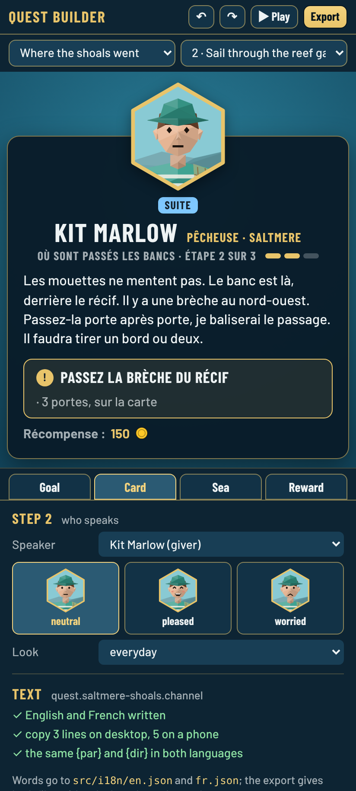

# Quest builder: mockup and plan

*Decision [0142](../decisions/0142-quest-builder.md), proposed (2026-10-24): Guillaume asked "Should there be a quest editor/builder tool?". Yes: this page is the proposal and its static mockups, for his answers before anything is built.*

## Why

A quest today is a JSON file in `src/data/quests/` plus text keys in `src/i18n/en.json` and `fr.json`, written by hand or by a thread ([how-to](../content/README.md#quests-0125)). Points at sea are numbers typed from the map editor's grid, the card is only seen in the game, and testing step 3 means playing steps 1 and 2 first. The map editor and the island builder already cover the sea and the islands; quests are the last content without a tool.

## What the pictures are

All pictures show the shipped quest **"Where the shoals went"** (Kit Marlow, Saltmere). The chart is the map editor's own drawing (`src/editor/chart.ts`), the cards are the game's own quest card (`src/ui/questCard.ts`) with the real portraits, and every place, word and reward comes from `saltmere-shoals.json`, `en.json` and `fr.json`. Source: [`mockup/quest-builder.html`](mockup/quest-builder.html) (`?view=steps`, `card`, `story`, `play`, `sea`, `portrait`, `portrait-card`), served by `npm run dev`. The check lines are examples: the "(new)" sailing check does not exist yet and its numbers are made up.

### 1. A third mode in the editor: Quests

**Map · Islands · Quests** at the top left of `editor.html`. On the left, the quest files (the giver's face, the step count, a `main` tag for the story spine) and, under the open quest, its **steps as cards**: the ask, the goal in plain words ("reach 3 gates · in order · within 10"), the gold, the flags (`clean`, `gulls`, the mood). Above the steps: when the quest starts and who offers it. Below them: the thanks and the reward, and **what changes after it** (the props, buoys and port trade tagged with this quest, [0130](../decisions/0130-after-a-quest-and-the-saltmere-shoals.md)). Steps are reordered by dragging; **+ Add step**, **+ New quest**.

### 2. The chart: places at sea

The selected step's places are drawn on the real chart: `reach` points and gates (numbered, a dashed line when `in-order`), a timed run's `via`, quest cargo's spot, the `compass` point and the `chart` circle. Drag a ring to move it, its edge handle to set `within`; the left tools add a place, a compass point, a chart circle or a spot. The quest's other steps show faded. **After the quest** shows the buoys and boats that appear once it is done.

### 3. The step panel: Goal, Card, Sea, Reward

- **Goal**: "Done when" picks a condition kind from the quest library (`src/sim/questLibrary.ts`) with a plain line for each ("reach · sail to places at sea"); its parameters become fields of the right type (port and good lists, numbers, points, the par per difficulty). **Wrap in all / any** and **not** nest conditions, shown as indented boxes. Then `next`, `clean` and `port`. Or **Choice**: options with their reward and `next`.
- **Card** (picture 4): speaker, mood (three real faces), look.
- **Sea** (picture 6): `marker`, `compass`, `chart`, `wind`, `sound`.
- **Reward**: gold, standing, discover, level up, home island, building spots.

Shipped ids are locked (old saves keep their progress by id); new ones can be renamed until exported.

### 4. The card and its words, English and French side by side

The **game's own card**, live, as it will show: the Quay tab or the note at sea (an arrival card for a `main` quest), English or French, the set mood or all three. Under it, the step's ask and speech **in both languages side by side**, with `{par}` and `{dir}` to insert. The text checks say when French is missing or the placeholders differ. The words are saved to `en.json` and `fr.json`.

### 5. The story: every quest and what starts it

A view of all quests, each a box with its giver, port, steps and reward, linked by their `start` conditions (Rook's thanks → the four arcs → Fair winds). Drag from one quest to another to make it start when the first is done. The right panel holds the quest's own fields: id, name, giver, where its card shows, offer, main, start condition, quest cargo, final reward. The tutorial is listed but greyed: its lessons use their own format and runner (see question 3).

### 6. Play from a step

**▶ Play from step…** opens the game in a new tab with the editor's map and quests, set up for the chosen step: the quests before it done, earlier steps done and paid, quest cargo aboard, docked at the step's harbour (or near its first place), with the ship, difficulty, time of day and wind you pick. It plays in the editor's own save like **Play this map** ([0095](../decisions/0095-map-editor.md)), so your voyage is untouched. A thin **quest test** bar in the game shows the step and its progress, with restart step, skip step and close.

### 7. Phone landscape and portrait

 

Landscape: a rail of step numbers, the chart, one panel. Portrait: the quest and step as two pickers, then the chart (or the card), then the panel's tabs; the story view becomes a list.

### 8. Checks and export

The checks are the test suite's: `checkQuests` (ids, kinds, rewards, people, ports, goods, spots, text in both languages) and `checkQuestHooks`, run as you type, plus "every place in clear water" from the map checks. **Export quest + text** gives the quest file and the two text files, formatted like the repo (byte for byte for unchanged files, as the island and map exports do), ready to upload as a pull request. Edits stay in the browser until then (`fwt.editor.quests.v1`).

## Plan if accepted

1. **Read and show** (one PR): Quests mode, quest list, step cards, chart places, story view, checks; no edits yet. Proves the layout on the real quests.
2. **Edit and export**: the forms built from the condition and reward library (each kind gets a small description of its parameters next to its check, so a new kind shows up in the builder by itself), chart handles, text side by side, undo, export.
3. **Play from a step**: the setup in the game (`?map=edited&quest=<id>&step=<id>`) and the quest test bar.
4. Later, if wanted: the tutorial's lessons, and a "(new)" sailing check that sails a step's places with the default ships at the base wind.

## Questions for Guillaume

1. **Go?** A Quests mode in `editor.html`, in the three steps above. Or not now.
2. **The story view** (picture 5): worth it in the first PR, or later?
3. **The tutorial**: keep it out of the builder (it has its own lesson format and coach marks), or make its lessons editable too, later?
4. **Play from a step**: in a new tab like Play this map (proposed), or inside the editor page?
