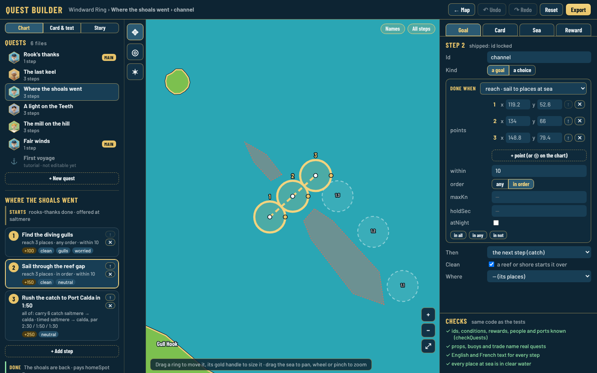
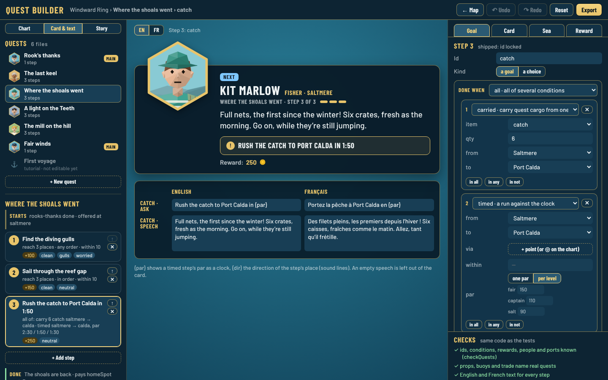
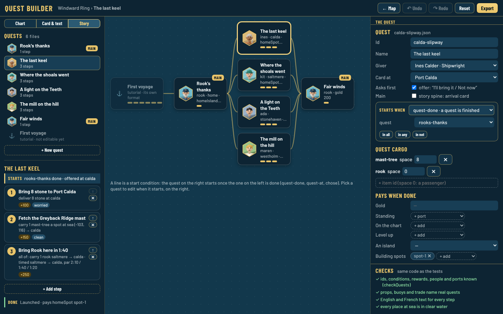
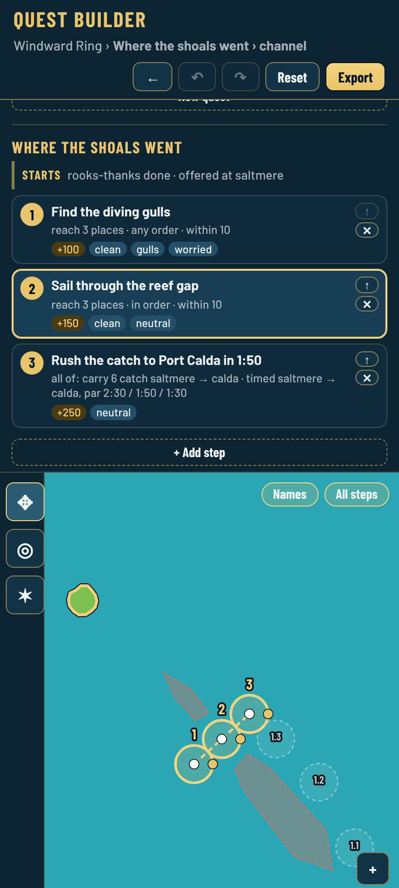

# Quest builder: how to use

*Decision [0142](../../decisions/0142-quest-builder.md). The [mockup and plan](../README.md) came first. Play from a step comes in the next part.*

Open the map editor (`editor.html`) and press **Quests** in its top bar. **← Map** (or Esc) goes back.

## Quests and steps (left)

- **Chart · Card & text · Story** pick what the middle shows.
- The quest files are listed in story order, with the giver's face, `main` for the story spine and `new` for a quest made here. The tutorial is listed but cannot be edited yet: it keeps its own lesson format for now, and must later move to the same quest format (Guillaume, 2026-10-24).
- Under the open quest: **Starts** (pick it to edit the quest itself), then its steps as cards (the ask, the goal in plain words, the gold and the flags), **↑** to move a step up, **✕** to delete it, **+ Add step**, and **Done** with the thanks card and the final reward.

## The chart (middle)

The map editor's chart with the step's places: `reach` points (numbered, joined when `in-order`), a timed run's `via` points, quest cargo's spots at sea (`load`, `unload`), the `compass` point (a star) and the `chart` circle. The quest's other steps show faded with their step and place number (`2.1`).

- Drag a ring's white handle to move it, its gold handle to change `within`.
- **◎** then click the sea: a new place at the end of the step's `reach` points (or the timed run's `via` points).
- **✶** then click the sea: the step's compass point.
- Drag the sea to pan, wheel or pinch to zoom, **⤢** fits the step.

## The fields (right)

With **Starts** picked: id (locked once shipped: saves know quests by id), name, giver, where its card shows, **Asks first** (`offer`), **Main**, the start condition, quest cargo (`items`: an id and its hold space, 0 for a passenger) and the final reward. A quest made here can be deleted.

With a step picked, four tabs:

- **Goal**: id (locked once shipped), **a goal** or **a choice**. A goal is a condition box: the kind picker lists every kind of the quest library (`src/sim/questLibrary.ts`) with a few words each (`CONDITION_ABOUT`), and the fields come from the kind's own `params`, so a new kind shows here with no builder code. **in all / in any / in not** wraps the condition, **unwrap** takes it back out, **+ and / + or** add a member. A choice lists its options (id, next step, reward). Then **Then** (`next`), **Clean** and **Where** (`port`).
- **Card**: who speaks (`speaker`, default the giver), the mood (their three faces) and a named look.
- **Sea**: marker (`ring` or `gulls`), compass point, chart circle, a held wind, a sound.
- **Reward**: gold, standing, ports put on the chart, ports levelled up, an island, building spots.

## Card & text

The game's own card for the picked step (or the quest's thanks card with **Starts** picked), in English or French, with `{par}` shown as the par's clock. Under it, every text of that step, **English and French side by side**: the ask, the speech, and each option's title and words. Text is saved to `src/i18n/en.json` and `fr.json` on export.

## Story

Every quest, in columns by what starts it: a line from one quest to another means the second waits on the first (`quest-done`, `quest-at`, `chose`). Pick a quest to edit its start on the right.

## Checks

Under the fields, live: the engine's `checkQuests` and `checkQuestHooks` (the same code as `tests/quests.test.ts` and `tests/quest-hooks.test.ts`), the text check (an ask in both languages, the same `{…}` in both) and every place at sea in clear water. The open quest's problems come first.

## Saving and export

Every edit is kept in this browser (`fwt.editor.quests.v1`) with undo and redo; **Reset** goes back to the shipped quests. **Export** downloads what changed: one file, or a zip with the repo's paths (`src/data/quests/<id>.json`, `src/i18n/en.json`, `src/i18n/fr.json`). The files are written the way the repo has them (Prettier style, objects on one line where the file had them so), so a pull request shows only the changes. New text keys go after their quest's other keys.

## Phone portrait

The quests and steps on top, then the chart, then the fields. It works, but the editor is made for a desk first.

## Code

`src/editor/quest/`: `doc.ts` (the document and its pure edits: words, places, story columns, renames, text checks, export; tested in `tests/quest-builder.test.ts`), `form.ts` (condition and reward forms from the library), `builder.ts` (the page), `quest.css`. `formatQuestJson` in `src/data/jsonFormat.ts` writes quest files like the repo's.
