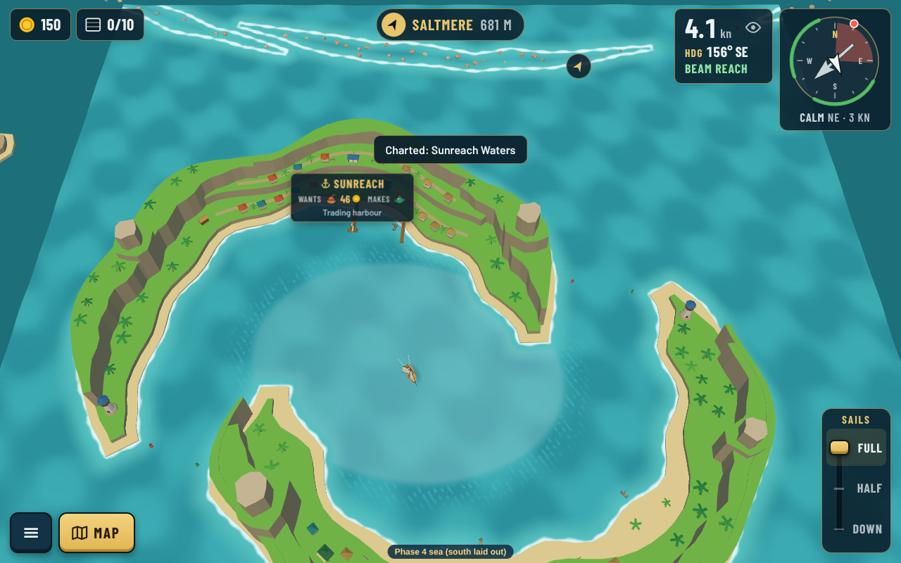
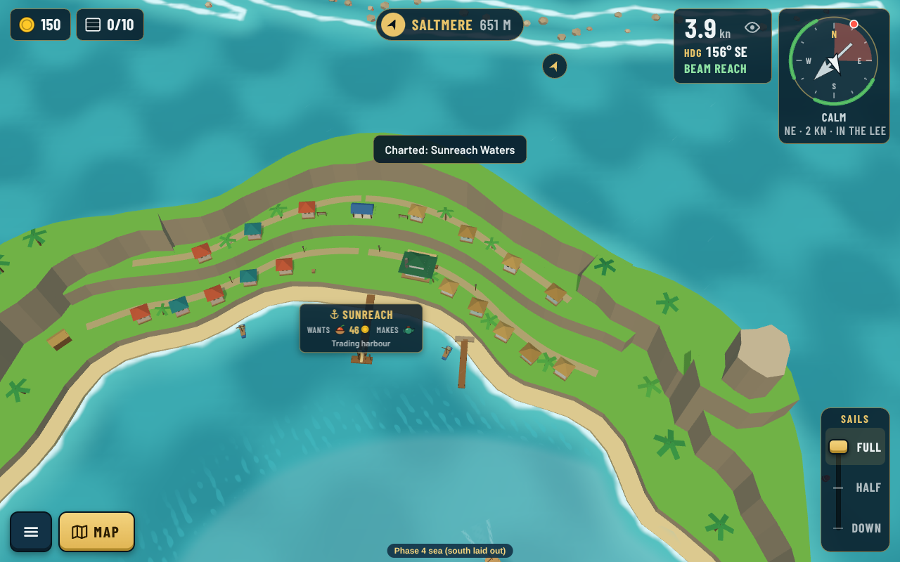
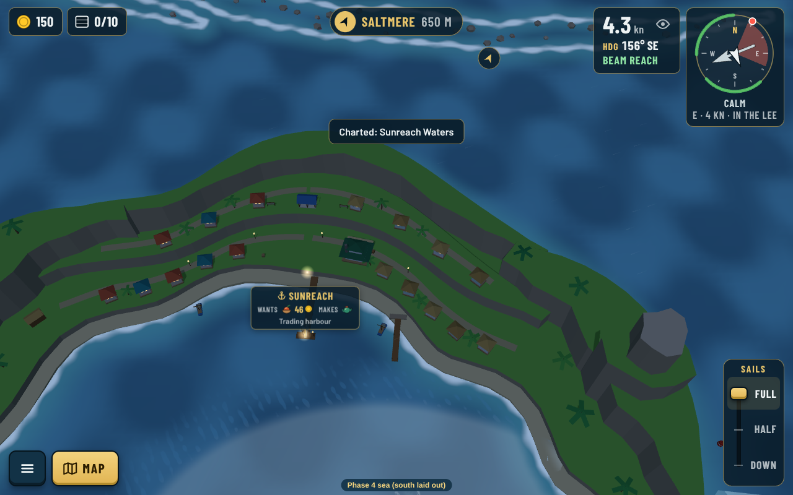
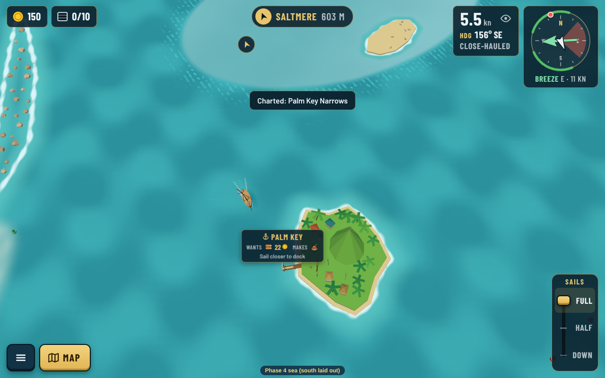

# South sea: art direction review

Art director's check of the shipped south sea ([0152](../../../decisions/0152-south-sea-sunreach-layout.md)) against the [art bible](../../../art/art-bible.md), 2026-10-24, on real-game screenshots (`npm run shots --sea phase4`).

| Sunreach from above | Sunreach town |
|---|---|
|  |  |
| **Sunreach at night** | **Palm Key at level 2** |
|  |  |

## What works

- The drowned-crater ring reads at once: high outer rim, staggered entrances, the pale lagoon.
- The town terraces with their mixed roofs and Juno's green-roofed tea house give the port a face.
- Turquoise water, white surf on the Coral Line, lighthouses on the arm tips: on style.

## What to polish

1. **The ground is the ring's.** Same B2 grass, same grey-brown cliffs, same sand, so Sunreach looks like a ring island with palms. Once grounds are data (north thread), give `tropic` its own: whiter coral sand, a deeper and warmer jungle green, warm ochre and red-brown crater cliffs (old volcanic rock).
2. **Big bare green surfaces** on the outer arms and summits. Denser `woodland-palm` woods and some low broadleaf jungle there, keeping the town terraces open.
3. **The town is nearly dark at night.** Only a few lamp dots; the windows barely show. Check that the `beach-house` and `tea-house` recipes have lit windows (`windows` / `glow`) and that harbour lanterns are placed, so Sunreach glows like the ring ports.
4. **Palm Key's hill** is one smooth single-colour green pyramid that looks unfinished. Break it into tiers or a rock peak with a green skirt, and put woods on it.
5. **The tea house reads small from far** (already a known follow-up): a slightly bigger roof or a tea-garden terrace in front would help.

## Recommendation

A small polish pass, done after the shared grounds land, checked by the art director, with every screenshot shown to Guillaume before merge. Not urgent: the south plays and reads well already.
