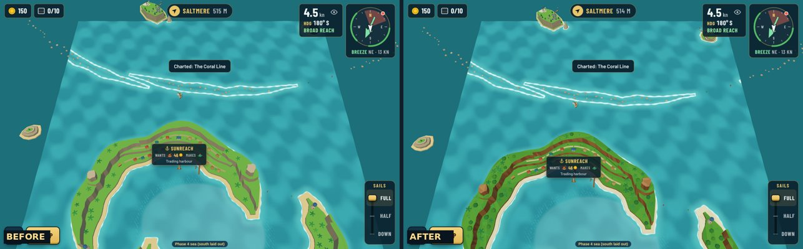
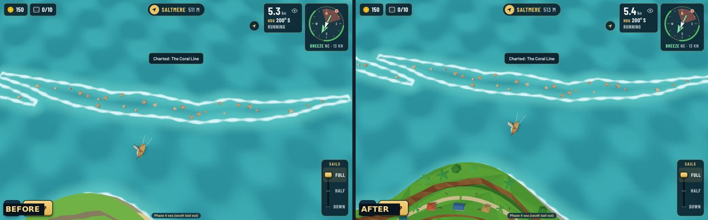
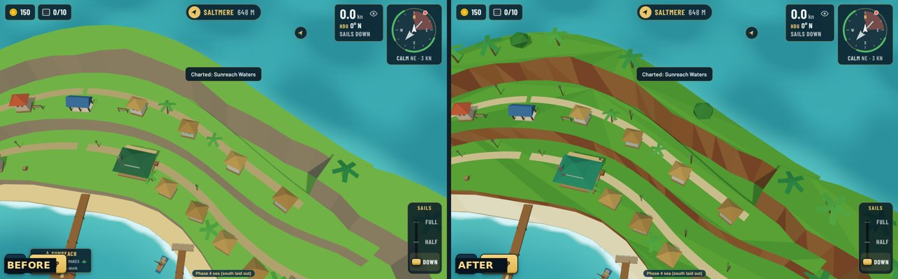
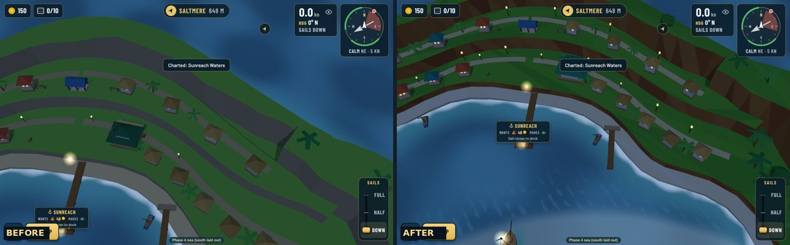
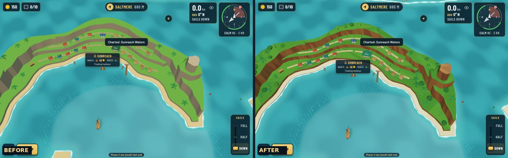
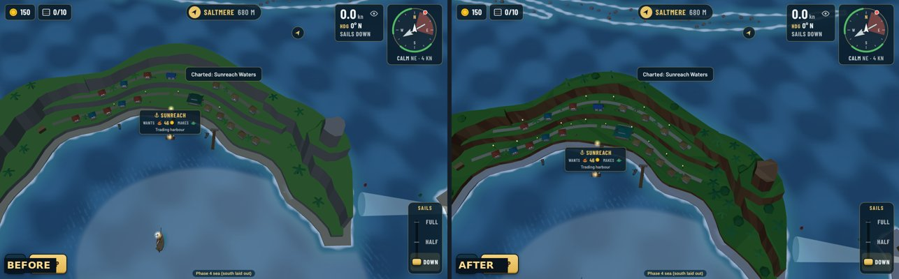
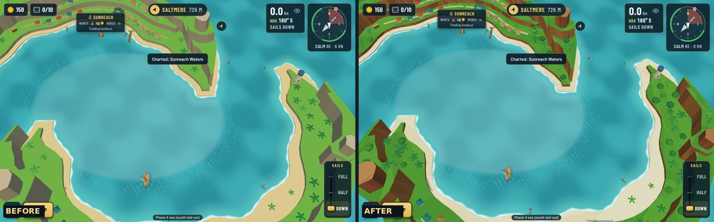
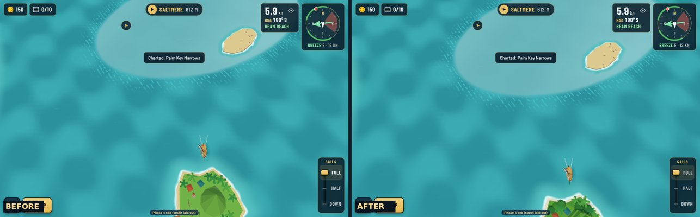
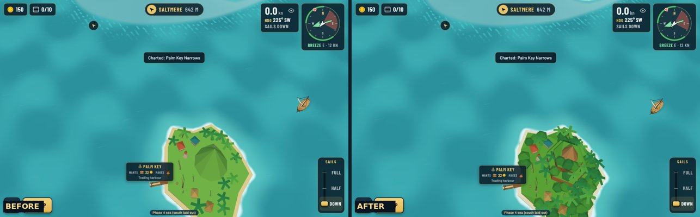

# South sea polish: before and after

The polish pass from the [art direction review](../README.md), [decision 0172](../../../../decisions/0172-south-sea-look-polish-tropic-grounds-jungle-woods-night-lamp.md). Real-game screenshots, taken with

```
npm run shots -- --sea phase4 --list docs/reviews/art-direction/south/polish/shots.json --sizes desktop,landscape,portrait
```

(before: the same list on `main` before this change). Left before, right after.

| Shot | Before / after |
|---|---|
| Sunreach from above |  |
| The outer rim |  |
| Town from the lagoon |  |
| Town at night |  |
| Sunreach from across the lagoon |  |
| The same at night |  |
| Lagoon and the South Arm |  |
| Palm Key at level 2 |  |
| Palm Key's hill |  |

Every shot after the change in desktop, landscape and portrait: `<shot>-<size>.jpg` in this folder.

## What changed

1. Tropic grounds: whiter coral sand, deeper warmer jungle green, ochre and red-brown crater cliffs, bare ochre summits.
2. Jungle woods (palms and low broadleaf crowns), denser on the arms and summits; town terraces stay open.
3. Palm Key's hill: two jungle tiers and an ochre rock peak, wooded.
4. Tea house a little bigger, its roof a brighter jade that stands out from the jungle.
5. Twelve lamp posts along Sunreach's lanes, lit at night.
