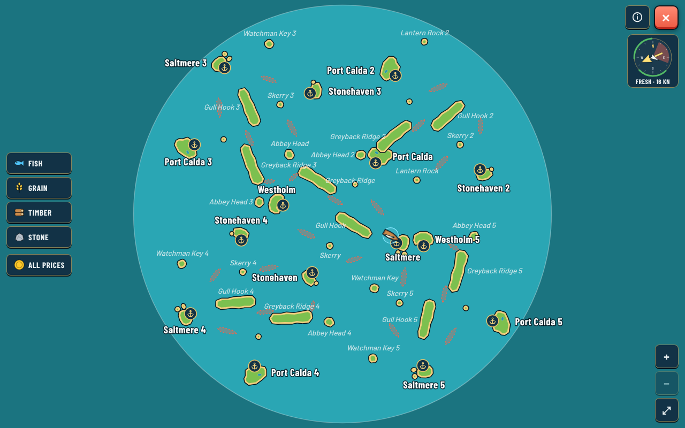
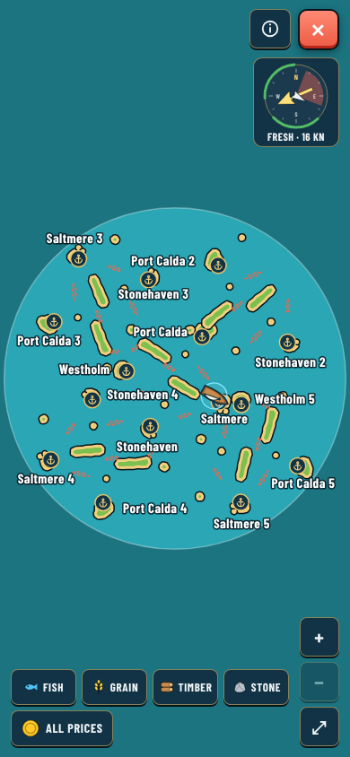
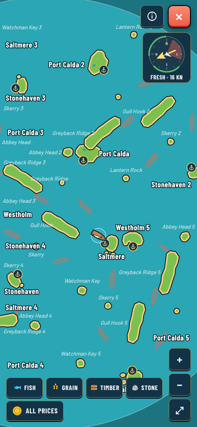
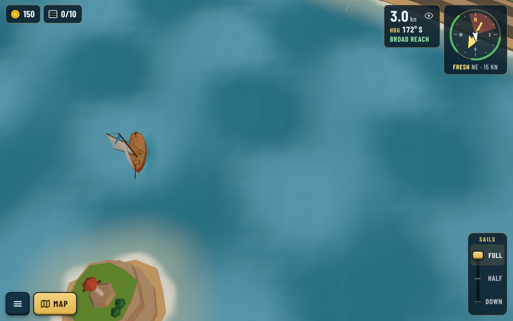
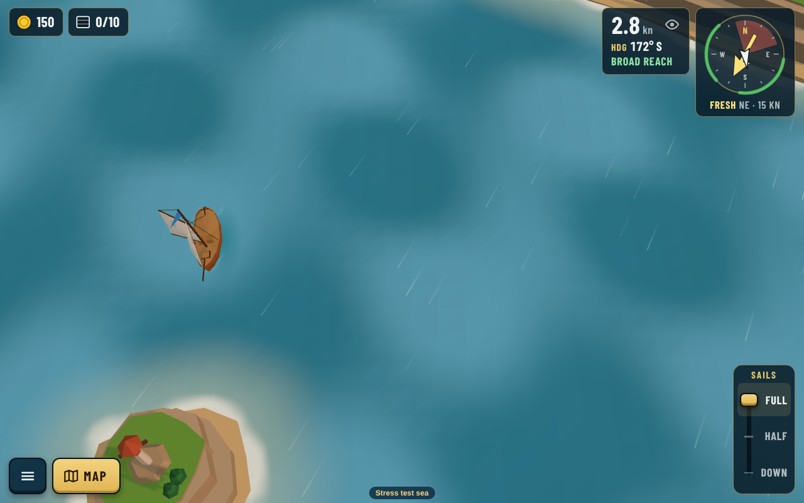

# Bigger map readiness (2026-10-23)

Decision: [0115](../../decisions/0115-bigger-map-engine-rules.md). Builds on the [performance review](../performance/README.md), [0116](../../decisions/0116-performance-priorities.md) and [0117](../../decisions/0117-nearby-wind-shelter-and-camera-far.md). Code map checked with graphify (`graphify update .`).

The map grows to **5 times its area**: sea radius about 985 instead of 440, sailing distances about 2.2 times longer.

## What was ready, what was not, and what happened

| Area | Before | Now |
|---|---|---|
| Drawing distant islands | Each island culled outside the view (0103); far plane 600 while fog ends at about 260 | Far plane = fog (0117). On the stress sea: same 16 draw calls and about 30k triangles as today while sailing |
| Wind shelter | Scanned every island at every ray sample | Shared `SpatialGrid` (0117) |
| Building islands | All at startup | Unchanged on purpose: measured, see below |
| Shoreline texture | One 512 x 512 RGBA over the whole map: 1.4 units per texel today, about 3.2 on a 5x-area map | Sized to the map at 1.4 units per texel, cap 2048, one byte per texel: today 539 x 517 (0.28 MB, was 1 MB), stress sea 1158 x 1195 (1.4 MB), about 25 ms to bake once |
| Storms | Crossed a fixed 440 area; looked back only 2 stretches, so a long crossing vanished mid-sea | Cross the map's radius (`areaShare`), one lane per `perRadius` (two on the stress sea), look-back follows the longest crossing; today's storms unchanged |
| Sea chart | Fits the sea at zoom 1, max 3x | Max zoom by scale (6.5x on the stress sea); scenery names hidden while above 3 units per pixel (whole big sea on a phone) |
| Collisions, reefs, port range | Linear but cheap | Box early-out added for reefs and sandbanks; a whole sim step on the stress sea is about 0.1 ms, so no grid needed yet |
| Editor | Sea radius field (min 100, no max), pan and zoom | Nothing needed |
| Save transfer QR | 896 bytes today, about 2.5 KB at 5x | Separate work: compact FW2 code (ADR 0118) |

## The stress test sea

`?map=stress` (`src/data/stressMap.ts`, `src/data/stress-map.json`): today's map copied five times, turned and shifted, overlapping islands left out. 46 islands, 24 ports, 24 reefs and sandbanks, radius 985, its own save.

Phone portrait, whole sea (scenery names wait) and two zoom steps in:

 

Shoreline foam at the same spot, today's map then the stress sea (the stress sea had a storm passing):

 

## Measurements

Headless Chromium in the cloud container (software GPU: frame times are not device evidence; counts and CPU timings are). Performance tool, 3 runs each, after 0117:

| | Today's map | Stress sea |
|---|---|---|
| Page start (median) | 1.8 s | 2.3 s |
| Sailing draw calls | 16 | 16 |
| Sailing triangles | about 30.3k | about 30.3k |
| Renderer CPU per frame (median) | 0.9 to 1.4 ms | 1.0 to 1.1 ms |
| Island geometry built (Node) | 0.08 s, 17k triangles, 1.8 MB | 0.4 s, 75k triangles, 8.1 MB |
| One sim step (Node) | about 0.04 ms | about 0.1 ms |
| Collisions per step (Node) | 0.006 ms | 0.02 ms |

Storms (share of time a spot is inside a storm's reach, 1,000 stretches, 8 directions):

| Distance from centre | Today | Stress, one lane | Stress, two lanes (shipped) |
|---|---|---|---|
| 0 | 5.8 % | 3.3 % | 6.3 % |
| 200 | 2.7 % | 2.2 % | 4.3 % |
| 400 | | 1.4 % | 2.8 % |
| 700 | | 0.7 % | 1.4 % |

## Next

1. Run the old tablet and phone on today's map and on `?map=stress` (in-game FPS and the performance tool).
2. Author the real bigger map; tune distance-based rewards (`economy.json › distanceScale`) and check the economy targets with the balance check.
3. Build islands near the ship only if step 1 shows startup or memory is a problem.
