# Characters' look: portraits, dialogue card and journal

**Status:** 2026-10-23, **Guillaume picked B, low-poly** ([0124](../../decisions/0124-characters-look.md)). The portrait builder (`src/ui/portraits.ts`), `src/data/characters.json`, the quest card and the chart journal are built (see [In the game](#in-the-game)).
**Related:** [0120](../../decisions/0120-communities-and-home-island.md) (community arcs), [the earlier B mockups](../progression/directions/README.md), UI style D ([0049](../../decisions/0049-ui-instrument-style.md)).

The cast is the draft from the story thread (`docs/story/community-arcs.md`, PR #101): Rook, Kit Marlow, Ines Calder, Maren Holt, Ada Flint and Old Ness. Names, lines and the "rotten jetty" arc are placeholders to show the art direction, not approved story. Backgrounds are real game captures (sea at Saltmere, the chart); everything on top is a static mockup.

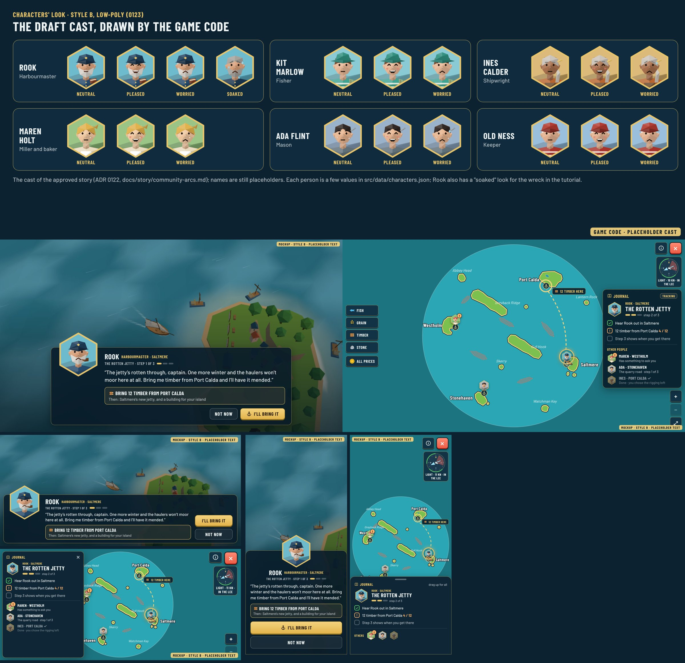

## In the game

The quest card and the journal, built ([0124](../../decisions/0124-characters-look.md)), captured from the game with a temporary test quest (Kit's arc from the story, placeholder text; no quest content ships yet).

| | Desktop | Phone landscape | Phone portrait |
|---|---|---|---|
| Card on docking | 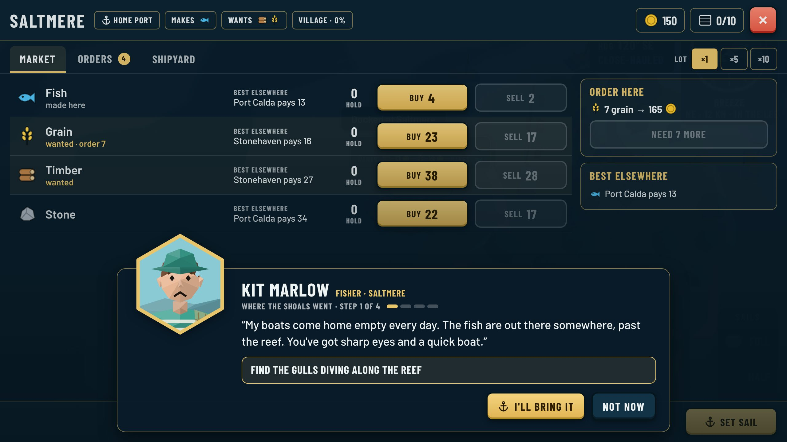 | 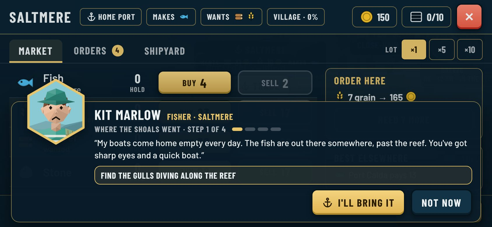 | 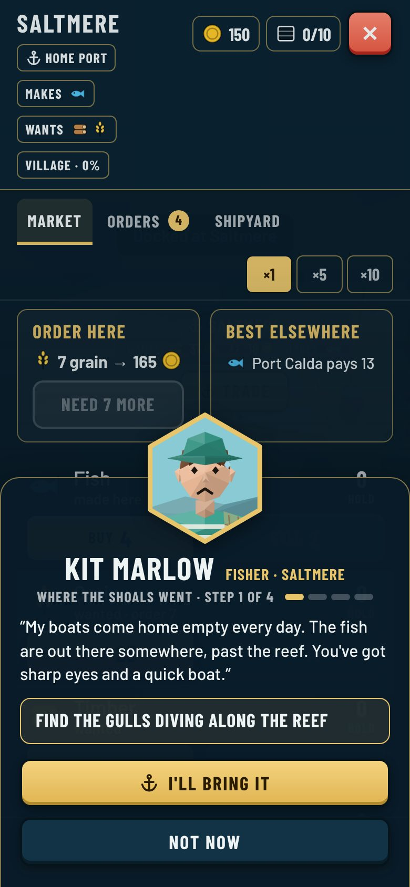 |
| Journal on the chart | 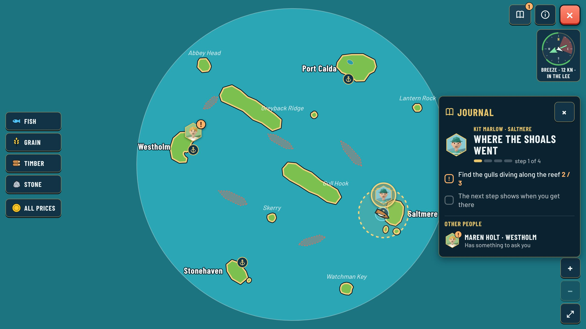 | 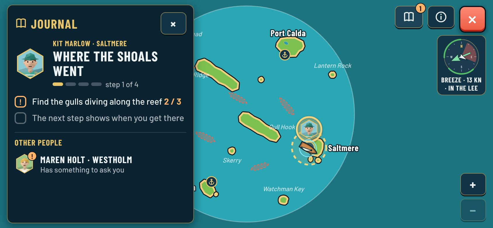 | 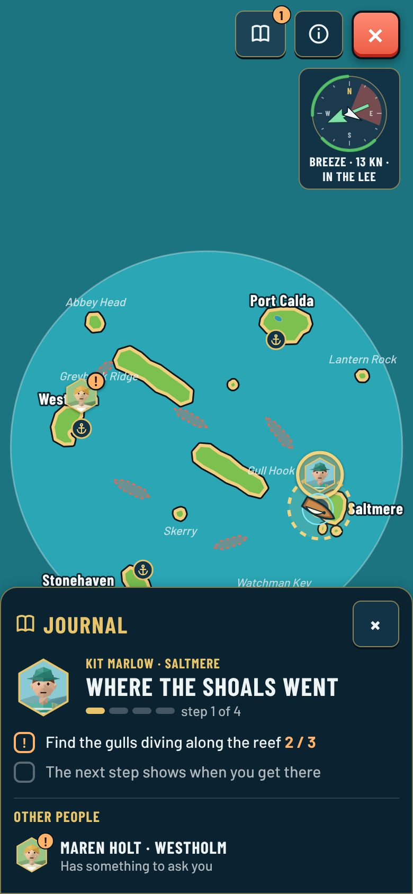 |

## The cast in style B, drawn by the game code

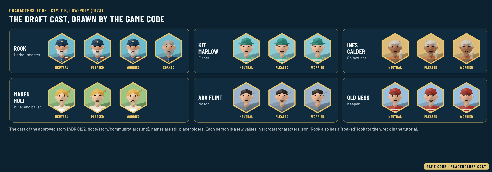

Each person in three moods (neutral, pleased, worried), and Rook soaked after the wreck in the tutorial. B's moods were made bigger after the pick (open smile, raised brows, a drop of sweat) so they still read on a chart pin.

## 1. Portrait style (B chosen)

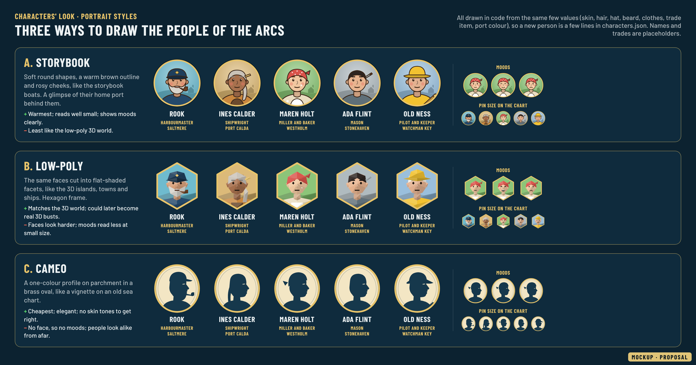

Every portrait is drawn in code (SVG, no paid image credits). These mockups drew all three styles with `src/portraits.js`; the game's builder is `src/ui/portraits.ts`. Each style is drawn from the same few values: skin, hair and hair style, hat, beard, clothes, apron, a trade item and the colour of their port. A new person is a few lines in `characters.json`; moods (neutral, pleased, worried) only move brows, eyes and mouth.

| | Look | For | Against |
|---|---|---|---|
| **A. Storybook** | Soft round shapes, warm brown outline, rosy cheeks, their home port behind them, round brass frame | Matches the storybook boats (style D) and the warm tone of the arcs; moods read clearly, even at pin size | Less like the faceted 3D islands and towns |
| **B. Low-poly** (chosen) | The same faces cut into flat-shaded facets, hexagon brass frame | Matches the low-poly 3D world; could later become real 3D busts | Faces look harder; moods read less at small size |
| **C. Cameo** | One-colour profile on parchment in a brass oval, like an old chart vignette | Cheapest, elegant, no skin tones to get right | No face so no moods; people look alike as small pins |

The screens below use B. The dialogue card with the others: [style A](dialogue-desktop-style-A.jpg), [style C](dialogue-desktop-style-C.jpg).

## 2. Dialogue card

Shown when you dock where a person has something for you (before the port screen), or when you tap them in the port. Portrait overlapping the card's edge, name and role, the arc name with its step pips, two to four lines of speech, the ask in a brass box (goods icon, amount, where, and what it leads to), then **I'll bring it** and **Not now**. The same card can carry the arc's end choice between two buildings.

| Desktop | Phone landscape | Phone portrait |
|---|---|---|
| 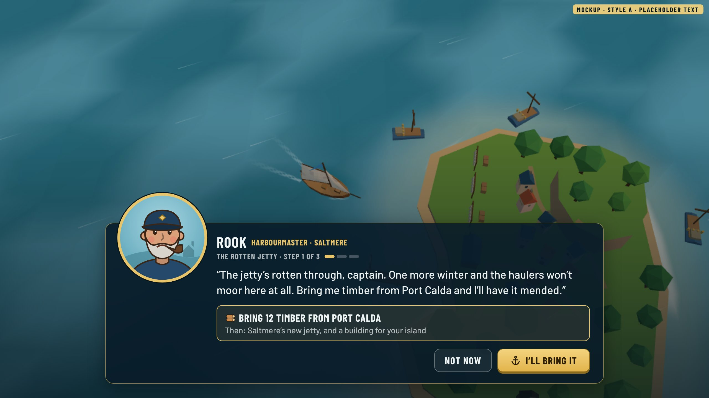 | 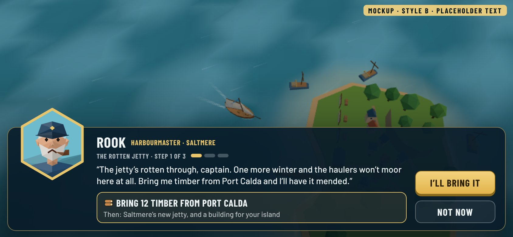 | 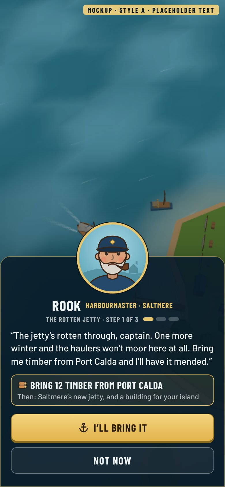 |

- **Desktop:** card along the bottom, the town stays visible above.
- **Phone landscape:** one low card, buttons in a column on the right under the thumb.
- **Phone portrait:** bottom sheet, portrait centred on its edge, full-width buttons.

## 3. Journal on the chart

| Desktop | Phone landscape | Phone portrait |
|---|---|---|
| 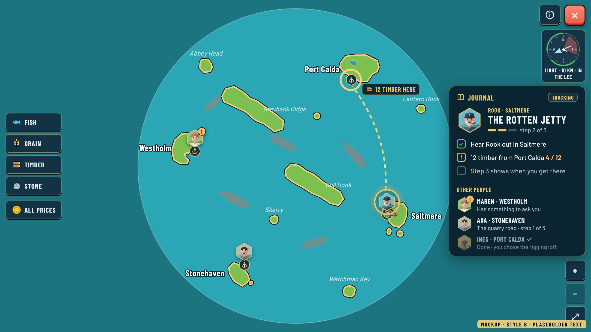 | 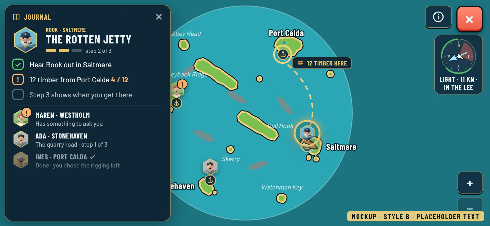 | 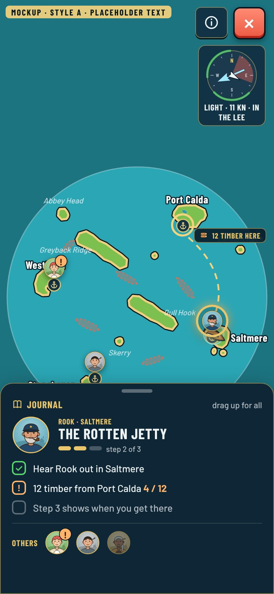 |

- **People pins on the chart:** each person's small portrait sits on their port. An amber **!** means they have something to ask; the tracked person glows brass. The tracked step draws a dashed brass line to where the goods are, with a chip ("12 timber here").
- **Journal panel:** the tracked arc first (portrait, person and port, arc name, pips, its steps: done, current with a count, next step hidden until you get there), then the other people with one line each, finished arcs dimmed with the building you chose.
- **Desktop:** panel on the right under the compass. **Phone landscape:** drawer on the left over the goods filters. **Phone portrait:** bottom sheet with the tracked arc and the other people as a row of small portraits; drag up for the full list. The chart would pan so the tracked route stays above the sheet.

## Regenerate

`npx vite --port 5179` at the repo root, then `node docs/reviews/characters/src/render.mjs`. Faces live in `src/portraits.js`, the screens in `src/mock.html`, backgrounds in `src/bg/` (captured from the game with `?debug`).
