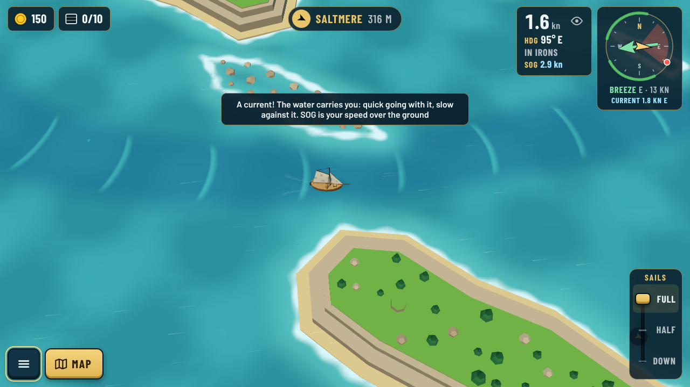
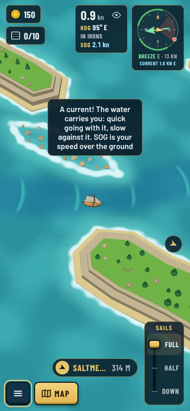
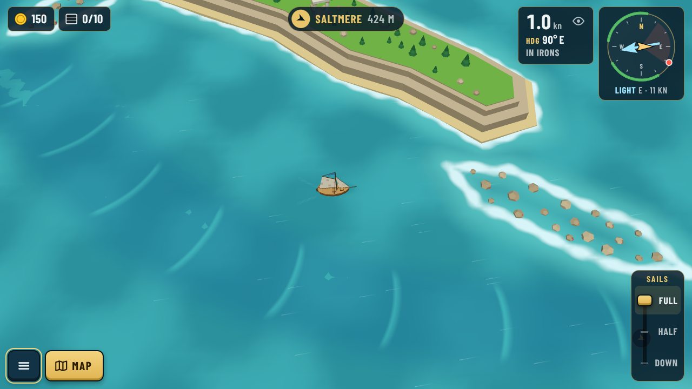
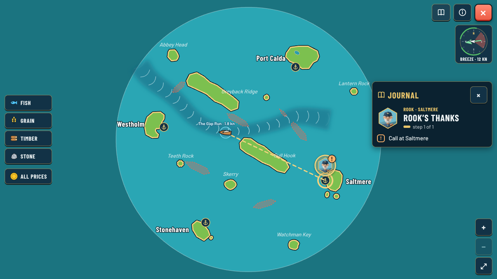

# Currents in the game (as built)

*Decisions [0140](../../decisions/0140-wind-zones-and-currents.md) and [0145](../../decisions/0145-building-currents.md).* These are real captures of the game on the Windward Ring (Captain, day, steady weather) with the Gap Run, today's ring's one current.

## At sea

The current is darker, bluer water. It has soft edges, no outline and no arrows. It fades near every shore, so harbours stay still. Lighter crests across it bow downstream and drift slowly east with the flow.

While you are in a current, two readouts appear in the log: **SOG** (speed over the ground) under the speed, and "Current 1.8 kn E" (where the water flows) under the wind. The log's eye toggle hides both. The first current you meet shows a one-time hint.

## On the chart

A current appears on the chart once you have sailed in it. It is drawn the same way, darker water with crests, plus its name and its speed at your level.

## Capture

Run `npx vite --port 5199`, then:

`node docs/reviews/currents/src/capture.cjs <name> <width> <height> <zoom> <x> <y> <heading> [chart]`

It writes `docs/reviews/currents/<name>.png`.
