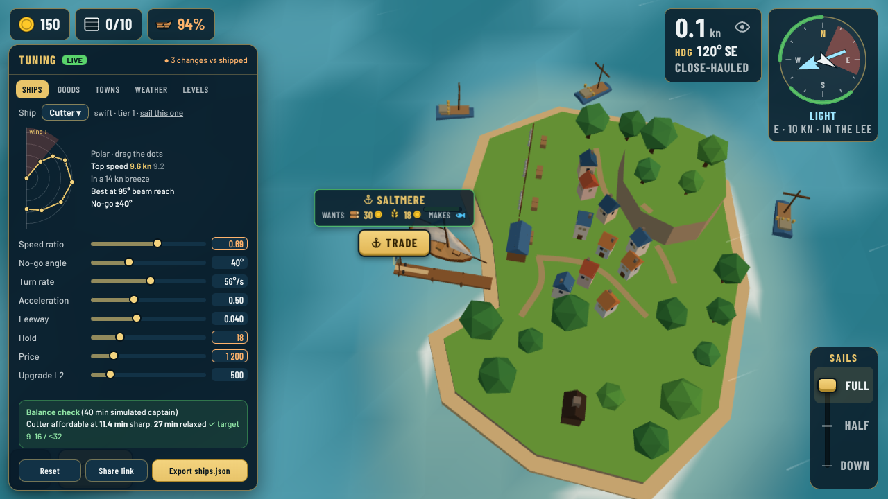
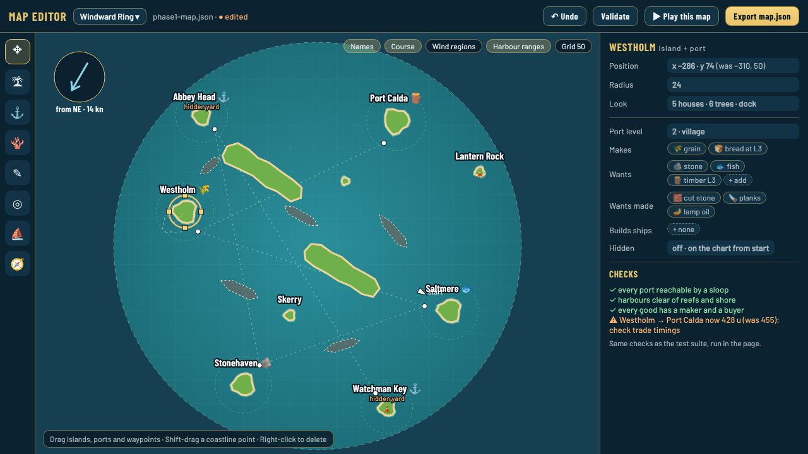

# Data-driven game and authoring tools: review

*2026-10-23 · audited `main` at v0.3.0 (after PR #68) · accepted by Guillaume the same day, see [ADR 0093](../../decisions/0093-data-driven-content-and-authoring-tools.md)*

## Short answer

Your friend is right, and the game is about one third of the way there. **The world is data, the numbers are not.** The map, ports, levels, productions and all the text already live in data files. But almost every tuning number (ships, prices, towns, orders, difficulty, weather, storms, hazards, day length) is written as constants inside the TypeScript code, and there is no tool to edit any of it except asking Claude.

The proposal, in four steps:

1. **Move tuning into JSON files** in `src/data/tuning/`, with no change to how the game plays (tests prove it).
2. **A tuning panel inside the game** (`?tune`): sliders for every value, live while you sail, with Reset, Export and Share link.
3. **A map editor page** (`editor.html`, like `models.html`): drag islands, ports and waypoints, edit what ports make and want, run the map checks, play the map, export the JSON.
4. **A balance check in the panel**: it runs the same 40-minute economy simulation as the tests, so you see "cutter affordable at 11 min" before you commit.

Everything stays static on GitHub Pages: the tools are extra pages and a hidden panel, loaded only when asked for, so players download nothing extra.

## Mockups

**Tuning panel** over the real game (`?tune`), Ships tab, three values changed:

**Map editor** on the Windward Ring, Westholm selected and dragged (dashed outline = where it was):

## 1. What is data today and what is code

| Area | Where it lives today | Data? |
|---|---|---|
| Map: islands, coastlines, reefs, start, course, bounds, base wind | `src/data/phase1-map.json` | ✅ data |
| Ports: makes, wants, level, what unlocks at each level, yards, hidden | same JSON | ✅ data |
| All player text, English and French | `src/i18n/en.ts`, `fr.ts` | ✅ data-like (typed TS dictionaries) |
| Ship classes: polar curves, speed, turning, hold, price, upgrade prices (7 ships) | `src/sim/ship.ts` | ❌ code |
| Upgrade effects (sails/hold/hull per level) | `src/sim/upgrades.ts` | ❌ code |
| Goods: base prices, what each specialty is made from, icons | `src/sim/goods.ts` | ❌ code |
| Market: elasticity, floor/ceiling, spread, recovery time | `src/sim/market.ts` | ❌ code |
| Town growth: thresholds, stall, equilibria, rare goods | `src/sim/settlement.ts` | ❌ code |
| Delivery and help orders: quantities, rewards, cooldowns | `src/sim/contracts.ts` | ❌ code |
| Difficulty levels (Fair winds / Captain / Old salt) and steady wind | `src/sim/difficulty.ts` | ❌ code |
| Weather: wind shifts, regions, calm/rain/gale weights, storms | `src/sim/wind.ts`, `storms.ts` | ❌ code |
| Hazards: shallows, reef and crash damage, leak, repair cost | `src/sim/hazards.ts` | ❌ code |
| Press warning, lurch, cargo overboard, docking, mooring | `src/sim/world.ts`, `trade.ts` | ❌ code |
| Day and night lengths | `src/sim/daylight.ts` | ❌ code |
| Wind force bands (calm…strong) | `src/sim/windStrength.ts` | ❌ code |

In numbers: about **110 named tuning constants across 20 sim files**, plus the 7 ship classes (about 20 values each) and the 3 difficulty levels (10 values each).

**What should stay code**, because it is not tuning and an editor would not help: the 3D models (built from code by design, ADR 0016), rendering and shaders, colours of the art palette, the music composer, the tutorial flow, the UI layout, and the physics formulas themselves. The editor changes *numbers and content*, not *rules*.

## 2. What moves and in what format

**Format: plain JSON**, one file per subject, in `src/data/tuning/`:

| File | Content | From |
|---|---|---|
| `ships.json` | 7 classes: polar, speeds, turning, hold, prices, standing | `ship.ts` |
| `upgrades.json` | effect per track and level | `upgrades.ts` |
| `goods.json` | base price, made-from, icon | `goods.ts` |
| `economy.json` | market, town growth, orders, help orders, start gold | `market.ts`, `settlement.ts`, `contracts.ts`, `trade.ts` |
| `difficulty.json` | the 3 levels and the steady-wind settings | `difficulty.ts` |
| `weather.json` | wind shifts, regions, weather kinds, storms, force bands, day/night | `wind.ts`, `storms.ts`, `windStrength.ts`, `daylight.ts` |
| `seamanship.json` | shallows, damage, leak, repair, press warning, lurch, docking | `hazards.ts`, `world.ts`, `trade.ts` |

Why JSON: Vite imports it natively (works on Pages with no server), the editor can read and write it, it diffs well in pull requests, and you can open and edit it on GitHub's website. It has no comments, so the explanation of each value moves into a small **field description file** (`tuning-meta.ts`: label, min, max, step, unit, one-line help) that drives the panel automatically. Add a value to JSON + meta and it shows up in the panel with no UI code.

Rules that keep it safe:

- **Ids stay in code in step 1, values go in data** (step 1b then moves the ids into data too, see 2b). The list of goods, ship ids and difficulty ids stays in TypeScript (so typos are compile errors); the JSON is keyed by those ids and a test checks every key is present and nothing extra.
- **One live tuning object.** Sim code reads `TUNING.market.recoverySeconds` when it needs it instead of a frozen `const`, so the panel can change it while you play. Reading a property per frame costs nothing measurable.
- **Step 1 changes no behaviour.** A one-off test compares every moved value with today's constant; the existing 59 test files (including the economy and difficulty balance sims) keep passing unchanged.

## 2b. Content as data, not just numbers (Guillaume, 2026-10-23)

Going one step further than tuning: **adding content should need no code**, only a file.

- **Goods**: a new good is an entry in `goods.json` (price, made from, icon, name in each language). Ids come from the data, checked when the game loads and again in the tests.
- **Ports and towns**: any number of levels, each with what the town asks for and makes.
- **Weather kinds and difficulty levels**: open lists in their files.

### A new ship = model + sailing data + unlock

The ship models are already close to this: since the per-ship redesign (ADR 0077), `clipper.ts` is mostly one block of numbers (length, beam, hull shape, colours, mast heights, booms, gaffs, number of jibs, cargo spots) handed to the shared `RefinedBoat` builder. Only the deck details (deck house, fairleads) are hand-written geometry. So each ship becomes one folder or one entry:

| Part | Where | What |
|---|---|---|
| **Model** | `ships/<id>.json` → `model` | hull dimensions and shape stations, colours, rig (gaff / square / jibs, masts with height and position), cargo spots, upgrade looks. Optional extras: a named deck-details piece from a small shared library (deck house, castle, leeboards, gun ports), or later a glTF file made in Blender. |
| **Sailing** | `ships/<id>.json` → `sailing` | polar, no-go, speed, turning, hold, draft, heel factor |
| **Unlock** | `ships/<id>.json` → `unlock` | where it is built (yard port), deliveries needed there, price, and optional extra conditions: town level at the yard, owning a ship of the tier below, map. Today these are split between the ship (`standing`, `price`) and the map (`builds`); they move together. |

The model sheet (`models.html`) becomes the ship preview: open a model file and see it at each upgrade level and quality, with triangle counts, before it goes in the game. A visual rig editor (sliders on the model sheet, like the tuning panel) is a later step; at first you edit the JSON and reload.

**Recommended layout: one file per ship** (`src/data/ships/clipper.json`) holding all three parts, `sailing`, `unlock` and `model`. Adding a ship = copy a file, rename it, change what differs; one place to look; one ship per diff. A ship can start from another with `"base": "schooner"` and list only what differs. Side-by-side comparison (for balancing) comes from the tuning panel and a generated table, not from the file layout. Models stay recipes for the shared builder (fits ADR 0016, keeps sail trim, reefing, heel and upgrade looks working for free); a Blender/glTF model per ship stays possible later but needs 3D skills and loses those for free.

What still needs code: a genuinely new kind of part (say a lateen rig or paddle wheel) is added once to the shared library, then any ship can use it from data.

## 3. The tools

### A. Tuning panel, inside the game (`?tune`)

Same idea as the existing `?debug` switch: add `?tune` to the game's address (on Pages, on tablet or desktop) and a panel opens beside the game.

- Tabs: **Ships, Goods, Towns, Weather, Levels, Seamanship**, generated from the meta file.
- Every value is a slider plus a number box; changed values are outlined, with a per-value reset and a "3 changes vs shipped" counter.
- **Live**: change the cutter's speed and sail it right away; change storm frequency and watch the next one. A "sail this one" link puts you in any ship class.
- Ships tab shows the **polar curve** you can drag, plus the resulting top speed in knots at the 14 kn reference breeze (ADR 0075).
- **Export** downloads the changed JSON file. **Share link** packs the changes into a link or QR (the same compression as save transfer, ADR 0066) to test them on the phone.
- Your changes are kept in this browser only, and only in `?tune` mode, with a visible badge. Players never see them.
- Style D like the rest of the HUD, landscape and portrait (bottom sheet in portrait). Custom-built (about 400 lines), no new library.

### B. Map editor (`editor.html`)

A separate page next to `models.html`, also published on Pages.

- Top-down chart of the map (same look as the sea chart), with toggles for names, course, harbour ranges, wind regions and a grid.
- Tools: move, add island, add port, add reef/sandbank, draw coastline (drag outline points), course waypoints, start position, base wind.
- Side panel for the selected item: position, radius, look (houses, trees, landmark), and for ports what they make and want at each level, rare goods, which ships the yard builds, hidden or not.
- **Checks** run in the page, the same ones the tests run today: every port reachable, harbours clear of reefs and shores, every good has a maker and a buyer, distances that moved a lot.
- **Play this map** opens the game on your edited map (kept in the browser), **Export** downloads `phase1-map.json`. It also covers the future selectable maps (roadmap "between Phases 2 and 4").

### C. Balance check (in the panel)

The economy simulation in `tests/economy-balance.test.ts` is pure TypeScript with no browser parts, so the panel can run it in the background on your edited numbers and show the result: "Cutter affordable at 11.4 min sharp, 27 min relaxed ✓ target 9–16 / ≤32". Same for difficulty levels.

## 4. How your edits get into the game

You tune in the browser, then:

1. **Upload the exported file on GitHub** (*Add file › Upload files* on `src/data/tuning/`, commit to a new branch, open a PR). CI runs all tests, including balance; merging deploys to Pages. No Claude needed.
2. **Or drop the file (or the share link) in the chat** and Claude commits it with an ADR if it is a design change.
3. Optional later: when running the game locally (`npm run dev`), a **Save** button writes the file straight into the repo.

The tests become your safety net: if a change breaks the economy targets or a map check, the PR goes red and says why.

## 5. Phasing and effort

| Step | What | Size | Notes |
|---|---|---|---|
| **1. Tuning to data** | 7 JSON files, `TUNING` object, meta file, key and same-values tests | 1 PR, about one session | No gameplay change. Every later step needs it. |
| **2. Tuning panel** | `?tune` panel, live edit, reset, export, share link/QR, polar editor | 1–2 PRs | Lazy-loaded, zero cost for players. |
| **1b. Content as data** | goods, town levels, weather kinds, one file per ship (`model`, `sailing`, `unlock`, optional `base`) read by `RefinedBoat`, deck details as a named library | 2 PRs | Lets a new good or ship be added with files only. Needs step 1. |
| **3. Map editor** | `editor.html`: view, select, drag, properties, export; then coastlines/reefs, checks, play this map | 2 PRs | Needs only the map JSON that exists today, so it can start in parallel with step 1. |
| **4. Balance check** | economy sim in a background worker, shown in the panel | 1 PR | Reuses the test simulation. |

**When:** step 1 and 2 now, at the start of Phase 3, because fleets and automated routes will add many new numbers (route timings, crew, costs) and they can be born as data. Step 3 before the multi-map work. Text editing stays as it is (translation files are already one file per language, and typed keys catch missing text).

## 6. Outcome

Guillaume accepted the whole plan on 2026-10-23, including content as data and one file per ship, and asked for implementation threads. Order: step 1 and the map editor (step 3) in parallel; then 1b and the tuning panel (step 2) once step 1 is merged; then the balance check (step 4). The panel is built touch-first so it works on the tablet as well as on a computer.
