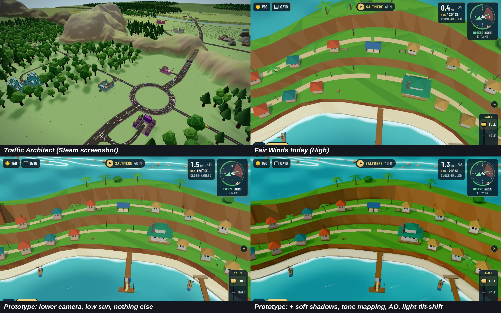
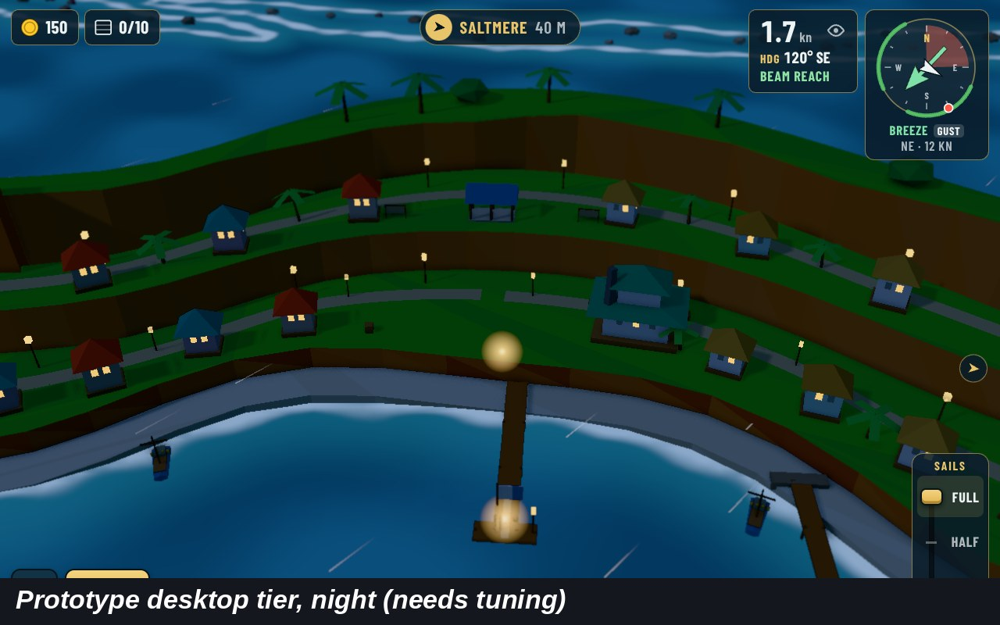
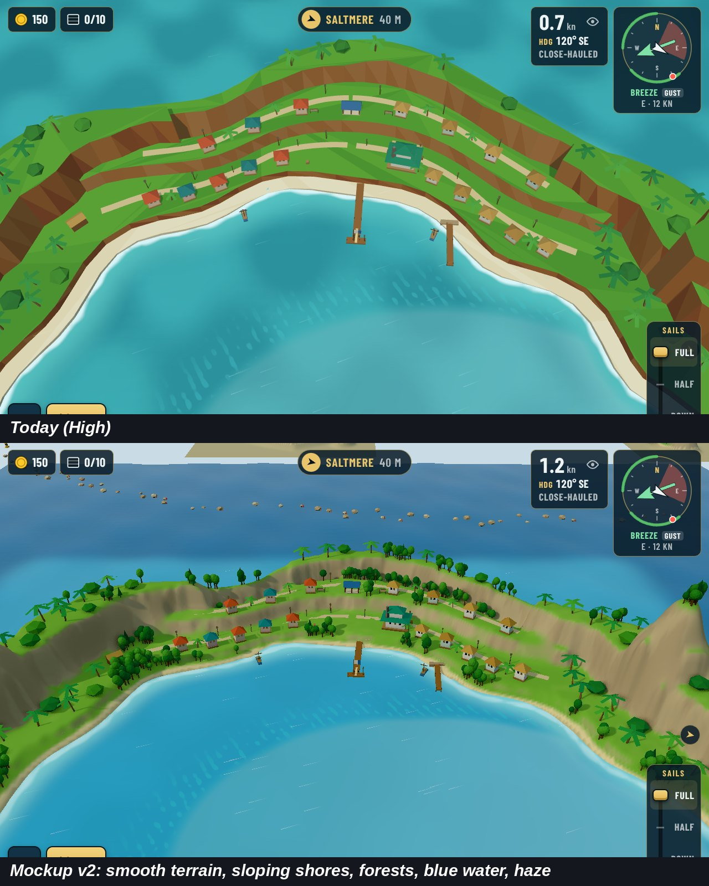
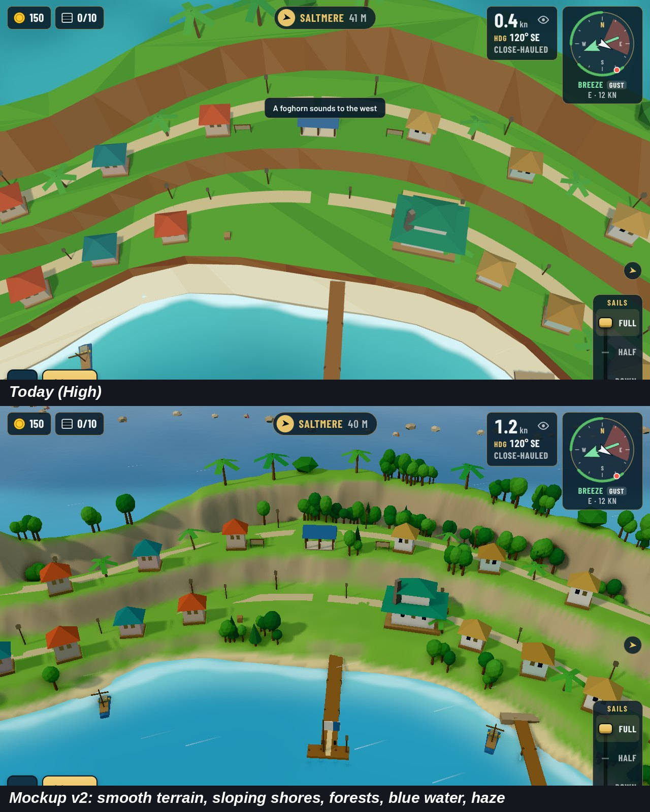
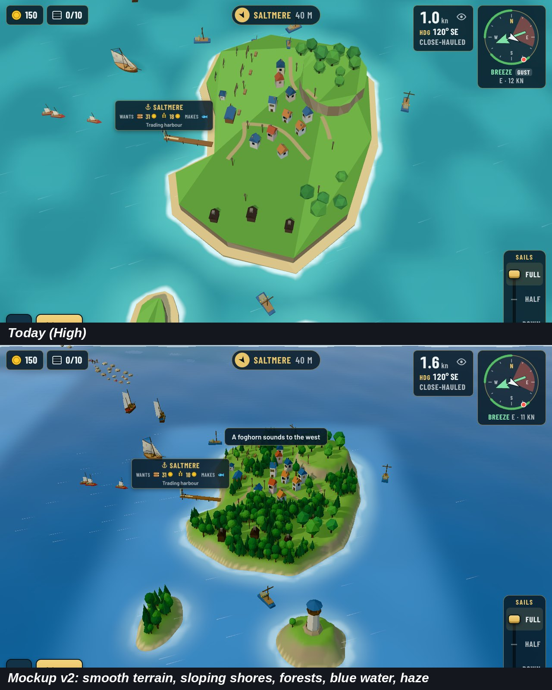

# Desktop and Xbox graphics: reaching Traffic Architect's level

Study of 2026-10-26 behind decision [0221](../../decisions/0221-an-ultra-quality-level-for-desktop-and-xbox.md). Guillaume: players say the game does not look good enough on computers (phones are fine); reach *Traffic Architect*'s level, achievable, not AAA. Full write-up: the Claude Doc "Better graphics on desktop and Xbox".

## What Traffic Architect does

*Traffic Architect* (Green Signal Games, [Steam](https://store.steampowered.com/app/5028050/Traffic_Architect/), needs WebGL 2) uses models as simple as ours. The difference is the scene:

| Area | Traffic Architect | Fair Winds v1.0 (High) |
| --- | --- | --- |
| Camera | About 30 to 45°, hills, haze and sky on the horizon | 58° pitch, looking north; the frame is mostly water |
| Shadows | Low sun, soft shadows from every tree and house | High sun; shadows only from island ground, only on High |
| Terrain | Smooth rolling hills, soft colour patches, grass tufts | Stacked flat-shaded tiers, one colour per face |
| Assets | Big varied trees in dense woods, busy roads | Bare grass planes between houses |
| Water | Depth colour, soft shore foam, sky reflection | Turquoise with streaks and foam |
| Colour | Tone mapping and distance haze | Raw colours, fog only |

## Prototype

Sunreach at the town camera (`--look -95,-610 --zoom 0.9`), effects switched on from a page script through `npm run shots -- --script` (no game code changed): a camera lowered to about 35° with a low sun, soft 4096 px shadows on all lit meshes, neutral tone mapping, three.js `GTAOPass` ambient occlusion with the water left out, and light tilt-shift.

- The **camera and sun** make the biggest change.
- **Shadows, tone mapping and occlusion** seat the houses and give the cliff bands depth.
- **Tilt-shift** is barely visible at our camera distance: dropped.
- **Night** gets too dark with the effects (below): it needs its own tuning.
- Not measured: frame rate (the headless browser has no real GPU). `?bench` on a desktop and an Xbox decides.
- Not fixed by rendering: the bare grass. Only terrain and prop work (v1.2) fills it.

Single shots: [today](today.jpg), [prototype](prototype.jpg). The page script is kept in the project files (`graphics-desktop/prototype-fx.js`); the build thread turns it into the real Ultra level and a `shots --quality ultra` option.

## Options weighed

| Option | Verdict |
| --- | --- |
| Ultra quality level in the web build | Chosen (0221) |
| Drop the old tablet | Not needed: Ultra leaves Low and Medium alone |
| WebGPU renderer | Later, only if Ultra runs short of frame time; our shaders would need rewriting |
| Native desktop app (Tauri, Electron) | A store decision (0204), no visual gain by itself |
| Engine change (Unity, Godot) | No: months of rewrite, and Traffic Architect runs on WebGL 2 |

## Mockup v2: the approved direction

After seeing more *Traffic Architect* shots, Guillaume asked for smooth ground and real-like terrain. Mockup v2 (page script, no game code changed) rebuilt each island's ground as a smooth heightfield from its own terrain, kept the town terraces, sloped the shores into the sea, planted dense instanced woods, coloured the water from the seabed depth and added haze. Guillaume, 2026-10-26: "Yes that's exactly the direction we want." Decision [0222](../../decisions/0222-a-new-look-smooth-terrain-blue-water-and-forests.md).

Today on top, mockup below:

Mockup limits: placeholder trees, the old cliff rim shows as a speckled band at some shores, no island reflections, houses and palms unchanged, not measured for frame rate. The script is kept in the project files (`graphics-desktop/mockup-v2-terrain.js`).
