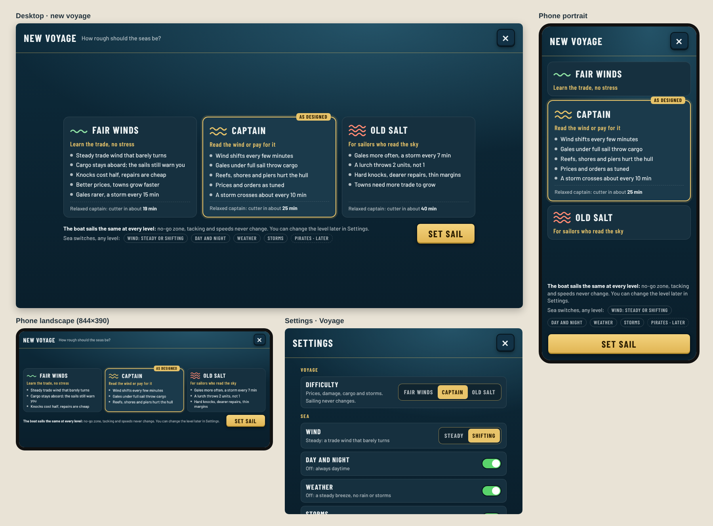

# Difficulty levels: proposal

**Status:** Picked and built (2026-10-22). Guillaume agreed on several levels, added the wind, and said "start working on it": three levels plus the Wind steady/shifting setting. Decision: [0083](../../decisions/0083-difficulty-levels.md). Screenshots of the built screens: [docs/screenshots/difficulty/](../../screenshots/difficulty/).

Guillaume: "game can be difficult which is a good and a bad thing. how can we go about making distinct difficulty levels?"

Mockup source: [docs/mockups/difficulty/mock.html](../../mockups/difficulty/mock.html) (`node docs/mockups/difficulty/render.mjs` re-renders the PNGs).

## The rule: sailing stays honest

The audience is sailing fans first. So the boat sails the same at every level: polars, no-go zone, tacking, leeway, shallows drag, island lee and gusts, the press warning and the mooring rule never change. Difficulty only changes **what a mistake costs** and **how fast the trade pays**. A good sailor is rewarded at every level, and nobody learns a "wrong" boat on an easy level.

## What makes the game hard today

| Source | Where | What it costs now |
| --- | --- | --- |
| No-go zone, tacking, in irons | `noGoAngle` per class, `src/sim/ship.ts` | Time. Stays the same at every level. |
| Reef strikes and shore/pier/boat crashes | `STRIKE_DAMAGE` 6, `CRASH_DAMAGE` 5 per kn, `src/sim/hazards.ts` (0032, 0038, 0082) | Hull points, a leak that slows her up to 25 %, then repairs. |
| Repairs | `REPAIR_COST` 2 g per point (0046) | A 6 kn reef strike costs 72 g, about a third of an early leg. |
| Cargo overboard | `OVERPRESSED_KN`, `LURCH_*`, `src/sim/world.ts` (0067, 0074, 0078) | 1 unit per lurch or 3 s overpressed, gales and storms only. |
| Weather and storms | `DEFAULT_WEATHER`, `src/sim/wind.ts` (0067) | Gales 15 % of spells; a storm every 10 min. Both can be switched off. |
| Night | `src/sim/daylight.ts` (0068) | Harder to see reefs and coasts. Can be switched off. |
| Economy pace | port's cut 6 %, order reward × 1.5, start gold 150 (0046) | Relaxed captain: cutter after about 25 min. |
| Upgrade gates and town growth | `GROWTH_TO_LEVEL` 40/150/350, home port level gates (0059, 0065) | Top upgrades wait for Saltmere to grow; relaxed captain gets there after about 45 min. |
| Catch-up help orders | 0069 | Make it easier: kept at every level. |

## Three presets

| Knob | Fair winds | Captain (today, unchanged) | Old salt |
| --- | --- | --- | --- |
| Sailing (polars, no-go, tacking, shallows) | same | same | same |
| Cargo overboard | **off**; the sails still turn amber/red so you learn | 1 unit per lurch | **2 units** per lurch, same warning lines |
| Reef and crash damage | × 0.5 | × 1 | × 1.5 |
| Repairs (gold per hull point) | 1 | 2 | 3 |
| Port's cut on trades | 2 % | 6 % | 11 % |
| Order reward factor | 2.0 | 1.5 | 1.25 |
| Start gold | 250 | 150 | 100 |
| Town growth needed | × 0.75 | × 1 | × 1.25 |
| Wind direction | **steady trade wind**: about ± 15° round the prevailing wind, slow changes, sea regions barely bend it, softer gusts | dynamic wind as now (0064): a new direction every 3 min, up to 75° a step, regions bend ± 40° | as Captain, or a little shiftier |
| Gale share of weather spells | 8 % | 15 % | 22 % |
| A storm crosses the sea every | 15 min | 10 min | 7 min |
| Help orders | on | on | on |

Names follow the game's voice: **Fair winds** (the game's own name), **Captain** (the current mode is already called Captain), **Old salt** (an experienced sailor).

Wind direction (Guillaume, 2026-10-22: "dynamic wind as there is now will feel brutal"): the steady trade wind on Fair winds is probably the knob players feel most. It keeps sailing honest, since the boat sails exactly the same and only the sea is kinder. The level only sets the **default**: a Settings choice **Wind: Steady / Shifting** sits next to Day and night, Weather and Storms, so a sailing fan can play Fair winds prices with shifting wind, or Old salt with a steady one (Guillaume asked whether to mix it into the levels; proposed answer: yes as a default, with an override, because wind is a matter of taste while damage, prices and cargo are how forgiving the game is). Two things to check when building it: with a near-fixed wind some legs are always a beat and others always a reach, so route balance must be re-simulated before fixing the range; and a level change at sea blends the wind over a minute or two instead of snapping it.

## Effect on pace (balance simulation)

`tests/difficulty-balance.test.ts` runs the 0046 balance sim on each level with the game's own knobs (`src/sim/difficulty.ts`): start gold, the port's cut, order rewards, damage, repair price and town growth. Fair winds times its legs over the steady wind's narrow range (about ± 10° instead of ± 50°), so legs into the wind stay beats. 120 minutes of play; the relaxed captain is the median of 5 seeds.

| Level | Captain | 1st upgrade | Cutter | Cutter maxed | 1st town | Repairs / income |
| --- | --- | --- | --- | --- | --- | --- |
| Fair winds | sharp | 2.4 min | 9.0 min | 38 min | 12 min | 0 % |
| Fair winds | relaxed | 5.4 min | 21 min | 67 min | 31 min | 1 % |
| **Captain** | sharp | 4.9 min | 14.5 min | 46 min | 24 min | 0 % |
| **Captain** | relaxed | 7.3 min | 25 min | 80 min | 60 min | 3 % |
| Old salt | sharp | 4.9 min | 14.5 min | over 2 h | 32 min | 0 % |
| Old salt | relaxed | 7.5 min | 31 min | 102 min | 63 min | 10 % |

Reading it: on Fair winds a relaxed captain reaches the cutter about as fast as a sharp one on Captain, and towns grow in half the time, so the top upgrades come within a session or two. Old salt hardly slows a sharp captain early but stretches the long game (no maxed cutter in 2 h), and a careless captain pays 10 % of income in repairs. The steady wind costs Fair winds about a minute on the cutter (some legs are always a beat), which the better prices more than make up. The sim does not model cargo overboard, storms or night, so Old salt feels harder at sea than these numbers say, and Fair winds softer. The tests check the order of the levels and these targets; Captain's own targets stay in `tests/economy-balance.test.ts` (0046).

## How it fits with the Settings switches

- **Two separate things.** The switches (Wind steady/shifting, whose default comes from the level; Day and night, Weather, Storms, and Pirates in Phase 5) decide *what happens at sea*. Difficulty decides *what it costs*. They stay independent at every level, so a player can pick Old salt with storms off, or Fair winds with night on.
- The switches stay global (Settings, localStorage). Difficulty belongs to the voyage (see below).
- **Pirates (Phase 5)** get their own switch, as Guillaume asked. Difficulty then scales them like the rest: how often they show up and how much a boarding takes (for example, Fair winds: they chase and warn but take nothing; Old salt: they take more and patrol the long hauls).

## Changing it mid-voyage, and saves

- Picked on **New voyage** (the screen in the mockup). Captain is preselected.
- **Changeable at any time** in Settings › Voyage. It takes effect at once: prices and damage use the new values; orders already posted keep their reward; nothing is refunded or taken back. Forcing a restart to change it would punish exactly the player who is struggling.
- **Saved with the voyage**: a new optional `difficulty` field in the save (`'fair' | 'captain' | 'salt'`), so no save version bump. Older saves load as Captain, which is the game they were playing. Save transfer (0066) carries it for free.
- The save also keeps the **easiest level used** on that voyage, for later: racing missions and any best-times board can show it or require Captain. Racing missions pin their own difficulty, as they already pin wind and storms (0072).

## Kids mode

Kids mode (shelved in [0043](../../decisions/0043-shelve-kids-mode.md)) is a different axis: it changes the *presentation* (words instead of numbers, simpler screens), not the costs. When it comes back in Phase 7 it should be **Kids UI on top of Fair winds**, locked to it. Fair winds gives that rework its gameplay half for free; the difficulty picker is not Kids mode and does not hide any sailing numbers.

## As built

- `src/sim/difficulty.ts`: the levels, their knobs and `weatherFor` (gales, storms and the steady trade wind, cached so the weather walk keeps its cache).
- Read by `hazards.ts` (repairs), `world.ts` (crash damage, cargo overboard, wind with a 60 s blend when the level or the Wind setting changes), `market.ts` (the port's cut, per market), `contracts.ts` (next order's reward) and `settlement.ts` (growth).
- `TradeState.difficulty` and `easiestDifficulty`, saved as optional fields (no save version change). `setDifficulty` and `startVoyage` in `trade.ts`.
- New voyage screen (`#new-voyage`), shown when Play starts a fresh voyage; Settings › Voyage › Difficulty and Settings › Wind. EN and FR (French names: Bon vent, Capitaine, Vieux loup de mer).
- On Fair winds the one-time strong-wind message says the cargo would go over on harder levels.
- Changing level at sea drops a storm already under way (the storm tracks depend on the level's interval).
