# Epilogue "Fair winds": screenshots (2026-10-24)

Static screenshots of the epilogue ([0134](../../decisions/0134-fair-winds-epilogue.md)), taken from the running game with `?debug&home`, with the four arcs marked done. The build-spot markers show because `?home` offers every spot.

| | Desktop | Phone landscape | Phone portrait | Desktop, French |
|---|---|---|---|---|
| Rook calls you home | 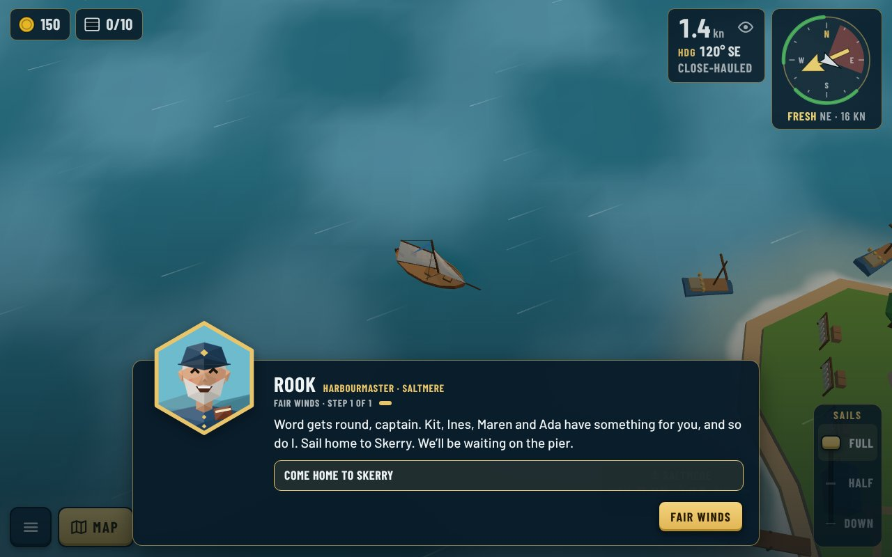 | 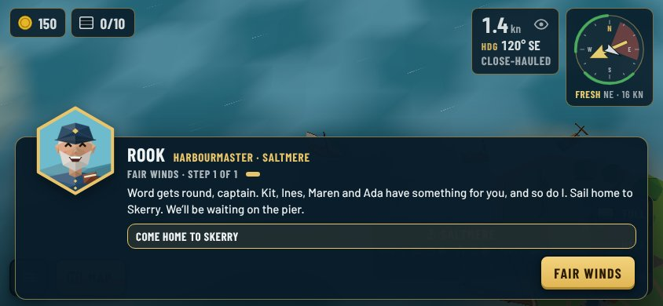 | 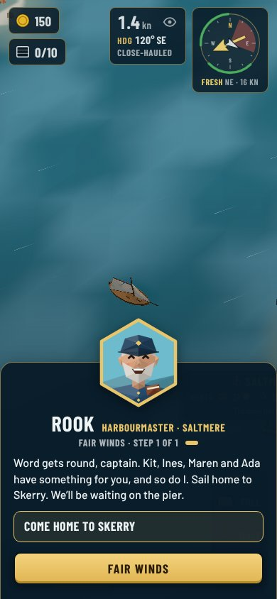 | 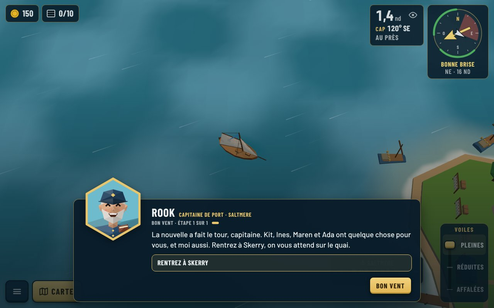 |
| Moored at Skerry: his thanks | 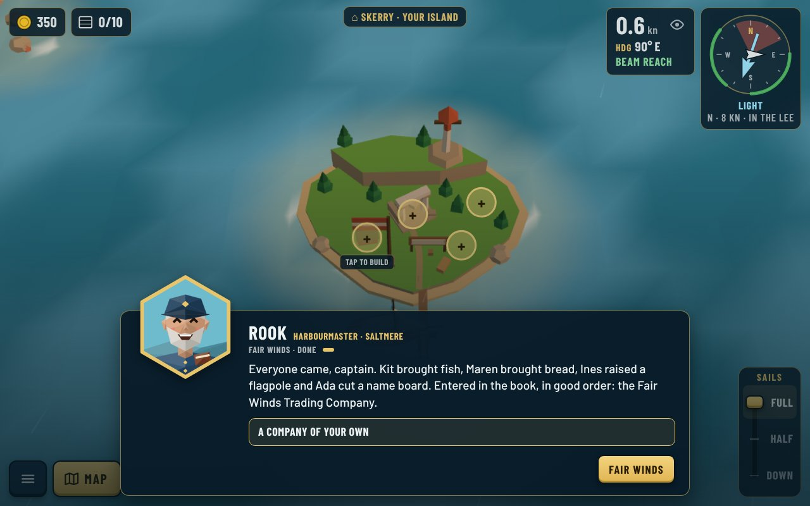 | 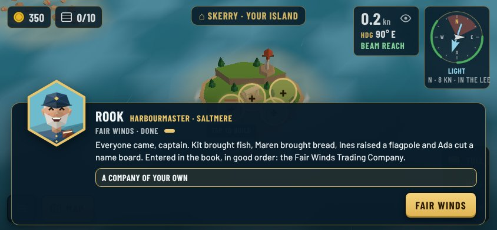 | 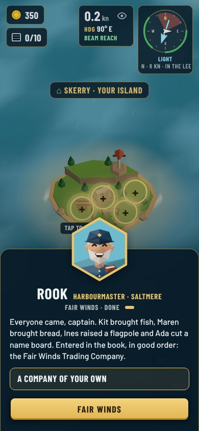 | 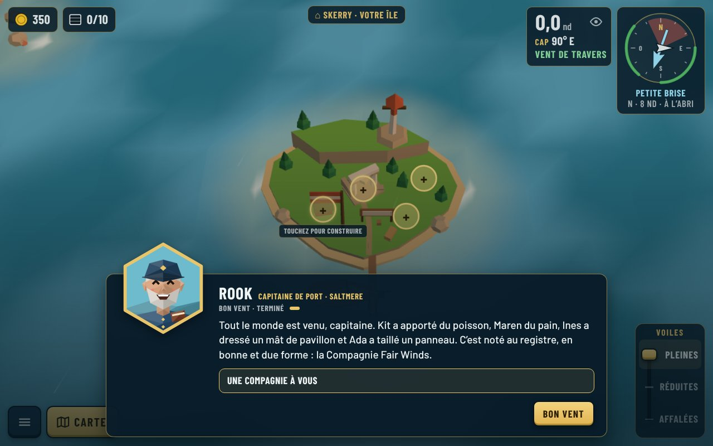 |
| Skerry afterwards: flag and name board | 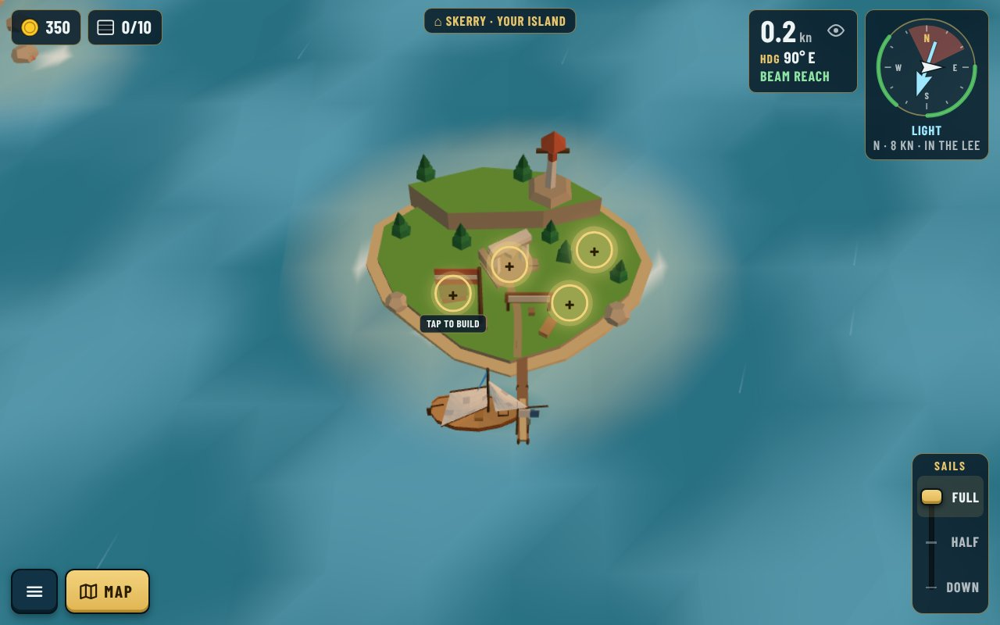 | 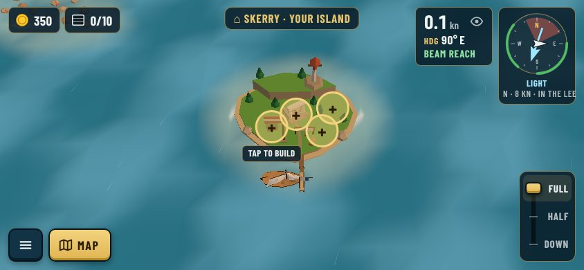 | 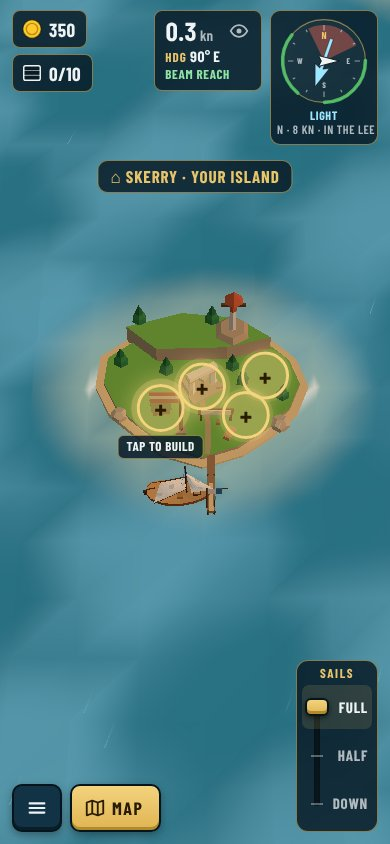 | 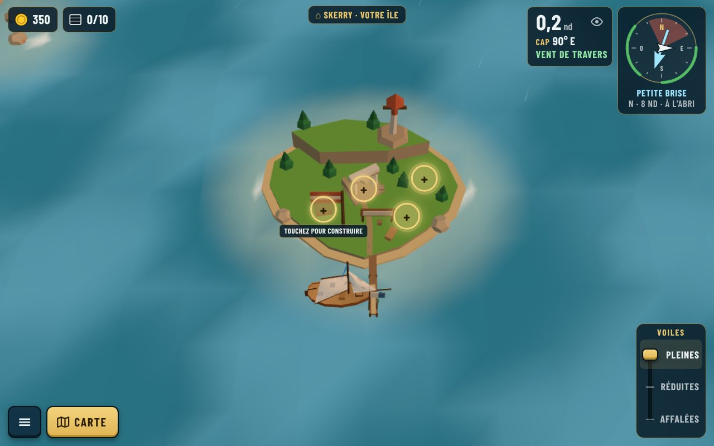 |
