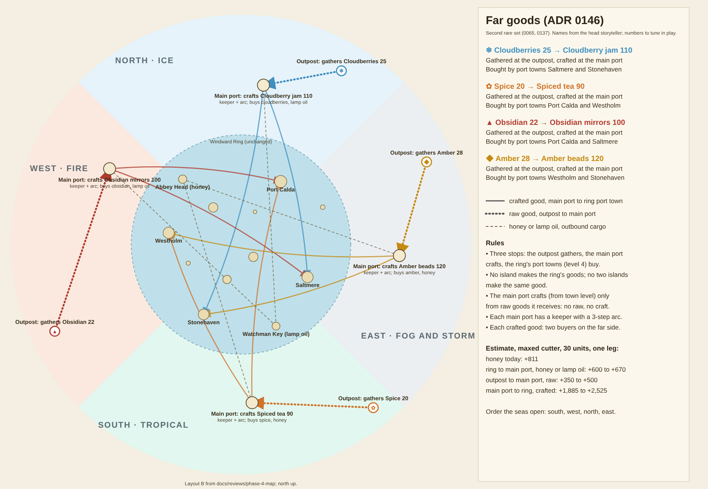

# Far goods for the biomes (Phase 4 economy pass)

**Status:** Decided in [0146](../../decisions/0146-far-goods-from-the-biome-outposts.md), 2026-10-24, after four rounds with Guillaume and the head storyteller. Docs and data proposal only, no code. The last preparation step from [0137](../../decisions/0137-phase-4-biomes-and-founded-outposts.md).

**Read for this pass:** [0065](../../decisions/0065-rare-goods-from-the-far-yards.md) (rare goods, port town gate), [0063](../../decisions/0063-specialized-town-goods.md) (specialties), [0059](../../decisions/0059-settlement-levels.md) (town levels), [0046](../../decisions/0046-phase-1-economy-tuning.md) (economy targets), [0137](../../decisions/0137-phase-4-biomes-and-founded-outposts.md) and its [layout review](../phase-4-map/README.md), [0140](../../decisions/0140-wind-zones-and-currents.md) (wind zones and currents), `src/data/tuning/goods.json`, `economy.json` and the ring's ports in `src/data/phase1-map.json`. The code was checked with graphify (`graphify update .`, then `graphify query` on the rare goods and market code).



## What exists today

- Ten goods: four raw (fish 8, grain 10, timber 14, stone 18), four town specialties (20 to 40) and two rare goods, honey 55 and lamp oil 50 ([0065](../../decisions/0065-rare-goods-from-the-far-yards.md)).
- Each ring town makes a raw good, and from town level (3) its workshop makes a specialty from it (fish → smoked fish, [0063](../../decisions/0063-specialized-town-goods.md)).
- The far yards make honey and lamp oil once they are villages. A town that buys one becomes a port town (level 4) only after receiving 20 units of it.
- Level 4 is the top level. Today it only brings bigger orders.
- 0065 promised a second, rarer set that only port towns want. 0137 moved it to the four biomes, each with an inhabited main port and an outpost the player founds.

## Proposal

**Every far voyage has three stops: the outpost gathers, the main port crafts, the ring buys.** It is the ring's own pattern (raw good, then a workshop's specialty), stretched across a sea. No island makes the ring's goods, and no two islands make the same good.

### The goods, in the order the seas open

Names, order and openers from the head storyteller (cozy: no weapons, no alcohol, no animal products). All four seas open after the ring arcs, each through someone from the ring. Prices climb with the order.

| Opens | Biome | Raw, gathered at the outpost (EN / FR) | Crafted at the main port (EN / FR) | Opened by |
|---|---|---|---|---|
| 1st | South, tropical | Spice / Épices, 20 | Spiced tea / Thé épicé, 90 | Old Ness's chart (Watchman Key) |
| 2nd | West, fire | Obsidian / Obsidienne, 22 | Obsidian mirrors / Miroirs d'obsidienne, 100 | Ines's contact (Port Calda) |
| 3rd | North, ice | Cloudberries / Mûres arctiques, 25 | Cloudberry jam / Confiture de mûres arctiques, 110 | Kit's contact (Saltmere) |
| 4th | East, fog and storm | Amber / Ambre, 28 | Amber beads / Perles d'ambre, 120 | Maren's contact (Westholm) |

### The three stops

1. **The outpost you found gathers the raw good.** Once it is a village it gathers it like a ring town makes fish (a full bulk stock), so it is cheap there. Only the main port of its biome buys it. This short hop is the biome's everyday trade.
2. **The main port is the heart of its biome.** It buys the raw good from its outpost, and honey or lamp oil, ring specialties and founding goods from the ring. Its **workshop** crafts the finished good from town level, only from raw goods it has received: each raw unit delivered becomes one crafted unit, so without supplies from the outpost it makes nothing better. The workshop keeps a big stock, like the far yards (70 % share). The main port grows with levels and wants like a ring town, and posts delivery orders.
3. **The ring's port towns (level 4) buy the crafted good.** Each crafted good has two buyers on the far side of the ring, and each ring town buys two once it is a port town:

   | Crafted good | Bought by |
   |---|---|
   | Spiced tea | Port Calda, Westholm |
   | Obsidian mirrors | Port Calda, Saltmere |
   | Cloudberry jam | Saltmere, Stonehaven |
   | Amber beads | Westholm, Stonehaven |

### The main port's people

Each main port has **one keeper of its craft**, named in the storyteller brief. The keeper is the voice of the port and has its own 3-step arc, which changes how the port looks (`after:` tags, as on the ring). The keeper also gives the quest to found the outpost. The relative from the ring who opened the sea is a different person. A biome fitting for your ship (ice-strengthened bow, shallow-water gear, ash screens, fog bell) could later be the prize at the end of a keeper's arc. It is not part of this pass.

| Biome | Main port buys from the ring | Outpost needs to grow |
|---|---|---|
| Tropical | Honey (Abbey Head), specialties | Grain, timber; then planks and stone |
| Fire | Lamp oil (Watchman Key), specialties | Fish, timber; then planks and bread |
| Ice | Lamp oil (Watchman Key), specialties | Grain, timber; then planks and cut stone |
| Fog and storm | Honey (Abbey Head), specialties | Fish, stone; then planks and smoked fish |

### Other rules

- Far goods add no level 5 and never count toward the honey and lamp oil gate (0065). Outposts stop at level 3.
- Delivery orders use today's formula, which already pays more for long hauls.
- The shared toast line (`toast.rareGood`) fits the crafted goods in English and French.

## What the player earns

`src/estimate.test.ts` times each leg with the balance simulation's own leg model (`legSeconds`) on the ring plus the placeholder sites of the [layout review](../phase-4-map/README.md), and prices a 30-unit load with the market formula (Captain's cut). It ignores currents, wind zones and hazards, so it is a first check, not a balance target. Maxed cutter, one leg:

| Leg | Earned | Leg time |
|---|---|---|
| Honey today, Abbey Head to Saltmere (for comparison) | 811 | 60 s |
| **Ring → main port:** honey or lamp oil out | 600 to 670 | 90 to 110 s |
| **Outpost → main port:** raw spice, obsidian, cloudberries, amber | 350 to 500 | 33 to 82 s |
| **Main port → ring port town:** spiced tea | 1,885 | 77 to 103 s |
| Main port → ring: obsidian mirrors | 2,103 | 68 to 83 s |
| Main port → ring: cloudberry jam | 2,311 | 77 to 109 s |
| Main port → ring: amber beads | 2,525 | 80 to 86 s |

A full round (ring → main port → outpost → main port → ring) earns about 2,900 to 3,700 gold. Each stop pays, and the main port is on every round. The first trip, before you have an outpost, pays by the honey or lamp oil you sell there.

### The whole price ladder

| Stage (0046, 0048, 0065) | Goods and prices | One good load earns | Ships at this stage |
|---|---|---|---|
| First hour, the ring | Raw 8 to 18, specialties 20 to 40 | about 100 to 400 | Sloop upgrades 300 / 900, cutter 1,500, hoy 1,800 |
| Far yards found | Honey 55, lamp oil 50 | about 800 | Schooner 5,000, fluyt 7,000 |
| First sea (south) | Spice 20, spiced tea 90 | 350 inside the biome, 1,885 home | Upgrades 1,500 to 6,000 |
| Later seas (west, north, east) | Raw 22 to 28, crafted 100 to 120 | 400 to 500 inside, 2,100 to 2,500 home | Clipper 20,000, indiaman 25,000, upgrades up to 18,000 |

Each stage roughly doubles what the best load earns, the same jump that honey made over the ring goods. The 40-minute targets of 0046 are untouched, since far goods exist only after the ring arcs. Phase 4 balance targets go into `balance-targets.json` once the real 5x map is authored, checked with the `?tune` panel's balance check (0114).

## Data proposal

Nothing is added to the game yet, because the goods would appear in markets before their islands exist. When Phase 4 is built:

- `src/data/tuning/goods.json`: eight entries of a new kind `far` (so they never count toward the 0065 gate), crafted ones with `madeFrom`:

  ```json
  "spice": { "id": "spice", "name": "Spice", "kind": "far", "basePrice": 20, "icon": "🌶️" },
  "spicedTea": { "id": "spicedTea", "name": "Spiced tea", "kind": "far", "basePrice": 90, "icon": "🫖", "madeFrom": "spice" },
  "obsidian": { "id": "obsidian", "name": "Obsidian", "kind": "far", "basePrice": 22, "icon": "🪨" },
  "obsidianMirrors": { "id": "obsidianMirrors", "name": "Obsidian mirrors", "kind": "far", "basePrice": 100, "icon": "🪞", "madeFrom": "obsidian" },
  "cloudberries": { "id": "cloudberries", "name": "Cloudberries", "kind": "far", "basePrice": 25, "icon": "🫐" },
  "cloudberryJam": { "id": "cloudberryJam", "name": "Cloudberry jam", "kind": "far", "basePrice": 110, "icon": "🫙", "madeFrom": "cloudberries" },
  "amber": { "id": "amber", "name": "Amber", "kind": "far", "basePrice": 28, "icon": "🟠" },
  "amberBeads": { "id": "amberBeads", "name": "Amber beads", "kind": "far", "basePrice": 120, "icon": "📿", "madeFrom": "amber" }
  ```

- `economy.json`: no new number. The outpost gathers like a raw producer; the workshop's stock target uses `rareShare` (0.7) but fills only from raw units received (one raw → one crafted). That one rule is new code.
- Map ports: each outpost `levelProduces: { "2": [<raw>] }`; each main port `wants: [<raw>]`, `wantsMade: [honey or lamp oil, specialties]` and `levelProduces: { "3": [<crafted>] }`; each ring port a new `levelWantsMade: { "4": [<two crafted goods>] }`.
- `src/i18n`: the eight names in English and French.
- `characters.json` and the brief: one keeper per main port, from the storyteller.

## Answers so far

- Round 1 (Guillaume): far islands must not make the ring's goods, prices must follow progression, ask the storyteller first, and say plainly what the player earns.
- Round 2 (Guillaume): two islands making the same good is not useful.
- Round 3 (Guillaume): the main ports must be useful more than once. They are the visual and story anchors of their biomes and must be interesting. With the storyteller: the outpost gathers, the main port crafts and has a keeper with an arc, and the ring buys.

- Round 4 (Guillaume): "yes better". He likes that the main port makes nothing better without raw goods, and asked that story quests explain it and that each biome get its arc. So the workshop crafts only from raw goods received, not just after a first 20, and each biome has the opener's quest, the keeper's arc and the founding of the outpost.

Image: `node docs/reviews/far-goods/src/make.cjs` (writes the SVG and, with Playwright, the PNG).
