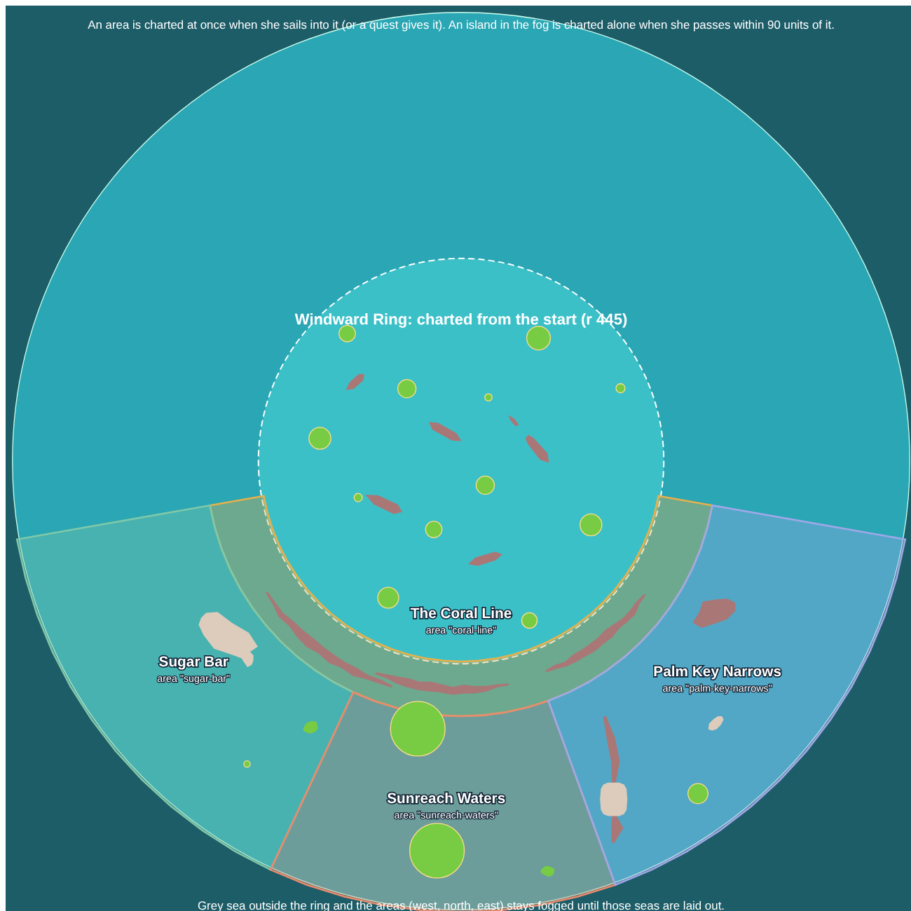
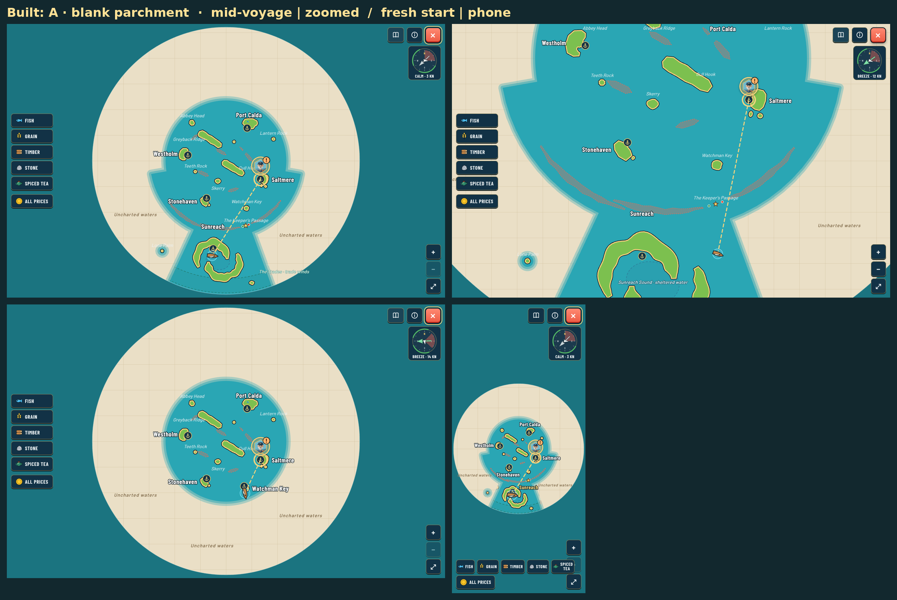
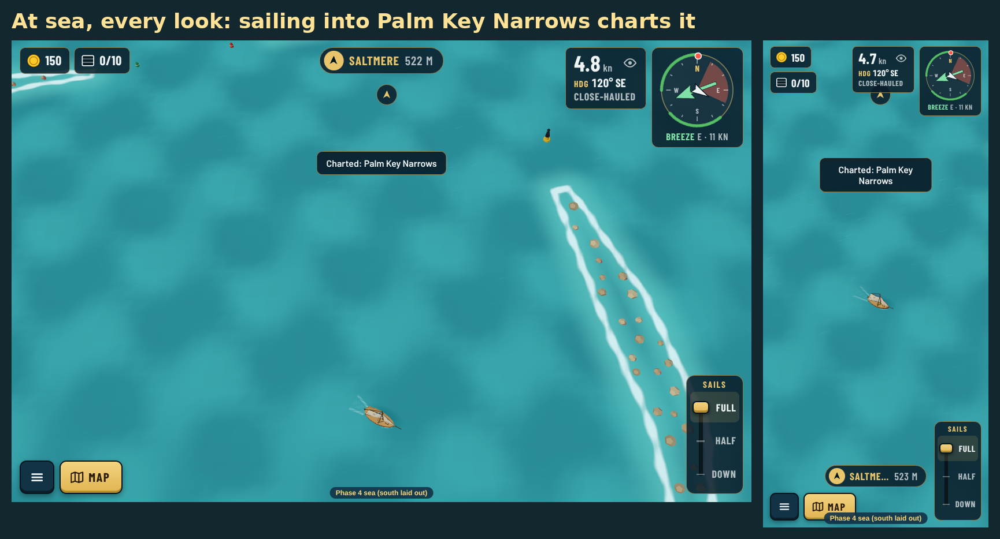
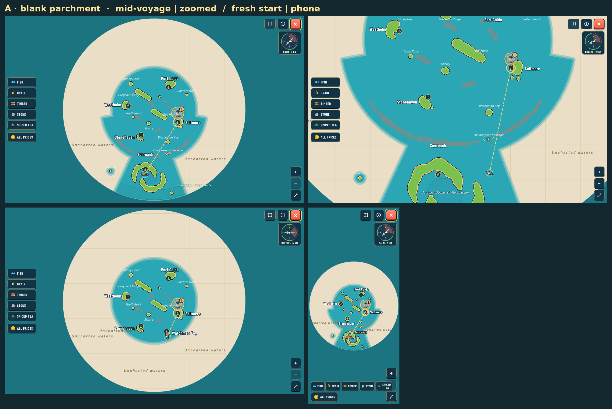
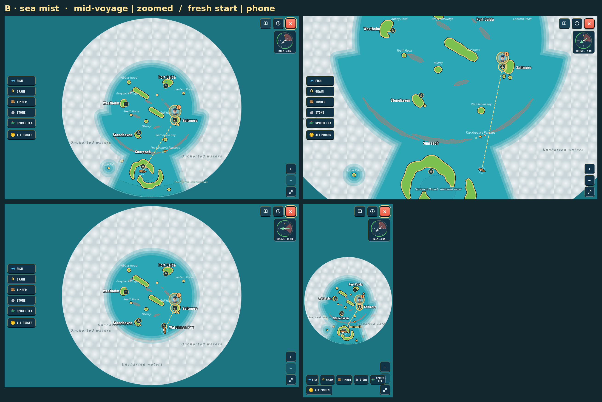
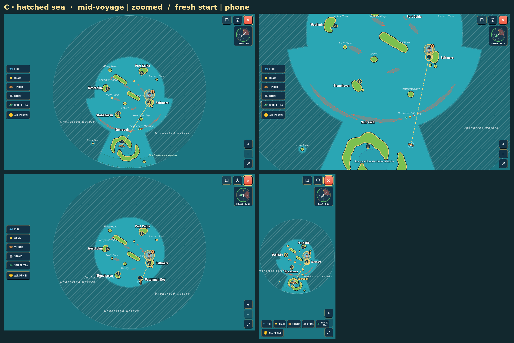

# Fog of war (ADR 0155)

Real captures of the Phase 4 dev sea (`?map=phase4`). Remake them with `npx vite --port 5199`, then `node docs/reviews/fog-of-war/src/capture.cjs` and `node docs/reviews/fog-of-war/src/make-schema.cjs`.

## The areas

The ring stays charted. An area is charted at once when she sails into it, or when a quest step hands it over. An island in the fog is charted alone when she passes within 90 units of it.

## Built: look A, blank parchment (Guillaume's pick)

At sea, sailing into an area charts it with a toast:

## The three proposals

Each sheet: mid-voyage (Old Ness's chart gave The Coral Line and Sunreach Waters; Lone Palm sighted), zoomed in, a fresh start, and a phone.

- A, blank parchment: 
- B, sea mist: 
- C, hatched sea: 

The B and C screenshots were taken with the review-only `&fog=b|c` switch, since removed.
