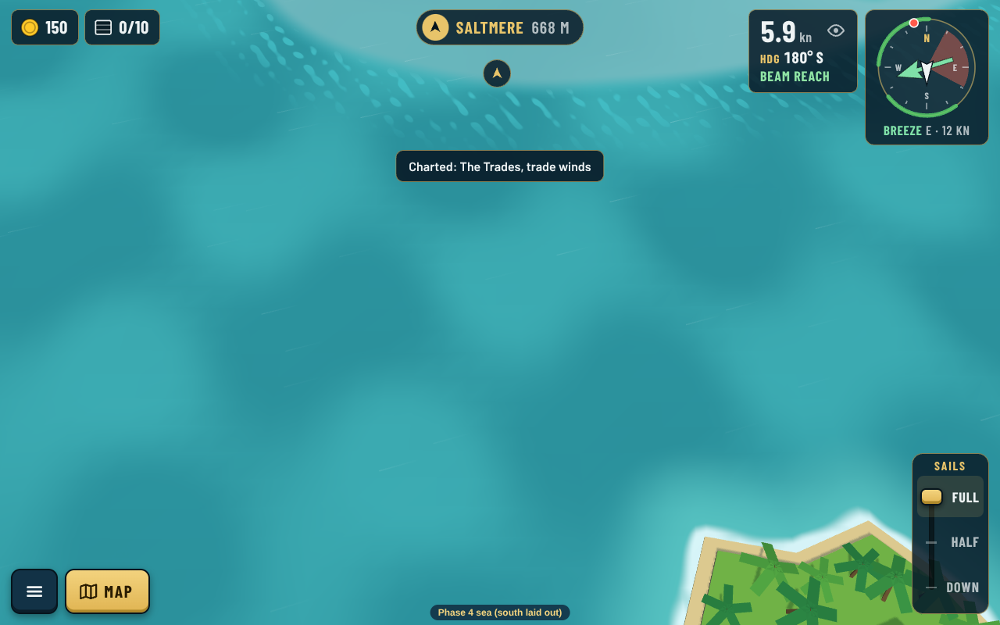
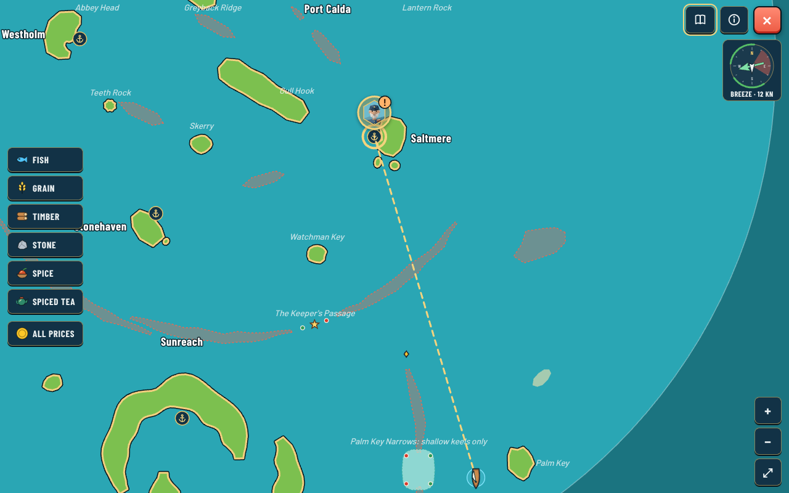
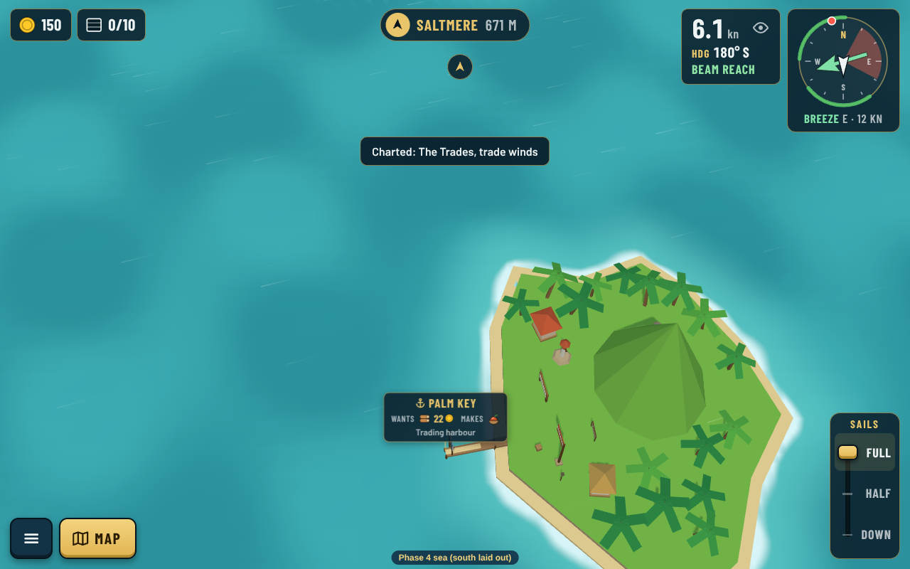
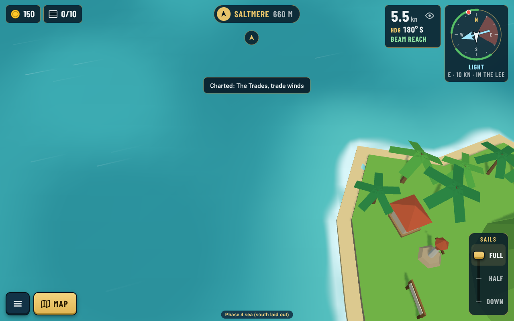
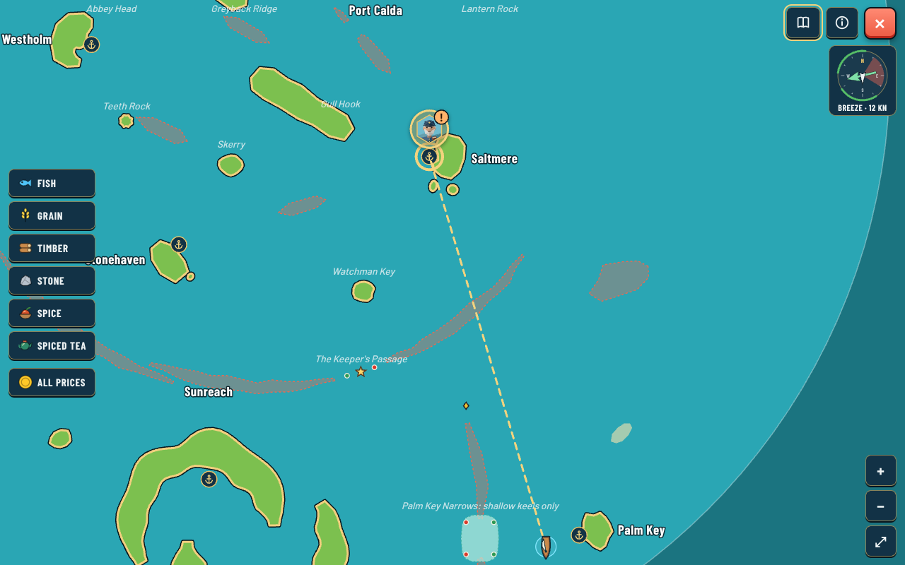
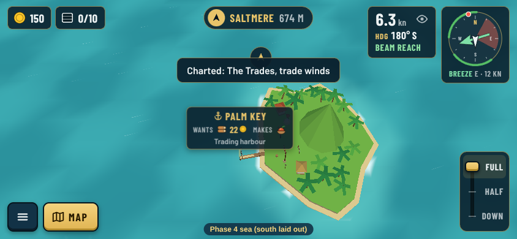
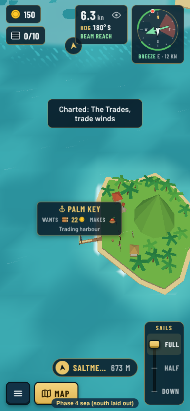
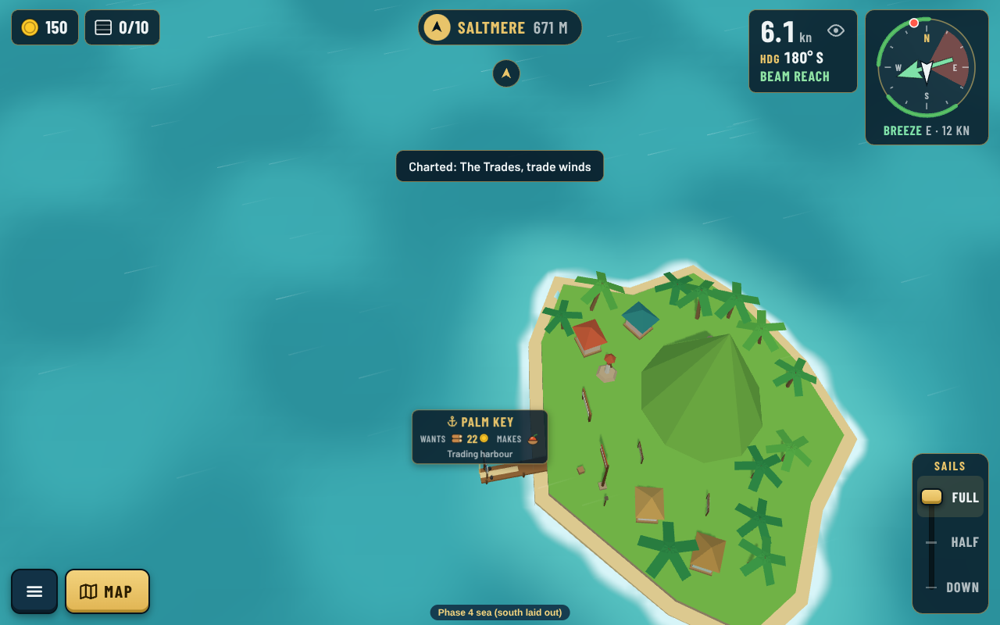
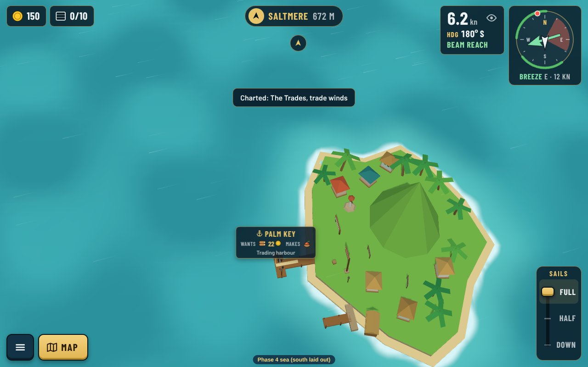

# Founding an outpost: Palm Key

**Decision:** [0155](../../decisions/0155-founding-an-outpost.md) (Accepted: Guillaume said "Ok"). Real captures of the south sea (`?map=phase4`), made with `npm run shots -- --sea phase4 --list docs/reviews/founding/shots.json --out docs/reviews/founding` (the new `--town palm-key:1` option founds the site first). The outpost's town is placed with existing props only (beach houses, drying racks, crates, lamp post, warehouse, the epilogue's flagpole and name board); its layout is new.

## Before founding: an empty island

Palm Key is not a port yet: no pier, no market, no name on the chart, only its stone daymark and palms.

## Founded: a hamlet (level 1)

The flagpole and name board, two homes, crates and a spice drying rack by the new pier. Palm Key goes on the chart as a port and starts gathering spice.

Landscape phone and portrait:

## Growing: village (2) and town (3, the outpost's top)

Two more homes and a rack at level 2; two more homes, a warehouse and a side pier at level 3.

