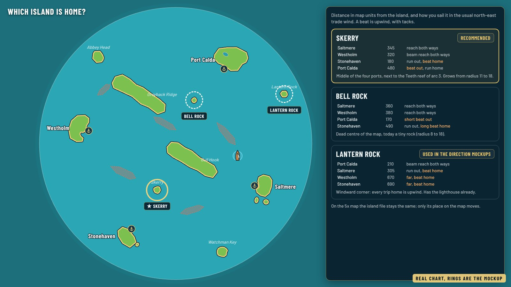
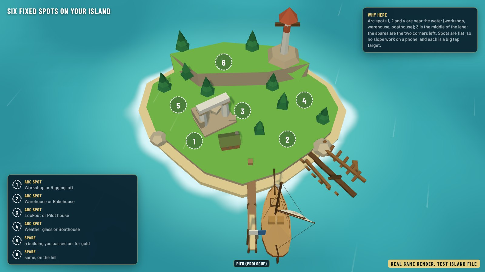
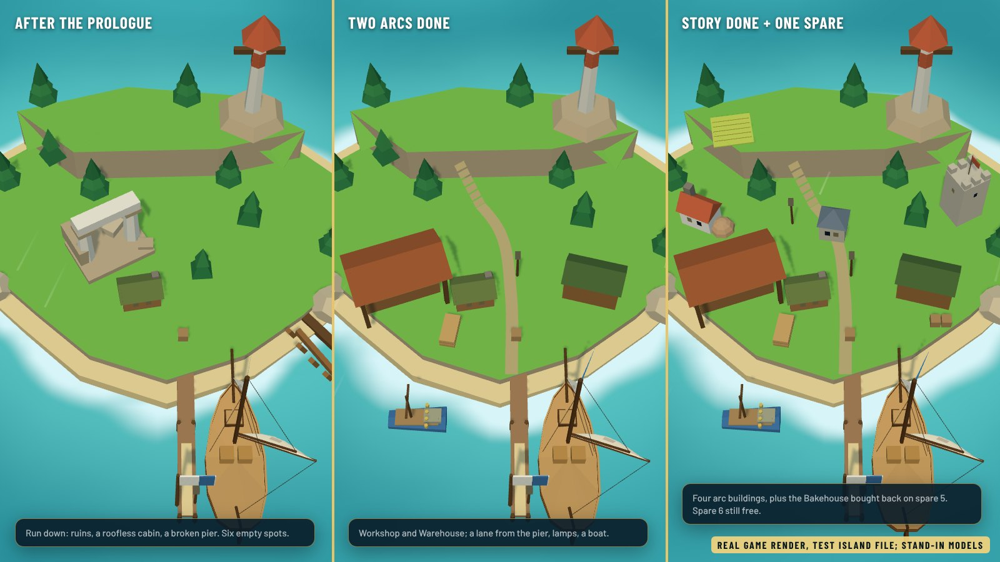
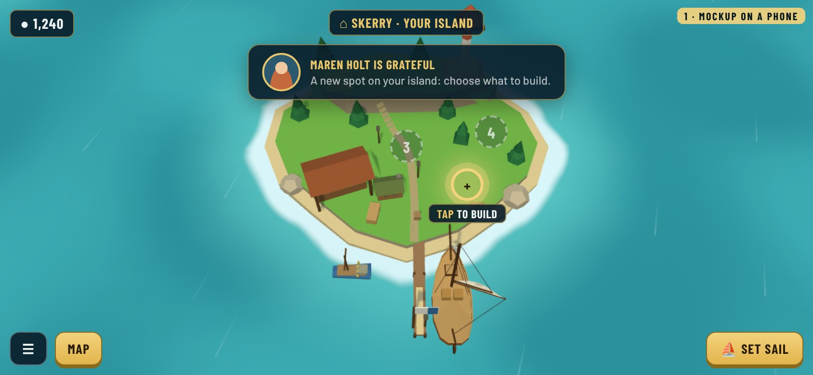
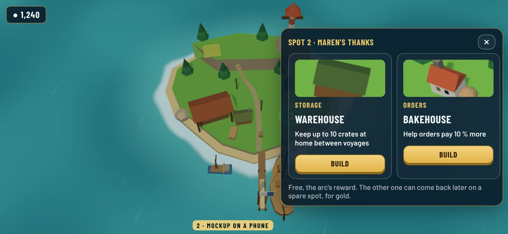
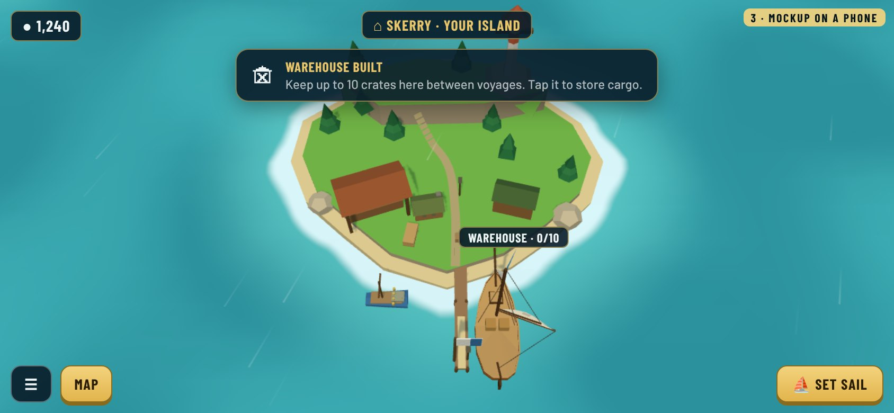
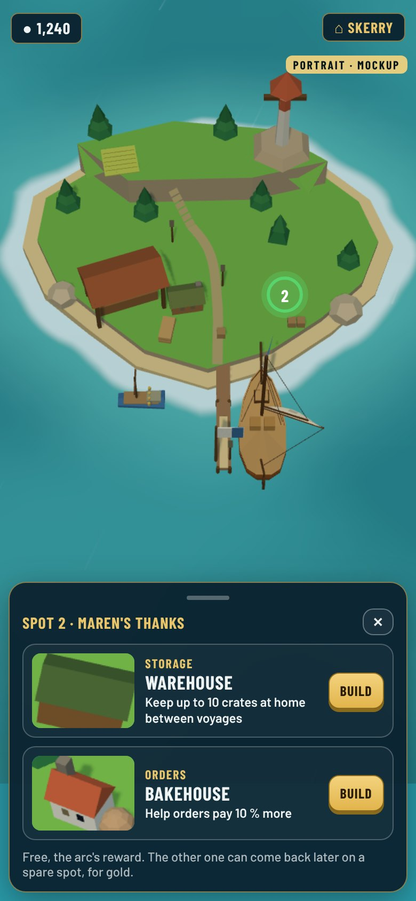
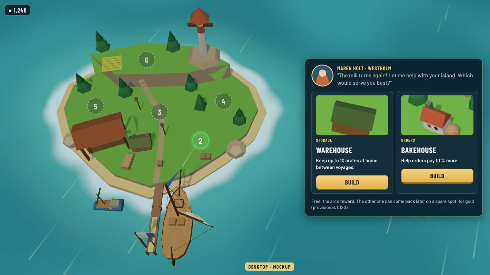

# Home island: which island, where the spots go, tap a spot

**Status:** mockups for Guillaume's pick, 2026-10-23. Nothing in the game changed.
**Follows:** [0120](../../decisions/0120-communities-and-home-island.md) (arcs build your home island; fixed build spots, a choice of two buildings). **Lines up with:** the arcs draft in PR #101 (`docs/story/community-arcs.md`, 6 spots, 8 buildings in 4 pairs; names are placeholders).

Three questions to answer before building it: which island is home, where its fixed build spots go, and how choosing a building works on a phone.

## 1. Which island is home?

Three candidates, all scenery islands today (none is a port). Distances are map units; "beat" means upwind with tacks, in the usual north-east trade wind.

| | Skerry (recommended) | Bell Rock | Lantern Rock |
|---|---|---|---|
| Where | middle of the four ports, south-west of Gull Hook | dead centre of the map | windward (north-east) corner |
| Saltmere (start) | 345, reach both ways | 360, reach both ways | 305, run out, beat home |
| Westholm | 320, beam reach both ways | 380, reach both ways | 670, far, beat home |
| Stonehaven | 180, run out, beat home | 490, run out, long beat home | 690, far, beat home |
| Port Calda | 480, beat out, run home | 170, short beat out | 210, beam reach both ways |
| Size today | radius 11, grows to 18 | radius 8, grows to 18 | radius 10, grows to 18 |

**Recommendation: Skerry.** It is the closest to all four ports on average (330 against 350 and 470), the first trip from Saltmere (the prologue) is a reach both ways, and it sits next to the Teeth reef of the Stonehaven arc, so its new light is visible from home. Lantern Rock, used in the direction mockups, makes every trip home a beat and is far from Westholm and Stonehaven. On the 5x map the island file stays the same and only its place moves.

The arcs draft says "a rock east of here" for Lantern Rock; with Skerry it becomes "west of here".

## 2. Six fixed spots

- **4 arc spots and 2 spares**, as in the arcs draft. Each arc spot takes one pair: Workshop or Rigging loft (1), Warehouse or Bakehouse (2), Lookout or Pilot house (3), Weather glass or Boathouse (4). A spare takes a building you passed on, later, for gold (the provisional rule of 0120).
- Spots 1, 2 and 4 are near the water (workshop, warehouse, boathouse); 3 is on the lane; the spares are the two corners left, 6 on the hill.
- Every spot is flat ground, so no slope rules on a phone, and each is a big tap target. The pier comes with the prologue and is not a spot.
- A spot is a place in the home island's file (`x`, `z`, a radius and which pair it takes), so the island builder can move them.

Real game renders of a **test** island file on Skerry (radius 18), in three stages. The first look is run down (ruins, a roofless cabin, a broken pier), as the arcs draft now asks. The buildings are stand-in props from today's catalogue (cutting shed for the workshop, a farm shed for the warehouse, a stone house, the keep); the real models come with the build.

## 3. Tap a spot, pick one of two (phone first)

| | |
|---|---|
|  |  |
| **1. A spot lights up.** When an arc ends, its person thanks you and that spot glows on your island. Other arc spots show as dim numbers; spares stay hidden until the story is done. | **2. Tap it, choose one.** A card with the two buildings side by side: picture, what it is for, its modifier in one line, Build. The island stays visible on the left. |
|  |  |
| **3. Built.** It appears on the spot straight away, with a short toast saying what it does. | **Portrait.** The same two choices as a bottom sheet, the island above. |

**Desktop.** The same card, bigger, with the person's portrait and one line from them.

- At home the HUD keeps only gold, the menu, Map and **Set sail**; there is nothing to trade, so no port screen. Docking at the pier shows the island and its spots.
- The arc's building is free (its reward). The other one comes back later on a spare spot for gold, provisionally.
- Close (✕) without choosing keeps the spot glowing; you can choose next time.

## How the images were made

- Test island: [src/home-island.py](src/home-island.py) writes a bigger Skerry (with a dock and `harbourBearing` facing south) into a scratch worktree, in stages 0 (arrival), 3 (one arc), 1 (two arcs), 2 (story done).
- Renders: [src/cap.mjs](src/cap.mjs), the game in headless Chromium with `?debug`, the camera held on the island, the ship drawn at the pier, HUD hidden; spots projected with `view.project`.
- UI: [src/frames.html](src/frames.html) in the game's colours and Barlow fonts, over the renders. Frames tagged "mockup" are proposals.
