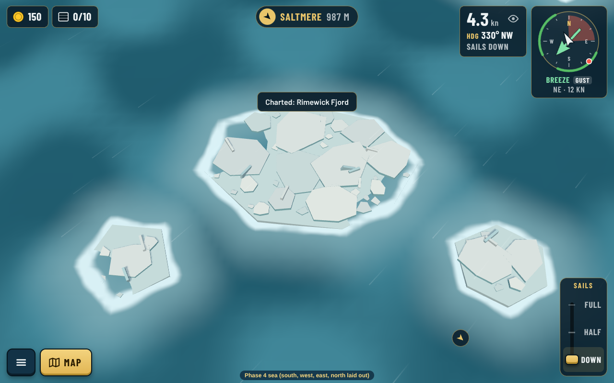
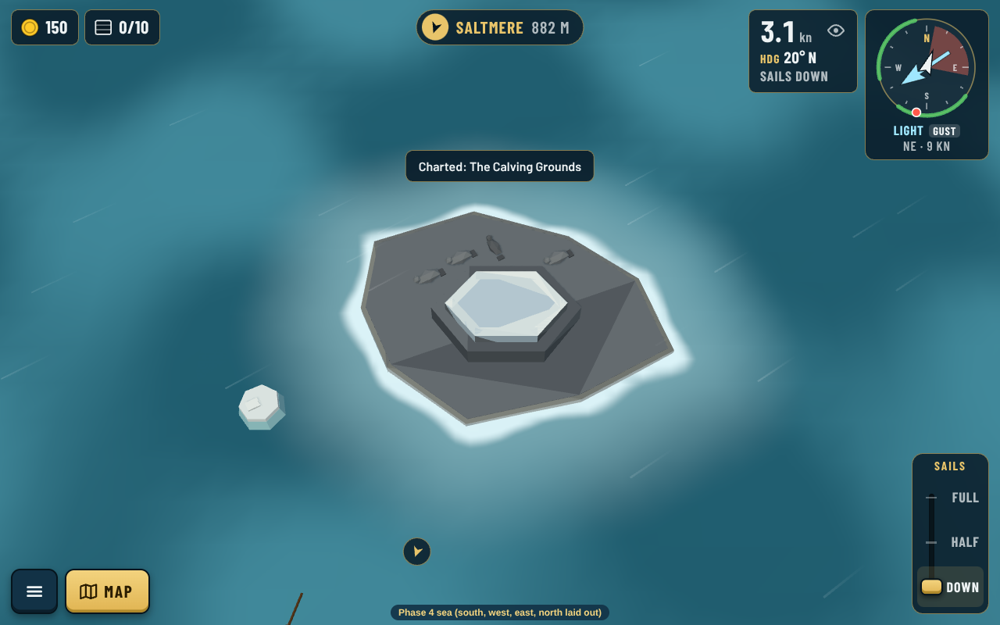
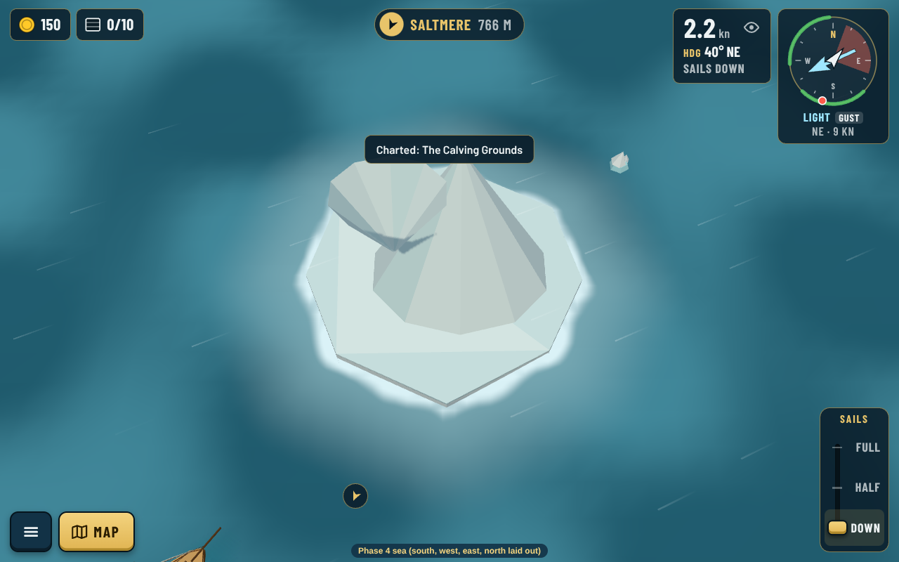
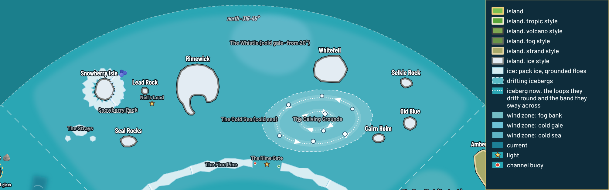

# North sea review: Rimewick, pack ice and drifting bergs (decision 0170)

Screenshots from the real game (`npm run shots -- --list src/final.json`) and the labelled chart (`npm run chart -- --sea phase4 --view -500,450,500,1000`). Art director approved review 2; review 3 applied the art director's tweaks. Review 4 reshapes Rimewick (Guillaume found it too close to Fogwatch): a long west arm curling round the fjord and a short east headland.

| Shot | What it shows |
|---|---|
| [Rimewick](shots/rimewick-desktop.png), [landscape](shots/rimewick-landscape.png), [portrait](shots/rimewick-portrait.png), [close](shots/rimewick-near-desktop.png), [night](shots/rimewick-night-desktop.png) | The main port at its start level, Sunreach's detail level (rule 10): bright fjord houses, the church, Sigrun's jam house, lamp lanes, gardens, fences, sledges, snowmen, firs, slate bands, glacier |
| [Sunreach, same camera](shots/sunreach-same-camera-desktop.png) | The comparison |
| [Snowberry Isle with the pack](shots/snowberry-pack-desktop.png), [founded](shots/snowberry-founded-desktop.png) | The pack closes the cove until `rimewick-jam`; the outpost after founding |
| [Lead Rock, tumbled](shots/lead-rock-tumbled-desktop.png), [lit at night](shots/lead-rock-lit-night-desktop.png) | The beacon before and after Sigrun's arc |
| [The Rime Gate](shots/rime-gate-desktop.png), [Calving Grounds](shots/calving-grounds-desktop.png), [Whitefell](shots/whitefell-desktop.png) | The Floe Line's gateway, drifting bergs, the wild island |
| [Chart, Fair winds](shots/chart-fair-winds-desktop.png), [labelled chart](shots/north-chart.png) | The player's chart (bergs shown on Fair winds only) and the editor's chart with berg loops |
| [Berg loops](shots/berg-drift-two-loops.png), [sea editor](shots/sea-editor-berg-field.png) | Two loops turning opposite ways with sway bands; the berg field's fields in the sea editor |

`src/` holds the steps the islands and the sea were made with (`npm run island` / `npm run sea` steps as data).

## The north's corners (decision 0180)

The density plan ([0180](../../decisions/0180-even-density-across-the-four-seas.md)) asked for one piece or two in each north corner, named by the storyteller. Made with `bash src/mk-corners.sh` (`npm run island` and `npm run sea`), shots from `src/corners.json`:

- **The Strays** (about 320°): three grounded floes, `ice` terrain, well clear of the Snowberry Pack and the cove.
- **Selkie Rock** (about 32°): a slate skerry with a snow cap and four seals, 352 triangles.
- **Old Blue** (about 37°): a grounded berg, an island in `ice` ground with two ice peaks, 103 triangles.

All three lie inside the north's chart areas, so its fog of war lifts as before. `npm run sea -- density`: north 3% empty water, biggest gap r142 at 3° (the open reach under the Whistle, kept on purpose), against a target of no gap over r150. Checks, routes and balance on all three levels pass.

