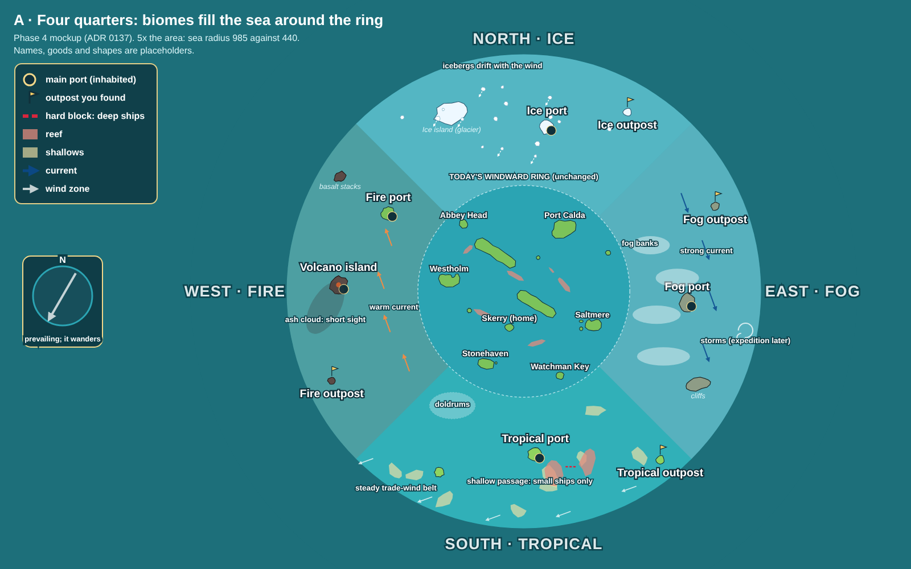
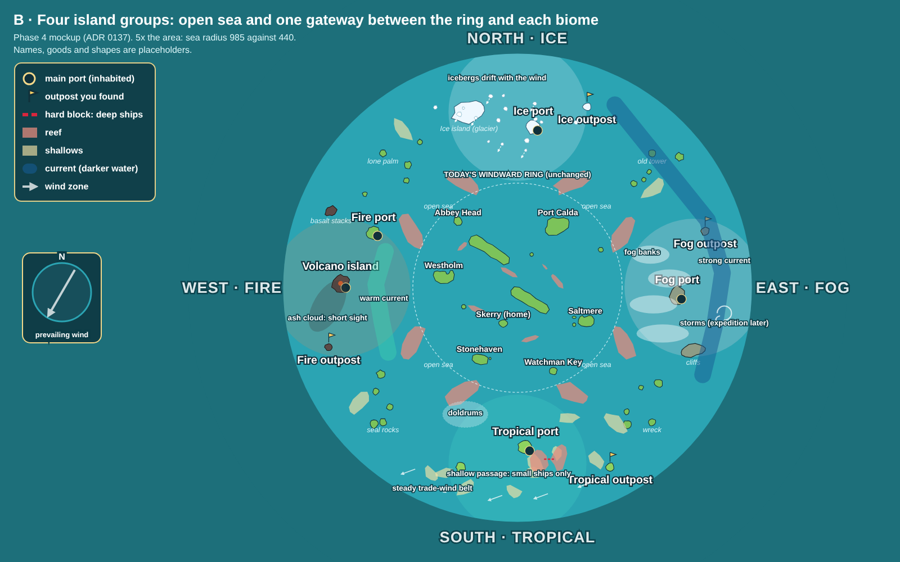
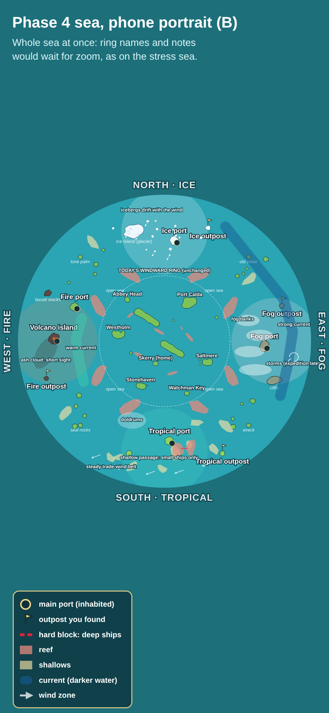
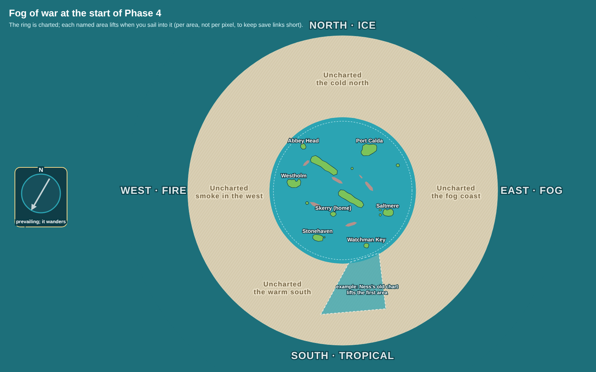

# Phase 4 map layout mockups (2026-10-24)

Static chart mockups of the Phase 4 sea, as decided in [0137](../../decisions/0137-phase-4-biomes-and-founded-outposts.md) ([scope review](../phase-4-scope/README.md)). Today's Windward Ring is drawn from the real map and island files. Everything outside it is a sketch: names, goods, shapes and positions are placeholders. Nothing here changes the game or its data.

**Scale:** the sea grows to 5 times the area ([0115](../../decisions/0115-bigger-map-engine-rules.md)), radius 985 instead of 440. A ring port to a biome's main port is about 350 to 500 units, about one of today's longer legs. A biome's outpost sits near the sea's edge, about 900 units from Skerry, one and a half of today's longest legs.

**Wind:** on Captain and Old salt the wind wanders round the whole compass and differs across the sea ([0064](../../decisions/0064-wind-from-every-quarter.md)). Only Fair winds keeps a steady wind by default ([0083](../../decisions/0083-difficulty-levels.md)). So no biome is fixed upwind or downwind; the arrow on the compass is only the map's starting wind. What the biomes add is local character on top of the wandering wind, for example the tropics' steadier trade-wind belt and doldrums, or the fog coast's gustier storms.

## Two layouts to choose from

### A. Four quarters

The biomes fill the sea around the ring, a quarter each, and border one another. You can sail from one biome straight into the next, for example ice to fog along the north-east. The sea feels continuous and full, but the borders between biomes need a blend, such as icebergs thinning out into fog.

### B. Four island groups

Each biome is a compact group with **open sea** between them. A broken reef barrier around the ring leaves one **gateway** per side. Each biome becomes a distinct destination with its own look. The open sea between groups is room for fast crossings, regattas and, later, pirates (Phase 5). The gateways make a natural first step: each one is "found" before the biome behind it lifts. The cost is reefs just outside today's ring edge, and the ring itself stays unchanged.

**Chosen: B** (Guillaume, 2026-10-24), but "don't make it too empty": the open sea between groups gets islets, a sandbar and a landmark each (old tower, wreck, seal rocks, lone palm), so a crossing always has something to steer by or shelter behind. Why B: Distinct destinations read better on a phone chart, each biome's look stays clean, and the gateways give each biome's arc a clear "first crossing" moment. The open sea also suits a sailing-first audience.

## Phone portrait (layout B)

The whole sea fits a portrait phone. As on the stress sea, small names and notes would wait for zoom.

## Fog of war at the start

At the start of Phase 4 only the ring is charted. Each named area lifts when you sail into it: per area, not per pixel, so the save link stays short (0137 point 1). The shaded wedge is an example of how the head storyteller's planned way in could work: Old Ness's chart from the Watchman Key arc lifts the first area to the south.

## What each biome shows

| Biome | Drawn here | New code needed later |
|---|---|---|
| North, ice | Glacier island, ice port, outpost, icebergs that drift with the wind | Drifting icebergs |
| East, fog and storm coast | Cliff port, cliffs, fog banks, strong current, storms (where the expedition belt can start) | Fog visibility, currents |
| South, tropical | Palm port on a ring island with a lagoon, harbour facing in, staggered entrances ([0143](../../decisions/0143-lagoon-wind-axis.md)), outpost, sand shallows, a reef passage that blocks deep ships, doldrums, steady trade-wind belt | Hard-block passages, wind zones (`sheltered` lagoon) |
| West, fire | Volcano island with ash drifting downwind, fire port, outpost, basalt stacks, warm current | Ash visibility, currents |

Each biome hazard gets a Settings switch, and every story step must work with it off (0137 point 5).

## Decisions (Guillaume, 2026-10-24)

1. **Layout B**, with the open sea between the groups kept busy (islets, sandbars, landmarks), not empty.
2. **The south (tropical) opens first**, through Old Ness's chart from the Watchman Key arc. It is chosen for the story and the gentle sailing, not for the wind, since the wind wanders on Captain and Old salt.

## How to regenerate

`node docs/reviews/phase-4-map/src/make.cjs` (needs Playwright). `src/ring.json` holds today's ring: island coasts as the game builds them (`islandCoasts`), reefs, ports and the home island, dumped from `phase1-map.json`. Dump it again if the ring changes.
