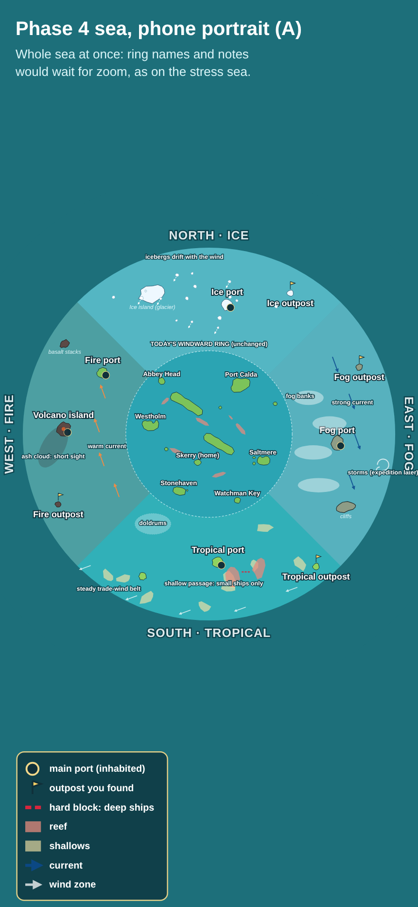

# Phase 4 map layout mockups (2026-10-24)

Static chart mockups of the Phase 4 sea, as decided in [0137](../../decisions/0137-phase-4-biomes-and-founded-outposts.md) ([scope review](../phase-4-scope/README.md)). Today's Windward Ring is drawn from the real map and island files. Everything outside it is a sketch: names, goods, shapes and positions are placeholders. Nothing here changes the game or its data.

**Scale:** the sea grows to 5 times the area ([0115](../../decisions/0115-bigger-map-engine-rules.md)), radius 985 instead of 440. A ring port to a biome's main port is about 350 to 500 units, about one of today's longer legs. A biome's outpost sits near the sea's edge, about 900 units from Skerry, one and a half of today's longest legs.

**Wind:** the prevailing wind blows from the north-north-east (map `wind.fromDeg` 30). So the ice in the north is **upwind**: a beat out and a run home. The tropics in the south are **downwind**: a run out and a beat home, which matches 0065's "one upwind, one downwind". West and east are reaches either way.

## Two layouts to choose from

### A. Four quarters

The biomes fill the sea around the ring, a quarter each, and border one another. You can sail from one biome straight into the next, for example ice to fog along the north-east. The sea feels continuous and full, but the borders between biomes need a blend, such as icebergs thinning out into fog.

### B. Four island groups

Each biome is a compact group with **open sea** between them. A broken reef barrier around the ring leaves one **gateway** per side. Each biome becomes a distinct destination with its own look. The open sea between groups is room for fast crossings, regattas and, later, pirates (Phase 5). The gateways make a natural first step: each one is "found" before the biome behind it lifts. The cost is reefs just outside today's ring edge, and the ring itself stays unchanged.

**My recommendation: B.** Distinct destinations read better on a phone chart, each biome's look stays clean, and the gateways give each biome's arc a clear "first crossing" moment. The open sea also suits a sailing-first audience.

## Phone portrait (layout A)

The whole sea fits a portrait phone. As on the stress sea, small names and notes would wait for zoom.

## Fog of war at the start

At the start of Phase 4 only the ring is charted. Each named area lifts when you sail into it: per area, not per pixel, so the save link stays short (0137 point 1). The shaded wedge is an example of how the head storyteller's planned way in could work: Old Ness's chart from the Watchman Key arc lifts the first area to the south.

## What each biome shows

| Biome | Drawn here | New code needed later |
|---|---|---|
| North, ice | Glacier island, ice port, outpost, icebergs that drift with the wind | Drifting icebergs |
| East, fog and storm coast | Cliff port, cliffs, fog banks, strong current, storms (where the expedition belt can start) | Fog visibility, currents |
| South, tropical | Palm port, outpost, sand shallows, a reef passage that blocks deep ships, doldrums, steady trade-wind belt | Hard-block passages, wind zones |
| West, fire | Volcano island with ash drifting downwind, fire port, outpost, basalt stacks, warm current | Ash visibility, currents |

Each biome hazard gets a Settings switch, and every story step must work with it off (0137 point 5).

## Questions for Guillaume

1. **Layout:** A (four quarters) or B (four island groups with gateways)?
2. **Which biome opens first?** The storyteller's planned way in is the Watchman Key arc, which points south (tropical, downwind, the gentlest start). Ice upwind would be the hardest start.

## How to regenerate

`node docs/reviews/phase-4-map/src/make.cjs` (needs Playwright). `src/ring.json` holds today's ring: island coasts as the game builds them (`islandCoasts`), reefs, ports and the home island, dumped from `phase1-map.json`. Dump it again if the ring changes.
