# Choosing the game's direction: mockups

**Status:** for Guillaume's review, 2026-10-23. Nothing chosen; the choice will be recorded as ADR 0114.
**Related:** [the comparison](../README.md), [decision 0097](../../../decisions/0097-progression-candidates-and-later-extensions.md), [roadmap](../../../roadmap.md) Phase 3.

The [comparison](../README.md) asks for "an equally concrete 30-minute sequence for each" direction before choosing. These static mockups give each one that: what you would see, how long it lasts, what it costs to build and which data files it adds. They were also shown as a slide deck.

Play times and PR counts below are rough guesses to compare the options, not estimates to plan on.

## Fixed whatever you choose

- Sailing and trade stay what you do most; each direction only gives them a purpose.
- No progress while the game is closed or paused (0097).
- Steam, automated routes and pirates stay later extensions.
- Every new number is born as data: costs, rewards and rules in JSON ([0093](../../../decisions/0093-data-driven-content-and-authoring-tools.md)); quests in the tutorial's quest format ([0113](../../../decisions/0113-levels-tutorial-and-music-as-data.md)).
- Old voyages, ships, towns and voyage transfer keep working; phone and old tablet stay targets.

## A. Your own harbour island

*"I sail and trade to turn a small abandoned harbour into my own home."*

| | |
|---|---|
| 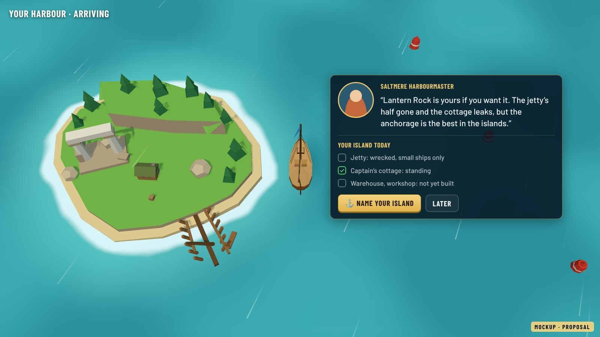 | 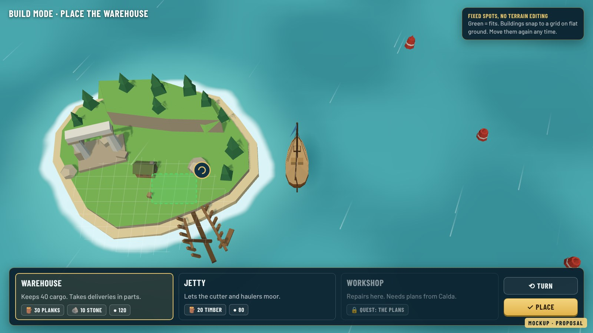 |
| **Arriving.** Saltmere's harbourmaster hands you the island early. | **Build mode.** Ready-made buildings snap to a grid on flat ground; no terrain editing; move them any time. |
| 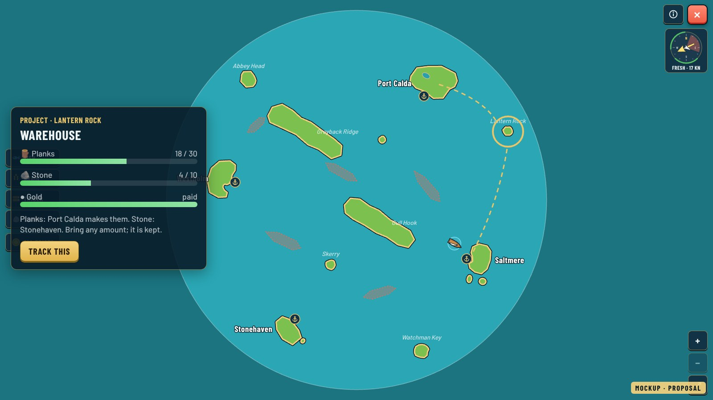 | 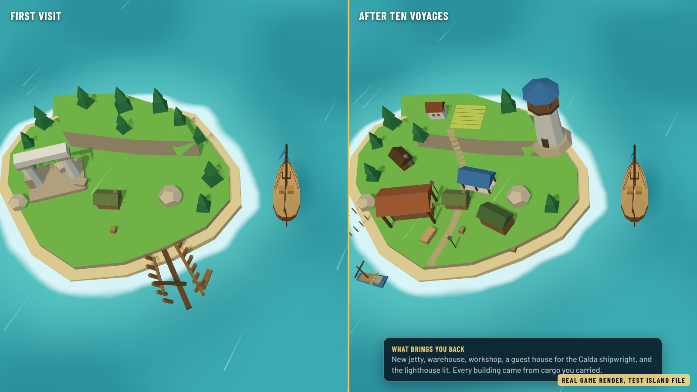 |
| **Projects on the chart.** Each building needs goods from other ports, delivered in parts. | **Coming home.** Real game render of a test island file in three stages. |

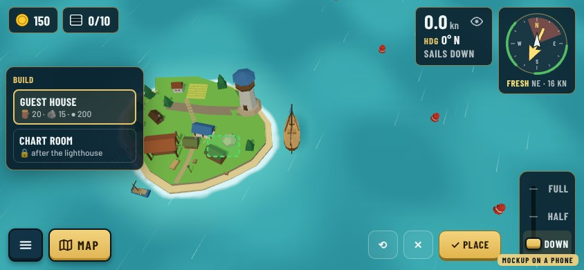

**On a phone.** Today's island builder (`editor.html`) is a desktop authoring tool and cannot ship as the player's build mode. The in-game version is a new, much smaller touch UI. What carries over: the island file format, the 42 props, drawing per level and the placement checks.

- **One session:** 15–30 min, a load or two toward a building. **Whole thing:** first four buildings 3–5 h, full island 8–12 h.
- **For:** personal, visible reward for every cargo; a home to return to; haulers carry materials, swift ships fetch plans; builds on the island files.
- **Against:** a whole new touch build mode; a self-sufficient island removes reasons to visit other ports; players who only love sailing may not care; many buildings strain the old tablet.
- **Main risk:** sailing turns into fetching materials.
- **Effort:** about 8–11 PRs. Writing medium, level design low (one island). Hardest part: the touch build mode.
- **New:** build mode (grid, turn, move, undo), projects taking deliveries in parts, island ownership in saves and transfer, building effects (storage, repairs), a few new models, English and French text.
- **Born as data:** `src/data/buildings.json` (prop, footprint, cost, effect, unlock); the home island file says where you may build; `src/data/tuning/home.json` (storage, repair discount); `src/data/quests/*.json` for the starter quests.

## B. Connect the communities

*"My voyages make these islands prosper, and people remember my help."*

| | |
|---|---|
| 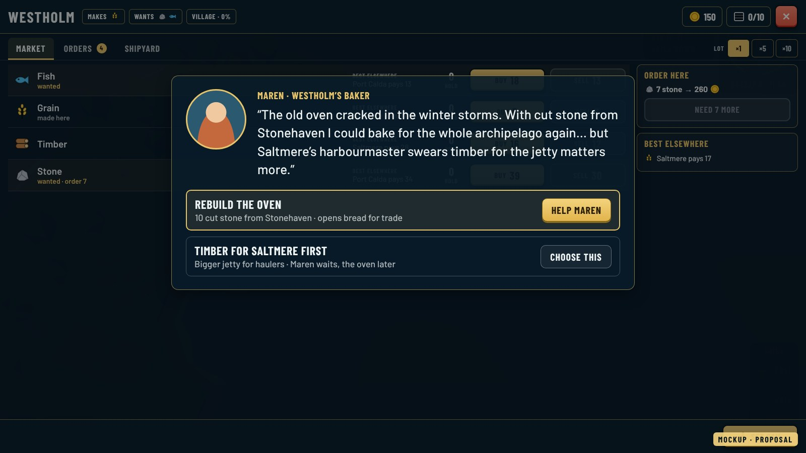 | 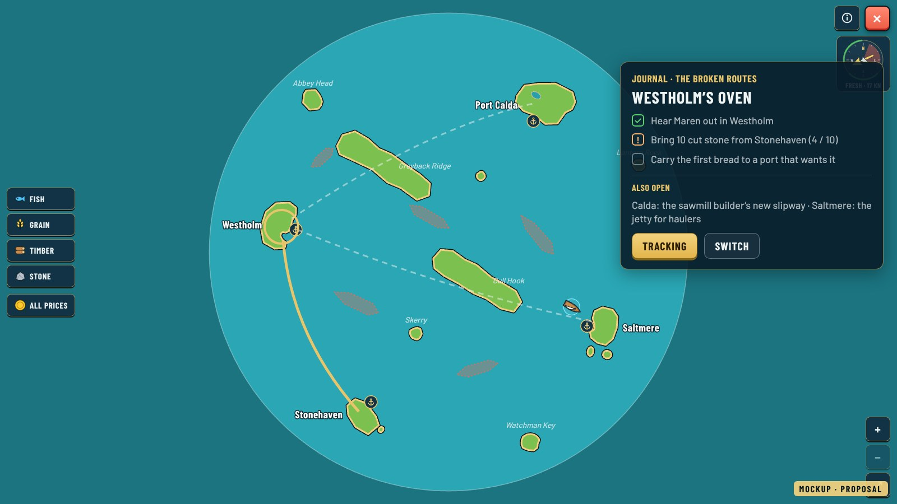 |
| **A person in port.** One character per port, tied to what it makes; a real choice of whom to help first. | **Journal on the chart.** Steps of the current arc; one objective tracked only when chosen. |
| 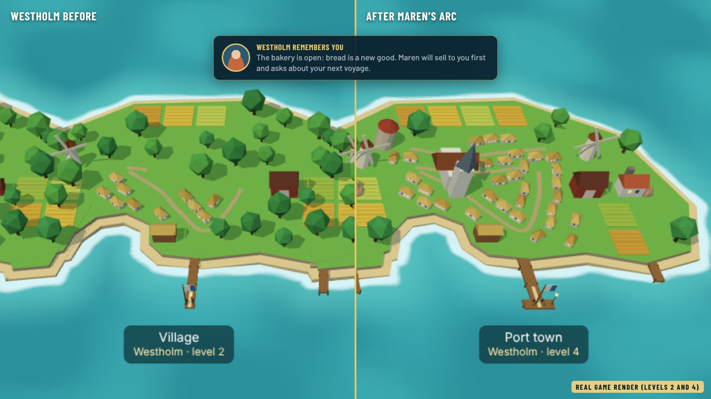 | 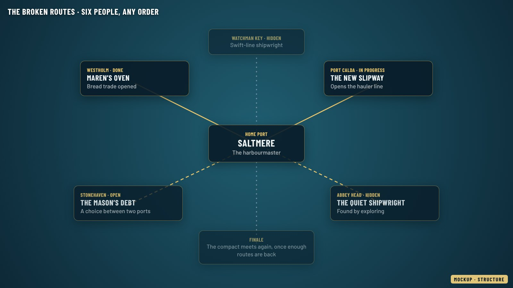 |
| **The consequence.** Real renders of Westholm's levels: the bakery opens, bread becomes a good. | **Six people, any order.** Hidden ports' arcs open by exploring; a finale once enough routes are back. |

Maren, the oven and "The Broken Routes" are example content from the comparison, not approved story.

- **One session:** 15–30 min, one quest step. **Whole thing:** one arc 45–90 min; six arcs and a finale 6–9 h.
- **For:** reuses almost everything built; every ship line gets a reason; short arcs suit short sessions; least change to how the game feels.
- **Against:** lots of writing in two languages; many quest orders to test; "help everyone" lacks one big end goal; portraits are new art.
- **Main risk:** quests feel like delivery orders with dialogue.
- **Effort:** 5–8 PRs, then about one per arc (mostly data and text). Writing high, level design low (today's map). Hardest part: choices that matter.
- **New:** a quest engine for many saved quests at once, choices and branches, rewards that unlock things, a dialogue card with a portrait, the journal, new events (delivered, discovered, town grew).
- **Born as data:** `src/data/quests/<arc>-<step>.json` (start, steps, choices, reward); `src/data/characters.json` (port, portrait, name); dialogue in `en.json` / `fr.json`; `src/data/tuning/quests.json` (rewards per difficulty).

## C. The great expedition

*"I know where I want to sail. I choose how to get ready."*

| | |
|---|---|
| 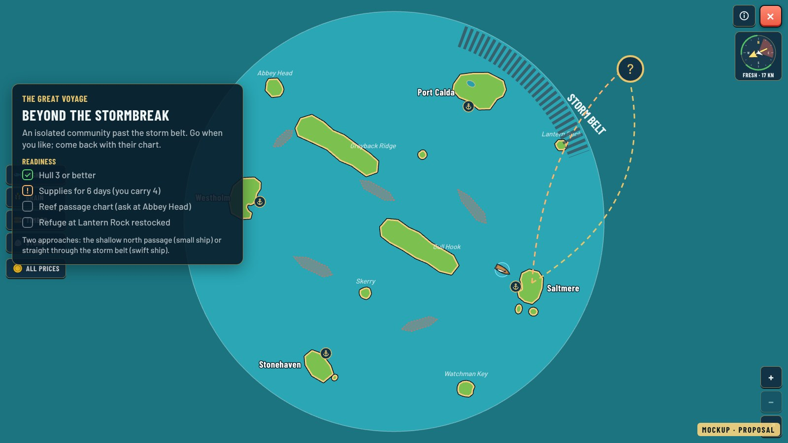 | 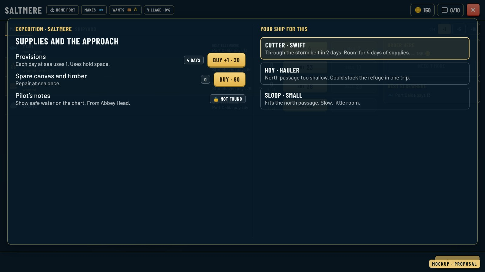 |
| **The goal.** Seen early, with a readiness list and two approaches. | **Preparing.** Provisions, spare canvas, pilot's notes; each ship line suits a different approach. |
| 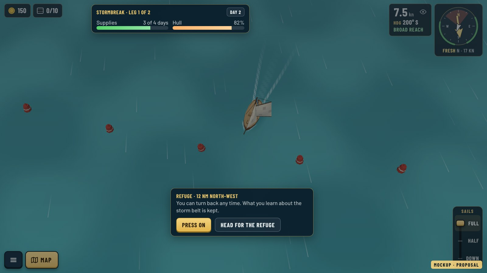 | 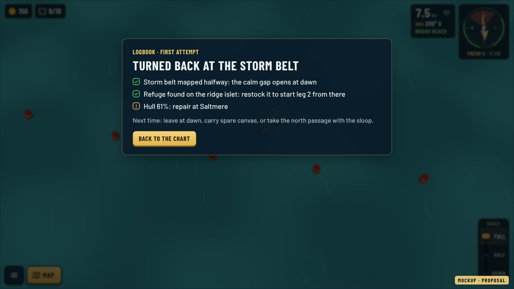 |
| **At sea.** Supplies and hull at a glance; you can always turn back to a refuge. | **Turning back is progress.** What you mapped and found is kept. |

- **One session:** 15–30 min preparing, or one 20–40 min leg. **Whole thing:** preparing 3–6 h, the voyage 1–2 h, 5–8 h in all.
- **For:** a clear goal from the first hour; uses sailing skill most; different ways to prepare; "we came back stronger" stories.
- **Against:** needs a new region and hand-made routes; supplies can add chores; failing must never feel like punishment; one finale leaves less reason to go on.
- **Main risk:** it becomes "buy the best boat and go".
- **Effort:** about 9–13 PRs. Writing medium, level design high (a new region). Hardest part: balance across ships.
- **New:** a region past the storm belt (fits the 5x map work), supplies, refuges, turning back, a logbook that keeps knowledge, the expedition HUD and readiness check, the destination and its story.
- **Born as data:** `src/data/expeditions/stormbreak.json` (legs, approaches, refuges, needs); `src/data/tuning/expedition.json` (supplies per day, storm belt per difficulty); the region in the map file; `src/data/quests/*.json` for the lead-up.

## Side by side

| | A · Harbour island | B · Communities | C · Expedition |
|---|---|---|---|
| What pulls you back | Your place, growing | People and what changed | One big goal |
| One session | 15–30 min, a building's load | 15–30 min, a quest step | 15–30 min, prep or a leg |
| Whole thing | 8–12 h | 6–9 h | 5–8 h |
| Biggest new work | Touch build mode | Quest engine and writing | New region, supplies |
| Rough size | 8–11 PRs | 5–8 PRs, then 1 per arc | 9–13 PRs |
| Writing / level design | Medium / low | High / low | Medium / high |
| Phone fit | Hardest: placing buildings | Easy: cards and journal | Easy: meters and cards |
| Main risk | Material grinding | Orders with dialogue | One best boat |

## Suggested next step (advice, Guillaume's call)

1. **Quest engine first.** Grow the tutorial's quest format into real quests: A needs it for plans and starter quests, B is mostly that, C for the lead-up. It is never wasted.
2. **Two small prototypes, behind a flag.** A: one island, four buildings, three quests. B: Saltmere and Westholm, five quests, one choice.
3. **Play, then pick.** Thirty minutes each with the comparison's questions ("did I want another voyage?"), then record the choice as ADR 0114.

C waits for the 5x map, where its new region fits. Picking one direction now and skipping the prototypes is also an option.

## How the images were made

- Game screenshots: production build, headless Chromium, `?debug` to place the ship; `models.html?view=towns&kind=grain&still` for Westholm's levels.
- The harbour island (A1, A2, A4, A5): a **test** island file for Lantern Rock (radius 20 instead of 10, 42-prop catalogue: cabin, ruins, warehouse, cutting shed, lighthouse, market hall, field, slipway…) built in a scratch copy, in three stages; generator in [src/test-island.py](src/test-island.py). Nothing in the game changed.
- UI overlays: HTML in the game's colours and Barlow fonts ([src/frames.html](src/frames.html)), rendered to JPEG. The frames tagged "Mockup" are proposals; "Real game render" means the 3D picture is the real game.
